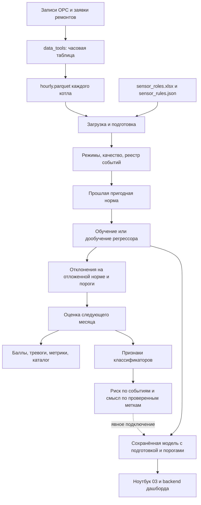

# Как работает код мониторинга котлов: данные, модели, тревоги и классификаторы

Дата разбора: **26 октября 2026 года**.

Это описание **реализации до доработки качества**, сохранённое как исходный аудит.

**После этого разбора код переработан.** Новое поведение, исправления, примеры и все дополнительные настройки описаны в [КАЧЕСТВО_И_ПЕРЕНОС.md](КАЧЕСТВО_И_ПЕРЕНОС.md). Ниже приведён прежний код и прежние результаты: например, старое разбиение и запреты классификатора уже не являются текущими правилами. В нём отдельно отмечены удачные решения, ошибки и предлагаемые изменения. Обнаруженные здесь проблемы не считаются исправленными только потому, что для них описано решение.

Основной предмет разбора — `monitoring_v3`, вызываемый ноутбуком `02_Обучение.ipynb`. Старый конвейер рассмотрен для сравнения. Подготовка OPC и дашборд включены, чтобы проследить путь от исходного измерения до того, что видит пользователь.

**Основание:** чтение исходного кода и сохранённых выводов присланного выполненного ноутбука. Исходная конфиденциальная телеметрия недоступна; обучение на ней в рамках этого обзора не запускалось. Все небольшие таблицы с вымышленными датчиками и показаниями — **условные учебные примеры**. Числа из реального выполненного прогона вынесены в отдельный раздел и подписаны.

## Содержание

1. [Что система пытается решить](#purpose)
2. [Какие части проекта участвуют](#entrypoints)
3. [Исходные OPC-измерения и заявки](#raw)
4. [Переход к часовой таблице](#hourly)
5. [Настройки и таблица ролей](#configuration)
6. [Загрузка и сопоставление датчиков](#loading)
7. [Определение работы, пуска и останова](#regimes)
8. [Очистка и редкие изменения датчиков](#quality)
9. [Реестр событий и выбор нормы](#events)
10. [Входы и цели: conditions, related, forecast](#features)
11. [Отдельные котлы, объединение и перенос](#scenarios)
12. [Разделение истории по времени](#partitions)
13. [Первоначальное обучение CatBoost](#initial)
14. [Память, дообучение и кандидат](#update)
15. [Другие модели и применения CatBoost](#models)
16. [Как прогноз становится отклонением](#residuals)
17. [Схемы объединения отклонений](#scores)
18. [Порог, подтверждение и уведомления](#alarms)
19. [Проверка на авариях и метрики](#evaluation)
20. [Каталог эпизодов и признаки классификаторов](#interpretation-features)
21. [Классификатор риска](#risk)
22. [Классификатор смысла отклонений](#cause)
23. [Какой классификатор нужен для практической задачи](#proposed-classifier)
24. [Полный проход одного месяца](#month)
25. [Сохранение, продолжение и перенос модели](#artifacts)
26. [Ноутбук 03 и дашборд](#deployment)
27. [Дополнительные исследования](#research)
28. [Сравнение со старой версией](#legacy)
29. [Что показал выполненный прогон](#observed)
30. [Проблемы и порядок исправлений](#recommendations)
31. [Справочник параметров](#parameters)
32. [Карта функций и словарь](#references)

<a id="purpose"></a>
## 1. Что система пытается решить

В проекте соединены три разные задачи. Их нельзя оценивать одним числом и нельзя считать взаимозаменяемыми.

| Задача | Вопрос | Что выдаёт |
|---|---|---|
| Модель ожидаемых показаний — регрессор | Какое показание датчика обычно соответствует таким условиям работы? | Ожидание и оценку разброса |
| Детектор отклонений | Насколько фактические показания не похожи на ожидаемые и достаточно ли устойчиво это расхождение? | Баллы, превышение порога, тревожные эпизоды |
| Классификатор | Что может означать наблюдаемая картина? Связана ли она с будущим аварийным остановом? | Класс смысла или оценку риска |

Условный пример:

```text
Нагрузка: 210 т/ч; механизм А включён; температура питательной воды: 230 °C.
Регрессор ожидает температуру металла 510 °C.
Факт: 540 °C.
Отклонение: +30 °C, сохраняется несколько часов.
Детектор: подтверждённая тревога.
Классификатор смысла: неизвестно / смена режима / проблема измерения / ...
Классификатор риска: насколько такая картина связана с аварийным остановом впереди.
```

**Почему выбран такой подход.** Для построения ожидания можно использовать много часов предполагаемой нормальной работы. Подтверждённых аварий значительно меньше. Поэтому сначала учится описание нормального поведения, затем используются отклонения от него.

**Что в нём удачно.** Можно показать, какие датчики ушли от ожидаемого поведения, даже если похожей аварии раньше не было.

**Ограничение.** Нестандартное показание не доказывает неисправность. Это может быть новый допустимый режим, ошибка данных, изменение схемы оборудования или реальная проблема. Регрессор не знает физическую причину, если она не представлена входами и разметкой.

**Что было бы лучше.** В результатах явно разделять качество данных, технологическое отклонение и риск аварийного останова. Сейчас слово «тревога» местами слишком близко по смыслу к «аварии», хотя код устанавливает только устойчивое отклонение.

<a id="entrypoints"></a>
## 2. Какие части проекта участвуют



Главный ноутбук управляет процессом, но сами алгоритмы находятся в Python-модулях. Перенос действий в ячейки не означает, что весь код моделей вставлен внутрь ноутбука.

| Часть | Назначение |
|---|---|
| `01_EDA.ipynb` | Отдельное исследование данных; основной запуск 02 не обязан выполнять его первым |
| `02_Обучение.ipynb` | Настройки, аудит, обучение, результаты, метки, классификаторы, исследования |
| `notebook_reports.py` | Связывает действия с ячейками и выводит таблицы/графики |
| `monitoring_v3/data.py`, `preparation.py` | Загрузка, режимы, качество, признаки, пригодная история |
| `monitoring_v3/pipeline.py` | Эксперименты, месячные срезы, модели, расчёт и сохранение |
| `monitoring_v3/models.py` | Реализации ожидаемого поведения и обновлений |
| `monitoring_v3/alarm_scores.py` | Нормировка, схемы тревог, пороги и метрики |
| `monitoring_v3/interpretation.py`, `interpretation_training.py` | Признаки, метки и обучение классификаторов |
| `monitoring_v3/runtime.py` | Экспорт и применение сохранённой модели |
| `03_Проверка_сохранённой_модели.ipynb` | Применение готового экспорта без дообучения |
| `dashboard/backend/` | Загрузка модели, расчёт выбранной даты и API |

**Важно:** запуск 02 не выгружает автоматически OPC из корпоративной БД. На входе он ожидает уже подготовленный локальный файл. Наличие отдельных скриптов в `data_tools` не означает, что они вызываются при `Run All` в 02.

<a id="raw"></a>
## 3. Самое начало: записи OPC и заявки ремонтов

### 3.1. Как выглядит исходное измерение

OPC-история длинная: один датчик записывается многими строками, датчики имеют разные моменты обновления.

| TimeValue | Kod_ItemOPC | Name | CurrValue | CurrStatus |
|---|---:|---|---:|---:|
| 2025-04-01 10:00 | 101 | КА-5 Расход пара | 200 | 192 |
| 2025-04-01 10:15 | 101 | КА-5 Расход пара | 220 | 192 |
| 2025-04-01 10:18 | 205 | КА-5 Температура металла | 510 | 192 |
| 2025-04-01 10:25 | 301 | КА-5 Механизм А | 1 | 192 |

Код датчика отличает физические сигналы, название нужно для сопоставления. `CurrStatus` — качество OPC-записи. Это не диагноз исправности оборудования.

Подготовители работают либо с файловой выгрузкой (`opc_to_wide.py`), либо с загрузкой из БД (`opc_to_wide_db.py`). Во втором случае промежуточно сохраняются записи отдельных датчиков. Они не являются входом CatBoost непосредственно.

### 3.2. Откуда берётся «Аварийный ремонт»

Заявки ремонтов — отдельный источник. Из них формируются интервалы состояний котла:

```text
начало                 конец                  состояние
2025-04-10 15:00        2025-04-13 09:00        Аварийный ремонт
2025-04-20 00:00        2025-04-22 12:00        Резерв
```

В подготовителе типы ХР, ВПр, ЗРР, ИСП относятся к резерву. Для остальных типов используется категория: плановая — плановый ремонт, другая — аварийный ремонт. Пересечения разрешаются по приоритету аварийный ремонт → плановый → резерв → работа. Отменённые/отклонённые заявки исключаются.

**Анализ.** Это полезная автоматическая разметка, но она описывает документы, а не непосредственно физический отказ. Ошибка или неполнота категории может превратить обычный ремонт в положительную метку риска. «Аварийный ремонт в таблице» и «подтверждённое предаварийное развитие» — разные уровни доказательности.

Есть параметр сдвига времени заявок `REPAIRS_SHIFT_H`, в исходных скриптах он равен 5. Это предположение о согласовании двух источников. Нельзя переносить это число на другой источник без проверки часовых поясов: ошибка сдвига искажает и окна предупреждения, и связь нагрузки с ремонтом.

**Улучшение.** Сохранять отдельно физический останов, документ ремонта, причину, уверенность и время фактического появления информации. Не подменять одно поле другим.

<a id="hourly"></a>
## 4. Как из записей получается hourly.parquet

### 4.1. Среднее с учётом времени действия

Для числового канала подготовитель считает значение действующим до следующей записи. Часовое значение — среднее с весами по длительности.

Пример для часа 10:00–11:00:

| Участок | Значение | Длительность |
|---|---:|---:|
| 10:00–10:15 | 200 | 15 минут |
| 10:15–11:00 | 220 | 45 минут |

```text
Среднее = (200 × 15 + 220 × 45) / 60 = 215.
Простое среднее записей было бы 210 — это другая величина.
```

Текстовое состояние выбирается по тому, сколько времени оно действовало в часе. При известных значениях менее половины часа (`MIN_COVERAGE=0.5`) результат считается пропуском. `hourly.parquet` подписывает строку **концом часа**: `11:00` означает сведения за 10:00–11:00.

### 4.2. Широкая таблица

| TimeValue | КА-5 Расход пара | КА-5 Температура металла | КА-5 Механизм А | Состояние | _Тип |
|---|---:|---:|---|---|---|
| 2025-04-01 11:00 | 215 | 510 | Включён | Работа | |
| 2025-04-01 12:00 | 218 | 512 | Включён | Работа | |
| 2025-04-01 13:00 | NaN | 511 | Включён | Нет данных | |

`NaN` — неизвестное числовое значение, а не ноль. Ноль может быть реальным измерением. Путать их особенно опасно у нагрузки.

### 4.3. Что теряется ещё до ML

- Кратковременный выброс может исчезнуть в среднем за час.
- Последовательность «механизм переключился → давление изменилось → температура выросла» внутри часа превращается в одну строку.
- Давность реальной OPC-записи не хранится отдельным признаком основной часовой таблицы.
- Если источник пишет только изменения, длинный постоянный участок может быть корректным. Если источник перестал передавать данные, внешне похожий участок может означать обрыв связи.

**Удачно:** временное взвешивание лучше простого среднего нерегулярных записей.

**Риск:** действующее до следующей записи значение не равно свежему измерению. В частности, отбрасывание плохих OPC-записей до расчёта требует аккуратной трактовки промежутков между хорошими записями: предыдущее хорошее значение может продолжить действовать через период плохого качества. Подготовка ML не сможет восстановить утраченный статус.

**Лучше:** хранить вместе со средним минимум/максимум, длительность известности, время последнего настоящего обновления, долю плохого OPC-качества и факт переключения. Эти величины особенно полезны для классификатора. Это предложение; текущий основной вход их полностью не использует.

### 4.4. Повторное приведение к сетке в обучении

Загрузчик `load_sources()` ещё раз делает `resample(step)`: числам назначает среднее, категориям — последнее значение. На уже уникальной почасовой таблице с `step='1h'` значения обычно сохраняются. При дублях они усредняются.

Это **другая операция**, чем взвешивание исходного OPC. Если подать нерегулярные записи напрямую, среднее строк не воспроизведёт часовой подготовитель.

Для числовых кодов состояний усреднение также может создать несуществующее состояние, например 0.5 между кодами 0 и 1. Важна согласованная типизация ещё до повторной агрегации.

Настройка `step='30min'` технически разрешена, но из одного часового среднего не восстанавливаются два настоящих получасовых измерения. Появятся промежуточные пустые строки. Для более частой диагностики нужен соответствующий источник данных.

<a id="configuration"></a>
## 5. Настройки, роли и правила: три разных договора о данных

### 5.1. Откуда берётся CFG

В ноутбуке последовательность такая:

```text
DEFAULTS из config.py
    → incremental_settings.json (или файл из BOILER_CONFIG_JSON)
    → переопределения SETTINGS в ноутбуке
    → проверка конфигурации
    → CFG.
```

Настройки JSON могут отличаться от значений по умолчанию. Например, текущий JSON включает `conditions` и `forecast`, несколько методов и все три сценария; выполненный присланный прогон был существенно уже: только CatBoost/conditions/local.

Ячейка аудита заново читает настройки, чтобы изменение `run_thresholds` действительно попало в подготовку. Но обучение запускается с уже существующей переменной `CFG`. После изменения `SETTINGS` нужно выполнить ячейку настроек/аудита; простое редактирование текста не обновляет объекты Python.

### 5.2. Таблица sensor_roles.xlsx

Для каждого котла выбирается его лист. Основные поля:

| col — имя в источнике | роль | общий параметр | единица |
|---|---|---|---|
| КА-5 Расход пара | нагрузка | расход пара | т/ч |
| КА-5 Температура питательной воды | условие | температура питательной воды | °C |
| КА-5 Механизм А | состояние | механизм а | |
| КА-5 Температура металла | проверять | температура металла | °C |
| Служебный тестовый сигнал | исключить | тестовый сигнал | |

Роли переводятся во внутренние обозначения:

| Роль | Внутреннее имя | Как используется |
|---|---|---|
| нагрузка | `load` | Определяет режим и входит в признаки |
| условие | `condition` | Объясняет ожидаемое поведение |
| состояние | `state` | Категория механизма, также входит в признаки |
| проверять | `target` | Значение, которое модель должна предсказать |
| исключить | `exclude` | Не входит в рабочее сопоставление |

**Важное последствие:** нагрузка и условия в обычной схеме сами не получают регрессорную оценку аномальности как `target`. Если датчик нагрузки врёт, это может испортить и определение работы, и прогнозы остальных каналов.

### 5.3. Правила sensor_rules.json

Роль отвечает «для чего канал», правило качества — «как обращаться с его значениями».

```json
{
  "defaults": {"kind": "unreviewed", "mask_frozen": false, "mask_spikes": false},
  "sensors": {
    "температура металла": {
      "kind": "continuous",
      "min": -50,
      "max": 900,
      "frozen_hours": 24,
      "mask_frozen": false,
      "group": "пароперегреватель"
    },
    "редкий технологический показатель": {"kind": "rare", "mask_frozen": false}
  }
}
```

Это условный пример назначения диапазона, а не рекомендация пределов конкретному прибору.

В текущем базовом файле индивидуальных правил нет. Каналы по умолчанию `unreviewed`; скачки и постоянство не должны автоматически удалять их значения. `SENSOR_RULES` из ноутбука накладывается поверх базового файла и сохраняется в `output/notebook_settings/sensor_rules.json`, исходный файл не перезаписывается.

**Оценка:** разделение ролей и политики качества правильно. Недостаток — пока правила не заполнены, система мало знает о технологическом смысле сигнала. Без этого одинаковая математическая обработка температуры, редкого переключателя и стартового небаланса может давать непригодные оценки.

<a id="loading"></a>
## 6. Загрузка, имена и внутренний объект котла

`load_sources()` читает источник каждого котла из `data_paths[unit]` либо `data_root/<котёл>/hourly.parquet`.

Порядок:

1. Чтение ролей и правил.
2. Проверка наличия файла и столбца `TimeValue`.
3. Преобразование дат; ошибочные даты удаляются и учитываются в аудите.
4. Преобразование чисел, включая десятичную запятую.
5. Сортировка времени и приведение к сетке.
6. Сопоставление физических названий с общими именами.
7. Подготовка режимов, качества, признаков и событий.
8. Сохранение аудита, если передана папка вывода.

Имена нормализуются: регистр, пробелы, `ё/е`, некоторые сокращения, префиксы котла. Например:

```text
"КА-5 Т металла" → "температура металла"
"КА-6 Температура металла" → "температура металла"
```

Это позволяет объединять однотипные каналы разных котлов. Отдельно обрабатывается небаланс пар/вода, чтобы различие формулы в подписи не мешало поиску.

Неоднозначное совпадение и повтор назначения вызывают ошибку. Но отсутствующий канал из Excel может попасть в аудит как `missing` и не войти в словарь рабочих ролей. Поэтому «загрузчик не упал» не означает, что все ожидаемые датчики действительно участвуют. Порог покрытия потом считается уже по оставшемуся набору.

### 6.1. Что находится в CONTEXTS

```python
CONTEXTS['К-5'] = {
    'frame': ...,       # исходные значения после сетки и переименования
    'cleaned': ...,     # те же данные с разрешённой маскировкой target-каналов
    'roles': ...,       # общий канал → роль
    'targets': [...],   # проверяемые каналы
    'regime': ...,      # режим, возраст нагрузки, время после пуска
    'eligible': ...,    # допустим ли час для диагностики
    'features': ...,    # базовые входы регрессора
    'quality': ...,     # флаги качества по каждому target
    'changes': ...,     # дельты и длительность постоянства target
    'events': ...,      # ремонты/резервы с поиском останова
    'threshold': ...,   # порог работы по нагрузке
    'aliases': ...      # имя в источнике → общее имя
}
```

Три похожие таблицы имеют разный смысл: `frame` хранит наблюдения, `cleaned` — допущенные значения, `features` — объясняющие входы. Модель не получает весь `frame` автоматически.

**Оценка:** явные промежуточные объекты удобны для проверки. Не хватает строгого перечня обязательных каналов, происхождения единиц и отчёта «назначено в Excel / найдено / реально обучено / реально оценивается».

<a id="regimes"></a>
## 7. Работа котла определяется по нагрузке

### 7.1. Выбор порога

Если задано `run_thresholds={'К-5': 140.0}`, используется 140. Иначе берутся положительные значения нагрузки до `first_test` с документным состоянием `Работа`:

```text
порог работы = медиана таких значений × threshold_fraction.
```

По умолчанию коэффициент равен 0.25. При медиане 200 автоматический порог будет 50.

Это порог «работает/стоит», **не порог аномальности**. Он фиксируется при подготовке и переносится в экспорт.

### 7.2. Пропуски и пуск

Последнее известное значение нагрузки можно удерживать не дольше `load_hold_hours=3` часов. После этого режим неизвестен. Если нагрузка строго выше порога, котёл считается включённым. Первые `startup_hours=24` часа непрерывного включённого участка считаются пуском, затем работой.

Для компактности пример использует пуск 2 часа и порог 140:

| Время | Нагрузка | Удержанное значение | Режим |
|---|---:|---:|---|
| 10:00 | 0 | 0 | стоит |
| 11:00 | 150 | 150 | пуск |
| 12:00 | 160 | 160 | пуск |
| 13:00 | 170 | 170 | работа |
| 14:00 | NaN | 170 | работа, нагрузка пропущена |
| 15:00 | NaN | 170 | работа, нагрузка пропущена |
| 16:00 | NaN | 170 | работа, нагрузка пропущена |
| 17:00 | NaN | NaN | неизвестно |

Длительный неизвестный участок разрывает последовательность. После восстановления включённой нагрузки отсчёт пуска начинается заново. Даже если история начинается с работающего котла, первые доступные часы считаются пуском: более раннего включения код не видел.

`eligible` дополнительно исключает часы `_Тип` = ИСП или ЗРР. Эти часы не участвуют в обычной диагностике.

### 7.3. Насколько удачна схема

**Плюсы:** нагрузка дополняет ремонтные документы; пропуск не превращается сразу в физический останов; алгоритм не заглядывает вперёд.

**Недостатки:**

- Один канал нагрузки — единственная опора определения работы.
- Автоматические 25% медианы — эвристика, а не физически подтверждённая граница.
- Нет отдельных порогов включения и выключения. Колебания возле одного порога могут дробить режимы.
- Нет минимальной длительности подтверждения физического останова.
- Удержанная нагрузка используется при определении режима, но в числовых входах остаётся исходный пропуск. Это разные представления одной величины.
- Универсальные 24 часа пуска могут исключать полезные переходные процессы, в том числе предвестники раннего отказа после пуска.

**Лучше:** проверенный порог плюс согласование с дополнительными признаками работы; гистерезис и подтверждение остановов; отдельное описание пусков. Не нужно автоматически включать пуск в обычную норму, но нельзя делать его невидимым для всей системы.

<a id="quality"></a>
## 8. Очистка: что удаляется, что сохраняется

Очистка в `clean()` применяется к `target`, а не ко всем входным условиям. Числовые бесконечности заменяются пропусками. Возможны четыре типа канала: `unreviewed`, `continuous`, `discrete`, `rare`.

### 8.1. Какие проверки выполняются

| Проверка | Как устроена | Удаляет значение? |
|---|---|---|
| Нет числа | NaN/бесконечность/ошибка преобразования | Да |
| Выход за min/max | Только если предел задан правилом | Да |
| Скачок | Изменение относительно распределения прошлых приращений | Только при `mask_spikes=True` и `kind=continuous` |
| Постоянство | Одно точное значение достаточно долго | Флаг для continuous; маска только при `mask_frozen=True` |

Скачок оценивается по прошлому окну до 168 часов. Текущее приращение не входит в свою опорную историю. По умолчанию нужен примерно день прошлых приращений, коэффициент превышения — 8. Если исторический разброс почти нулевой, эта проверка не объявляет любой первый скачок выбросом автоматически.

### 8.2. Почему редкий канал нельзя выбрасывать за постоянство

```text
Время               Редкий показатель
1 апреля — 10 апреля       0
11 апреля 10:00            1
11 апреля 11:00            1
```

При `kind='rare'` длительность нуля сама по себе не маскирует канал. Переход в 1 сохраняется. При `kind='continuous'` и включённой маске старый постоянный участок мог бы быть скрыт, но изменившееся значение начинает новый участок и не наследует старое залипание.

Флаг постоянства означает лишь точное равенство значений, а не доказанную неисправность. Точность округления и способ записи OPC существенно влияют на него.

### 8.3. Промежуточные таблицы

```text
cleaned:
time      температура   редкий показатель
10:00          510              0
11:00          NaN              1

quality: столбцы имеют два уровня (sensor, quality)
time      (температура, missing)  (температура, masked)  ...
10:00             False                  False
11:00             False                  True

changes:
time      редкий показатель::held_hours   ::changed   ::delta
10:00                   240                  0           0
11:00                     0                  1           1
```

Условная строка 11:00 показывает маскированное, но первоначально существовавшее значение температуры. `missing=False` и `masked=True` здесь не противоречат друг другу.

**Сильная сторона:** подозрение можно сохранить как флаг, не уничтожая сигнал.

**Недостатки:** условия и нагрузка не проходят ту же индивидуальную политику; нет приборной точности; `::changed` и `::delta` рассчитываются, но не все автоматически становятся входами обычного регрессора или классификатора. Наличие признака в `changes` ещё не означает его использование.

**Лучше:** для редких сигналов сохранять отдельные события изменения, для непрерывных учитывать точность и контекст режима; флаги качества показывать независимо от технологической тревоги.

<a id="events"></a>
## 9. Реестр событий и отбор предполагаемой нормы

### 9.1. Как создаётся событие

`registry()` находит непрерывные участки `Аварийный ремонт`, `Плановый ремонт`, `Резерв` в `Состояние`. Для каждого ищет переход из работы/пуска в другое состояние нагрузки в пределах 72 часов от начала отметки. Предпочитается последний переход до отметки; если его нет — первый после.

| event_id | start | stop | end | type | label_available_at | verified |
|---|---|---|---|---|---|---|
| условный-id | 10.04 15:00 | 10.04 13:00 | 13.04 09:00 | Авария | 10.04 15:00 | False |

`start` — начало документной отметки, `stop` — найденное время останова по нагрузке, `end` — конец документного участка. Они могут различаться.

`verified=False` ставится автоматически: физическая причина не проверена. При этом текущая логика риска **не требует** `verified=True` и использует тип `Авария` как положительную разметку.

### 9.2. Подтверждённые недостатки реестра

1. **Нет полного поиска всех физических остановов.** Поиск запускается вокруг уже имеющейся документной отметки. Неразмеченный останов может отсутствовать полностью.
2. Переход в `неизвестно` тоже может попасть в кандидаты останова, потому что определяется как выход из работы/пуска. Потеря нагрузки и физическое выключение недостаточно разделены.
3. Несколько документных интервалов могут привязаться к одному физическому останову, в том числе с разными типами.
4. Доступность метки принимается равной началу её интервала. Это не обязательно фактическое время, когда запись появилась в информационной системе.
5. При длинном несовпадении документов и нагрузки окно ±72 часа может не найти правильный останов.

**Лучше:** сначала отдельный реестр всех подтверждённых нагрузкой остановов, затем привязка документов и причин; неизвестный тип сохранять неизвестным. Дубли одного физического события объединять до обучения и подсчёта метрик.

### 9.3. eligible и healthy — не одно и то же

`eligible` отвечает: «можно ли сейчас диагностировать этот рабочий час?»

`healthy(context, as_of)` отвечает: «можно ли к дате as_of использовать этот прошлый час как предполагаемую норму для обучения?»

Для `healthy` нужны одновременно:

- допустимый рабочий режим по нагрузке;
- отсутствие ИСП/ЗРР;
- документное состояние `Работа`;
- возраст данных больше `admission_delay_days=14` дней;
- час не попадает в 14 суток перед известной аварией;
- час не попадает в `post_repair_hours=48` часов после завершённого ремонта/резерва.

Учитываются только метки, считающиеся известными к `as_of`. Будущий конец незавершённого ремонта не используется.

Пример на 1 мая:

```text
28 апреля: котёл работает, данные есть → диагностировать можно,
но учить на них норму пока нельзя: не прошли 14 дней.

10 апреля: котёл работает, но 15 апреля произошла отмеченная авария →
час исключается из нормы как потенциальный предвестник.

5 апреля: работа, никаких известных исключений → кандидат в норму.
```

### 9.4. Анализ отбора нормы

**Почему так:** модель не должна выучить развитие аварии как обычное поведение; недавно поступившие данные ещё могут оказаться предаварийными.

**Удачно:** разделены текущая диагностика и допуск в обучение, предусмотрено запаздывающее знание меток.

**Проблемы:** `Работа` в заявках не гарантирует физическую исправность; неизвестные аварии загрязняют норму; после любого завершённого события используется одинаковый запрет 48 часов; исключение целых 14 дней перед каждой аварией может убирать пригодные режимы, если предвестник реально появился только за несколько часов.

**Лучше:** сохранять причину недопуска каждого часа, оценивать покрытие режимов до и после фильтров, различать неизвестность и подтверждённую норму. Не отбирать норму исключительно условием «модель уже считает этот час нормальным»: это может закрепить её старые ошибки и отрезать новые допустимые режимы.

<a id="features"></a>
## 10. Что конкретно подаётся регрессору

Функция `dataset()` формирует пару таблиц:

```text
X: строка = момент; столбцы = объясняющие признаки.
Y: строка = тот же момент; столбцы = проверяемые датчики.
```

Одна строка X сама по себе не является окном из 24 часов. История появляется только через специально рассчитанные признаки или сдвиги.

### 10.1. conditions — показание сейчас по условиям сейчас

Входы:

- все каналы `load`, `condition`, `state`;
- идентификатор котла `unit`;
- часы после пуска с ограничением сверху 720;
- признак отсутствия исходного измерения нагрузки;
- изменения числовых условий и нагрузки за час;
- длительность неизменного состояния каждого механизма;
- синус и косинус календарного месяца.

Условный пример X:

| time | нагрузка | питательная вода | механизм а | механизм а::held_hours | нагрузка::delta_1h | since_start_hours | unit |
|---|---:|---:|---|---:|---:|---:|---|
| 01.04 10:00 | 210 | 230 | Включён | 50 | 5 | 180 | К-5 |
| 01.04 11:00 | 215 | 231 | Включён | 51 | 5 | 181 | К-5 |

Соответствующая Y:

| time | температура металла | давление | уровень барабана |
|---|---:|---:|---:|
| 01.04 10:00 | 510 | 13.5 | 20 |
| 01.04 11:00 | 512 | 13.6 | 21 |

Для температуры модель учит связь `X → температура`. Другие столбцы Y **не становятся входами этой CatBoost-модели**.

В присланном прогоне у каждого котла в базовом наборе были нагрузка, три других непрерывных условия и 14 состояний механизмов; с производными это примерно 41 вход. Проверяемых целей было 226 / 199 / 194.

**Зачем сезон:** одинаковая нагрузка зимой и летом может соответствовать разным условиям. **Риск сезона:** номер месяца может подменить отсутствующий физический фактор или особенности конкретной исторической кампании. Это нужно проверять на других годах.

**Оценка conditions:** понятная модель «ожидание по режиму», с небольшой шириной входа и меньшим риском прямого копирования неисправного датчика. Но выбранных режимных величин может быть недостаточно для отдельных ветвей и узлов.

### 10.2. related — показание сейчас по условиям и другим датчикам сейчас

В общий промежуточный X добавляются текущие значения целей с префиксом `sensor::`. Но для каждой цели `RelatedModel._inputs()` оставляет только явно разрешённых соседей.

```python
related_inputs = {
    'температура металла': ['температура пара', 'расход пара'],
    'давление': ['расход пара', 'положение клапана']
}
```

Это иллюстрация структуры: фактические имена должны существовать в проверяемом наборе. Саму цель включать в её список нельзя. Для запуска требуются списки для всех целей выбранного эксперимента; автоматического технологически проверенного подбора здесь нет.

| Цель | Пример входов |
|---|---|
| Температура металла в 10:00 | Условия 10:00 + температура пара 10:00 + расход пара 10:00 |
| Давление в 10:00 | Условия 10:00 + расход пара 10:00 + положение клапана 10:00 |

**Плюс:** взаимосвязи между датчиками представлены явно, можно лучше различать режим ветви.

**Минусы:** если связанные датчики вместе изменились при неисправности, ожидание тоже может сместиться; ошибочный сосед может испортить прогноз цели; ручная карта сложна в сопровождении. Связь по корреляции не доказывает причинность.

**Улучшение:** сравнивать related и conditions на одинаковых часах и событиях, смотреть отдельно одиночные ошибки измерения и согласованные физические сдвиги. Не выбирать related только по меньшей средней ошибке прогноза: вместе с ошибкой он может уменьшить полезную чувствительность к аварии.

### 10.3. forecast — сегодняшнее показание по информации из прошлого

В текущей реализации строка результата привязана к **моменту факта t**. В неё помещаются условия из `t−h` и прошлые значения всех целей, их изменения и длительность постоянства.

При горизонте 6 часов:

| Строка результата | Из какого времени входы | Что предсказывается |
|---|---|---|
| 01.04 10:00 | Условия и датчики 01.04 04:00 | Датчики 01.04 10:00 |

```text
X(t) = условия(t−6ч), значения датчиков(t−6ч),
       их предыдущее приращение и длительность постоянства к t−6ч.
Y(t) = фактические датчики(t).
```

Это не скользящее окно всех 6 часов и не прогноз аварии через 6 часов. Это прогноз чисел датчиков с горизонтом 6 часов. На почасовом шаге `past_delta` — приращение за один предыдущий шаг.

Для допуска требуется непрерывная рабочая пригодность между началом прогноза и моментом факта. Иначе прогноз через останов/пуск не оценивается как обычный рабочий прогноз.

**Плюсы:** модель знает прежнее состояние всех датчиков, видит зависимости и инерцию.

**Минусы:** вход становится широким — при 226 целях добавляются 678 прошлых признаков; медленная неисправность может следовать за собственным прошлым и давать небольшую ошибку; данные с неполным рабочим интервалом исчезают; одинаковое слово «горизонт» легко спутать с горизонтом риска.

**Лучше:** хранить отдельно `origin_time` и `target_time`, явно разделять `forecast_horizon` и `risk_horizon`, добавлять проверенные сводки истории вместо механического расширения на все каналы.

<a id="scenarios"></a>
## 11. Как формируются эксперименты: local, pooled, transfer

| Сценарий | Кто даёт историю обучения | Кто оценивается |
|---|---|---|
| local | Один котёл | Этот же котёл |
| pooled | Все котлы группы | Каждый котёл группы |
| transfer | Один донор | Остальные котлы группы |

У pooled строки объединяются с двойным индексом:

| time | unit | нагрузка | температура металла |
|---|---|---:|---:|
| 01.04 10:00 | К-5 | 210 | 510 |
| 01.04 10:00 | К-6 | 205 | 505 |
| 01.04 11:00 | К-5 | 215 | 512 |

Разбиение по времени удерживает все котлы с одинаковым timestamp в одном разделе. Это защищает от прямого смешивания будущего с прошлым по разным котлам.

Перед pooled/transfer берётся пересечение каналов, проверяются роли и заявленные единицы. Недостающие условия убираются, цели сортируются. Однотипность названия не гарантирует одинаковую физическую точку; при пустых единицах часть проверки невозможна.

**Плюсы pooled:** больше режимов и данных, проще обучать редкие закономерности.

**Риски pooled:** индивидуальные особенности, разные ремонты, несовпадающие смещения приборов. `unit` позволяет учитывать различия, но модель может чрезмерно опираться на имя котла. Число строк суммируется по котлам: 500 строк группы не равны 500 часам покрытия каждого котла.

**Строгий transfer:** при оценке получателя его данные не используются для обучения порога и масштаба. Порог берётся по донорам. Это честно для проверки переноса, но может быть плохо откалибровано на ином котле. Отдельная адаптация на подтверждённой норме получателя была бы другим экспериментом и должна называться отдельно.

**Важное ограничение:** pooled относится к регрессору. Текущий запуск классификаторов всё равно перебирает котлы по отдельности. Групповой классификатор риска не появляется автоматически.

Число экспериментов растёт от сочетания сценариев, методов, входов и горизонтов. Варианты related/forecast запускаются только для метода CatBoost. Поэтому перед запуском всех комбинаций нужен осмысленный список сравнений, иначе вычисления многократно вырастут без столь же полезного вывода.

<a id="partitions"></a>
## 12. Как делится история перед обучением: текущее слабое место

Для месячного среза `cutoff` сначала остаются часы `healthy` и строки, где доступны хотя бы 70% целей (`minimum_coverage=0.7`). Далее создаются три раздела.

При почасовом шаге и значениях по умолчанию:

```text
mature_end = cutoff − 14 дней
warmup = slow_hours + smooth_hours = 48 + 6 = 54 часа
cal_start = mature_end − (168 + 54) часа
val_start = cal_start − 168 часов

train: time < val_start
validation: val_start ≤ time < cal_start
calibration: cal_start ≤ time < mature_end
```

Дополнительные 54 часа нужны, чтобы на участке подбора порога успели сформироваться медленный балл и его сглаживание. Но всё окно остаётся коротким.

Пример для **1 мая 2025 года**:

| Раздел | Граница |
|---|---|
| Обучение | До 31 марта 18:00 |
| Проверка обновления | 31 марта 18:00 — 7 апреля 18:00 |
| Калибровка | 7 апреля 18:00 — 17 апреля 00:00 |
| Пока не допускается как норма | 17 апреля — 1 мая |

Нужно минимум 500 строк train и по 48 строк validation/calibration. Это проверяется **до ветвления на первое обучение и обновление**.

### 12.1. Почему было «данных недостаточно» при годовой истории

```text
Старая пригодная история: 5000 часов.
Последняя неделя проверки: 0 часов — котёл стоял.
Результат: первоначальное обучение не запускается.
```

Нехватка здесь означает недостаток в искусственно заданном разделе, а не отсутствие общей истории.

**Подтверждённая ошибка:** требование validation сохраняется при `validate_candidate=False`. Отключённая функция продолжает блокировать обучение и отнимать свежие данные.

**Другой дефект:** 48 строк достаточно, чтобы пройти этот допуск, но порогу нужно минимум 168 валидных баллов. Можно принять версию без пригодного порога.

### 12.2. Как должно быть лучше

- Отдельный отбор для первого обучения: достаточно прошлой нормы с покрытием рабочих режимов, а не случайно удачная последняя календарная неделя.
- Отдельная логика обновления: новые допущенные часы действительно есть или отсутствуют.
- Отключённая проверка не создаёт обязательного раздела.
- Калибровка использует достаточный независимый от обучения набор, с контролем возраста, режимов и промежутков остановов.
- Модель, масштаб и пороги получают отдельные даты готовности. Если новый полный детектор не готов, сохраняется предыдущая работоспособная версия с точной причиной.

Недостаточно просто брать последние 168 непустых строк и склеивать их: они могут оказаться из разных месяцев и режимов. Для обучения это иногда допустимо, для проверки длительности тревог разрывы времени нужно сохранить.

<a id="initial"></a>
## 13. Первоначальное обучение CatBoost по шагам

### 13.1. Что вообще делает CatBoost

CatBoost строит последовательность деревьев решений. Дерево задаёт вопросы входам: например, «нагрузка больше 200?» и «механизм А включён?», затем выдаёт поправку к прогнозу. Следующие деревья уменьшают оставшиеся ошибки предыдущих.

Условная иллюстрация, не внутренний журнал реальной модели:

```text
Начальное ожидание температуры: 500.
Поправка дерева 1 для этого режима: +8.
Поправка дерева 2: +3.
Поправка дерева 3: −1.
Итог: 510.
```

Для обучения нужны входы X и известные правильные значения Y. Здесь правильный ответ — **показание датчика**, а не «авария/норма». Аварийные метки нужны для отбора истории и последующей оценки, не как числовая цель регрессора.

Категории механизмов и имя котла передаются строками как категориальные признаки. Код не превращает их в произвольные порядковые числа вроде «Включён=2, Выключен=1».

### 13.2. Подготовка представления

`FrozenEncoder.fit()` фиксирует список входов, известные категории и статистики числовых признаков на первоначальном обучении.

Для CatBoost `native()` сохраняет числовые пропуски и строковые категории. Для численных альтернатив `numeric()` использует масштабирование, заполнение медианой, признаки пропуска и отдельные индикаторы категорий, включая неизвестную.

**Почему фиксировать:** модель следующих месяцев должна видеть те же физические признаки в тех же столбцах. Нельзя молча заменить смысл входа при продолжении обучения.

**Риск:** фиксированные масштабы и старая схема могут устареть. Изменение состава оборудования требует явной миграции, а не бесконечного добавления деревьев.

### 13.3. Одна модель на каждую цель

Для 226 целей обычный CatBoost создаёт до 226 регрессоров. Каждый получает свою Y, но один общий X при conditions.

```text
X → CatBoost температуры → q25, q50, q75 температуры
X → CatBoost давления → q25, q50, q75 давления
X → CatBoost уровня → q25, q50, q75 уровня
```

Взаимосвязи с нагрузкой и механизмами учатся через общие входы. Текущие взаимосвязи между самими target-датчиками в conditions этим не добавляются.

Настройки обычного CatBoost:

| Параметр | Текущее значение по умолчанию | Назначение |
|---|---:|---|
| `loss_function` | `MultiQuantile:alpha=0.25,0.5,0.75` | Три условных квантиля показания |
| `iterations` | 150 первоначально | Число добавляемых деревьев |
| `depth` | 4 | Сложность одного дерева |
| `learning_rate` | 0.05 | Размер последовательных поправок |
| `thread_count` | 2 | Потоки CPU |
| `random_seed` | 42 | Воспроизводимость случайных частей |
| `has_time` | True | Использовать порядок объектов без обычных случайных перестановок |
| `task_type` | CPU | Обучение на процессоре |

`has_time=True` не заменяет временное разбиение и не превращает деревья в модель последовательностей. Нужные исторические зависимости всё равно формируются признаками.

Квантили — оценки распределения показаний при данном X. Например, q25=506, q50=510, q75=514. Нельзя считать этот диапазон гарантированным или инженерно допустимым. Смысл MultiQuantile описан в [документации CatBoost](https://catboost.ai/docs/en/concepts/loss-functions-regression#MultiQuantile).

### 13.4. Если данных датчика мало или они постоянны

- Менее `min_sensor_rows=48` пригодных значений: дерево для датчика не обучается.
- Все значения одинаковы: сохраняется константное ожидание.
- Все входы одинаковы: сохраняется опорное постоянное ожидание.

Датчик с постоянным прошлым не обязан исчезнуть навсегда: если при обновлении появится вариативность, может быть обучено дерево. Но нулевой/малый масштаб такого сигнала требует особой осторожности при оценке первого изменения.

### 13.5. Сколько работы выполняется

150 деревьев относятся к **каждой** из 226 моделей, а не к котлу целиком. Дополнительно выполняются подготовка входов, копирование состояния, прогнозы калибровки, расчёт порогов, прогнозы месяца, диагностика интервалов, сохранение и отчёты.

Поэтому завершение датчика 226/226 означает окончание подэтапа обучения, не окончание месяца. Универсальное время в минутах из числа строк вывести нельзя: влияют число целей/входов, категории, размер накопленной модели, CPU и дисковая запись.

**Оценка:** отдельные модели позволяют учитывать пропуски каждой цели и смотреть качество конкретного канала. Цена — сотни последовательных обучений и возможность несогласованных между собой прогнозов. Необходимо проверять не только среднюю ошибку по всем датчикам, но и критические узлы отдельно.

<a id="update"></a>
## 14. Что происходит при дообучении

### 14.1. Новые строки

Состояние хранит `ingested` — ключи `(time, unit)` уже принятых в обучение строк. В новом месяце выбираются пригодные train-строки, которых там нет. При большом числе новых строк за один проход берётся не более `update_rows=2000`.

Если строка не попала в ограниченный пакет, она не отмечается принятой и может попасть в следующий. При постоянном большом притоке ограничение может создавать очередь. Это нужно измерять, а не считать, что каждый месяц использована вся доступная новая история.

### 14.2. Что такое replay и память

Модель хранит до `memory_rows=1500` старых примеров. Из них при обновлении выбирается до `replay_rows=500` и добавляется к новым.

```text
Старые деревья: 150.
Новые допущенные строки: 720.
Старые примеры для повторения: до 500.
Пакет продолжения: до 1220 строк.
Добавляется: до 20 деревьев на целевой датчик.
Итог: около 170 деревьев, если не сработали ограничения отдельных целей.
```

Старые примеры выбираются **не как самые похожие на текущий час**. `balanced_rows()` распределяет выборку по сочетаниям категорий и квантильным диапазонам первого числового входа, внутри них берёт разнесённые строки. Это попытка сохранить разнообразие режимов.

**Тонкость:** первый числовой вход не гарантированно является нагрузкой. В частности, после сортировки столбцов pooled им может стать другой показатель. Поэтому название «балансировка по нагрузке» было бы слишком сильным описанием фактического алгоритма.

### 14.3. Как сохраняется старая модель

Создаётся новый объект `CatBoostRegressor`, которому в `fit(..., init_model=old)` передаётся прежняя модель. Обучение продолжается от неё. Это не полный ежемесячный запуск с нуля; старые деревья не переучиваются на новом пакете.

Продолжение через `init_model` предусмотрено [официальным API CatBoost](https://catboost.ai/docs/en/concepts/python-reference_catboostregressor_fit#init_model).

**Плюс:** существенно меньше работы, старые зависимости сохраняются.

**Ограничение:** ошибки старых деревьев могут лишь компенсироваться новыми; бесконечное добавление деревьев не гарантирует успешную адаптацию. Лимит `cb_max_trees=1500` останавливает дальнейший рост. Политики управляемого пересоздания/сжатия модели после достижения лимита в этом конвейере нет.

### 14.4. Кандидат и проверка

Сначала создаётся снимок состояния, обновляется кандидат. Если `validate_candidate=True`, старая и новая модели сравниваются на недавнем отложенном участке плюс до 100 примеров из исходной эталонной памяти.

Решение принимает ошибка в физических единицах, поделённая на первоначальный масштаб каждого датчика. По времени берётся медиана, затем медиана по датчикам. Новая ошибка допускается не более чем на `validation_tolerance=0.25` выше старой.

```text
Старая сводная ошибка: 1.0.
Допуск: 25%.
Новая 1.2 → принимается.
Новая 1.4 → отклоняется.
```

Также рассчитывается ошибка относительно предсказанного разброса, но она не является главным условием принятия. Это полезно: простое расширение разброса не должно считаться улучшением прогноза.

При `validate_candidate=False` кандидат принимается без этого сравнения. Это ускоряет расчёт, но не исправляет плохие данные и не гарантирует качество обновления.

**Недостатки проверки:** медиана может скрыть ухудшение нескольких критических датчиков; 25% — произвольная допустимость; проверка не оценивает будущие аварии; старые опорные примеры — не полностью независимый новый тест. Отключённая проверка пока всё равно оставляет ошибочный предварительный допуск по validation.

**Лучше:** отдельные ограничения на критические каналы и группы, сравнение по режимам, различение «проверка невозможна» и «модель ухудшилась», журнал конкретных причин принятия.

### 14.5. Эталонная модель

После первого обучения сохраняется `reference`, которая не обновляется. Она позволяет сравнивать исходное и адаптирующееся ожидание. Например, адаптирующаяся модель могла принять новый режим как норму, а исходная продолжает показывать большой сдвиг.

Разность их средних ошибок — диагностический признак, но не доказательство, какая модель права. Если исходная модель плохо знала новый допустимый режим, её сохранённое расхождение не означает неисправность.

### 14.6. Зачем был deepcopy

Нужно изолировать кандидата: если он не принят, предыдущая модель, её память и статистики должны остаться прежними. Обычный `deepcopy` пытался копировать и нативные объекты CatBoost, что стало подозреваемым местом зависаний в прежних запусках.

Текущий `snapshot_model()` копирует изменяемое Python-состояние, но сохраняет ссылки на уже обученные CatBoost-объекты. Это допустимо, потому что продолжение создаёт **новый** регрессор, а не вызывает `fit` на сохранённом старом объекте. Будущее изменение этого правила потребует пересмотра копирования.

Из исправления и успешного последующего запуска нельзя восстановить точную внутреннюю причину зависания библиотеки на другом ПК; её не следует выдавать за доказанный диагноз C++-кода.

<a id="models"></a>
## 15. Другие модели и применения CatBoost

| Метод | Что фактически делает | Обновление | Основные ограничения |
|---|---|---|---|
| `analogs` | Линейная часть по условиям + распределение остатков похожих часов из памяти | Накопление линейных статистик и обновление памяти | Зависит от расстояния и покрытия режимов |
| `AAKR` | Ожидание по взвешенной памяти нормальных состояний, с линейной частью | Статистики линейной части и замена памяти | Стоимость расстояний, влияние соседних датчиков |
| `MSET` | Локальное восстановление по сходству нормальных состояний | Статистики и память | Много малых линейных систем, обусловленность |
| `HistGradientBoosting` | Отдельные квантильные деревья sklearn | После первого обучения заморожен | Это сравнение без настоящего продолжения |
| `CatBoost` | Отдельный квантильный регрессор на цель | Добавление деревьев | Стоимость сотен моделей, старение деревьев |
| `CatBoostMulti` | Общие деревья для вектора нескольких целей | Продолжение общей модели | Нет отдельных условных квантилей; пропуски и общий компромисс качества |
| `CatBoostCorrection` | CatBoost поправляет прогноз аналогов | Обновляет поправку и базовую память | Согласованность двух меняющихся ступеней |

### 15.1. Важная неодинаковость входов у разных методов

Хотя эксперимент может называться `conditions`, AAKR/MSET внутри `kernel_models.py` используют также автоматически выбранных связанных target-соседей. Собственный датчик исключается из его входного расстояния, подозрительные соседи могут отсекаться вторым проходом.

У обычного CatBoost/conditions таких текущих target-соседей нет. Поэтому это **не полностью равное сравнение только алгоритмов на одной информации**. Нужно отдельно фиксировать, какой информации разрешено пользоваться каждому методу.

Автоматическая карта соседей ядерных методов строится при первом обучении; простое обновление памяти не означает повторный полноценный пересмотр карты связей.

### 15.2. CatBoostMulti

Использует `MultiRMSEWithMissingValues`, цели делятся на первоначальные стандартные отклонения, затем масштаб возвращается. Прогноз нескольких выходов получается совместно. Разброс в текущем варианте фиксированный, а не отдельный q25–q75 для каждого режима.

Общие деревья позволяют делить структуру, но **не означают**, что в X автоматически попали реальные текущие показания всех целей. Модель учится совместно предсказывать их из разрешённых входов.

### 15.3. CatBoostCorrection

Первую историю делит примерно 70/30. Базовые аналоги обучаются на ранней части, ошибки на поздней используются как цели коррекции. Вход коррекции включает условия, прогнозы аналогов и расстояние до памяти.

```text
Аналоги ожидают 500.
CatBoost ожидает систематическую поправку +8.
Итоговое ожидание: 508.
```

Это разумная попытка исправить систематическое смещение аналогов. Но после обновления базы меняется сам объект, чьи ошибки училась исправлять коррекция. Нужна отдельная проверка согласованности двух ступеней; малой общей ошибкой одной ступени её не заменить.

### 15.4. Что не стоит смешивать

Квантильная регрессия, прогноз будущего датчика, классификация причины, риск останова и survival — разные применения CatBoost. Название библиотеки общее, но цели, метки, входы и проверка у них различаются.

<a id="residuals"></a>
## 16. Прогноз → отклонение датчика: две нормировки

### 16.1. Первая нормировка — относительно предсказанного разброса

Для обычного CatBoost три выхода сортируются, чтобы исправить пересечение квантилей. Далее:

```text
ожидание = средний из трёх отсортированных прогнозов
spread = max((q75 − q25) / 1.349, floor)
e = (факт − ожидание) / spread
```

«Средний» здесь означает центральный по порядку, не арифметическое среднее трёх чисел.

При первом обучении:

```text
scale = max(первоначальный IQR / 1.349,
            |первоначальная медиана| × 0.001,
            0.001)
floor = max(scale × 0.1, 0.000001)
```

Пропущенный IQR имеет резервное заполнение через стандартное отклонение. Множитель 1.349 используется для перевода межквартильной ширины в масштаб, сопоставимый со стандартным отклонением у нормального распределения. Это предположение о масштабе, а не доказательство нормальности ошибок.

Пример:

```text
Факт = 540; ожидание = 510.
q25 = 506; q75 = 514.
spread = 8 / 1.349 ≈ 5.93.
e = 30 / 5.93 ≈ +5.06.
```

Знак показывает сторону отклонения. Значение 5.06 безразмерное: его нельзя называть «5 градусов» или вероятностью.

**Проблема пола разброса:** он вычисляется из статистики истории и доли уровня сигнала, не из паспортной точности прибора. Для редкого почти постоянного показателя это может давать неоправданно огромную ошибку после первого изменения.

Сортировка квантилей предотвращает отрицательную ширину, но не делает плохие квантили качественными. Частота пересечений отдельно сохраняется в диагностике.

### 16.2. Вторая нормировка — относительно прошлых ошибок датчика

На отложенной предполагаемой норме рассчитываются e. Для каждого датчика берётся 99-й процентиль `|e|`, затем вводится общий нижний предел по типичным масштабам каналов.

```text
q_sensor = характерный высокий уровень |e| на калибровке
z = e / q_sensor
```

В примере при `q_sensor=2`:

```text
z = 5.06 / 2 = 2.53.
```

Это нужно, чтобы канал, который регрессор и в норме предсказывает хуже, не доминировал автоматически над хорошо предсказываемыми каналами.

**Риск:** слабая модель получает большой допуск и может перестать замечать полезные изменения. Поэтому нормировка не заменяет отчёт о качестве исходного прогноза. Сильный сдвиг в самой калибровке может быть закреплён как допустимый.

### 16.3. Где какие числа хранятся

| Объект/поле | Величина |
|---|---|
| `prediction_diagnostics.csv: median_absolute_error` | Физические единицы датчика, медиана `abs(факт−ожидание)` |
| `prediction_diagnostics.csv: median_interval_width` | Физические единицы, медиана `q75−q25` |
| `prequential_errors.parquet` | Подписанные e после первой нормировки |
| `interpretation_features.parquet: mean_abs` | Среднее `abs(e)`, до второй нормировки |
| Матрицы `sensor_errors` у runtime | `abs(z)` для выбранной временной схемы |
| `score` схемы тревоги | Агрегат `abs(z)` или доля каналов |
| `ratio` | Сглаженный score / общий порог |

**Это принципиально:** «средняя ошибка» классификатора и «средняя ошибка» тревоги сейчас не одно и то же. При сравнении графиков и обучении на разных версиях модели это нужно учитывать явно.

<a id="scores"></a>
## 17. Как объединяются датчики и время

Вначале для каждого часа рассчитываются подписанные z. Затем формируются временные и пространственные варианты.

### 17.1. instant и slow48

- `instant`: берётся текущий z.
- `slow48`: по каждому датчику берётся среднее **подписанного** z за последние 48 часов, затем модуль. Нужно не менее половины соответствующего числа точек. Общие провалы расчёта разрывают накопление.

Пример:

```text
Датчик А: +2, +2, +2, +2 → устойчивое однонаправленное смещение.
Датчик Б: +2, −2, +2, −2 → колебание вокруг ожидания.

Среднее модулей у обоих 2.
Модуль подписанного среднего: А=2, Б=0.
```

Поэтому slow48 пытается выделить смещение, а не любой шум. Это не отдельная нейросеть и не самостоятельное обучение.

**Ограничения:** изменения направления компенсируются; ожидание реакции дольше; при очень долгом систематическом несоответствии схема может оставаться в тревоге почти постоянно. Проверка разрывов делается по наличию хотя бы одной ошибки строки, а полнота каждого отдельного канала дополнительно определяется его окном и покрытием.

### 17.2. Пространственные схемы

Пусть в одном часу `|z|` пяти датчиков равны:

```text
0.2, 0.4, 0.6, 2.0, 4.0
```

| Схема | Балл примера | Для чего полезна | Слабость |
|---|---:|---|---|
| `max` | 4.0 | Один сильный локальный сигнал | Чувствительна к одному плохому каналу |
| `top5` | 1.44 | Несколько сильнейших каналов | Состав лидеров меняется, группа шума может доминировать |
| `mean` | 1.44 | Массовое согласованное отклонение | Одиночный важный сигнал разбавляется многими нормальными |
| `fraction` | 0.4 | Доля каналов с `abs(z)>1` | Теряет величину и зависит от локального масштаба |
| `group:...` | По выбранной группе | Локализация узла | Нужна заполненная карта технологических групп |

В этом примере top5 совпадает с mean только потому, что датчиков ровно пять. При 200 каналах среднее пяти наибольших и среднее всех будут разными.

**Простое усреднение всех отклонений уже реализовано как `mean`.** Оно усредняет безразмерные модули, а не градусы вместе с давлениями. Усреднение подписанных ошибок между разными датчиками было бы опасно: высокая температура и низкое давление могли бы арифметически погасить друг друга.

### 17.3. Покрытие и сглаживание

Нет факта или прогноза — канал не участвует ни в сумме, ни в знаменателе среднего. Но если доступно менее `minimum_coverage=0.7` целей, итоговый балл часа отсутствует.

```text
Всего 200 целей, пригодны 150 → покрытие 75%, балл возможен.
Пригодны 130 → 65%, балл не выдаётся.
```

После объединения балл ещё сглаживается средним за `smooth_hours=6`. Непригодные часы разрывают сглаживание. В начале участка допускается меньше шести наблюдений.

Имена соединяют два решения: `mean::instant`, `top5::slow48` и т. п. Даже instant имеет последующее шестичасовое сглаживание; название не означает отсутствие всей временной обработки.

### 17.4. Как было бы полезнее

Вместо выбора одного глобального среднего для всех целей разумно проверять сочетание общей картины, технологических групп и отдельных критических каналов. Но запуск восьми схем не должен превращаться в восемь независимых уведомлений об одном физическом эпизоде. Нужен общий уровень объединения и объяснения событий, которого сейчас полностью нет.

<a id="alarms"></a>
## 18. Подбор порога и превращение превышения в тревогу

### 18.1. Как выбирается общий порог

`calibrate_threshold()` получает сглаженный балл на прошлом калибровочном участке. Перебираются кандидаты от низких до высоких квантилей, а также значение чуть выше максимального балла. Для каждого воспроизводится тот же алгоритм подтверждения тревоги, который затем работает на проверке.

Выбирается первый, то есть наименьший из перебираемых, порог, при котором выполнены оба условия:

```text
новых уведомлений × 720 / валидных часов ≤ alarm_budget
доля валидных часов в подтверждённой тревоге ≤ max_background_fraction.
```

По умолчанию это не более одного уведомления на 720 рабочих часов и не более 5% времени в тревоге. 720 часов — условный 30-дневный месяц, а не фактическая длина каждого календарного месяца. При неполной работе котла это показатель на рабочее время, не число сообщений за реальный месяц календаря.

На проверке:

```text
ratio = smoothed / threshold
ratio > 1 → превышение.
```

Условный пример:

| Время | Сглаженный балл | Порог | ratio |
|---|---:|---:|---:|
| 10:00 | 0.60 | 0.80 | 0.75 |
| 11:00 | 0.96 | 0.80 | 1.20 |
| 12:00 | 1.04 | 0.80 | 1.30 |

Порог существует отдельно для каждого вида `mean::instant`, `max::slow48` и т. п. Это не один универсальный порог на все таблицы.

### 18.2. Недостаточность калибровки

Нужно не менее `calibration_rows=168` валидных точек балла. Иначе результат:

```json
{"threshold": "Infinity", "status": "insufficient_calibration"}
```

На применении бесконечный порог превращается в отсутствие ratio. Это означает **нет готовой оценки**, а не «все часы нормальные». JSON здесь показан условно: реальный Python-экспорт может записывать нестандартное для строгого JSON значение `Infinity` без кавычек.

Длительность калибровки и число пригодных точек различаются. Календарные 222 часа могут содержать только 49 рабочих часов. А slow48 может потерять дополнительные начальные часы на накопление истории.

`calibration_limit=4000` — лишь верхнее ограничение используемой сетки, оно **не расширяет** фактическое окно 222 часа при остальных стандартных настройках.

### 18.3. Почему разные бюджеты могут давать один и тот же порог

На 222 часах одно уведомление соответствует `720/222 ≈ 3.24` уведомления на 720 часов. Поэтому бюджеты 0.5, 1 и 2 требуют одинакового результата: ноль уведомлений на этом коротком участке.

Это ограничение разрешающей способности проверки. Настройки выглядят разными, но калибровка не располагает достаточным временем, чтобы различить их. Совпадение результатов всех трёх бюджетов в присланном прогоне согласуется с этим механизмом.

**Что было бы лучше:** более длительная внеобучающая проверка порога на нескольких рабочих режимах и оценка неопределённости частоты уведомлений. При единичных событиях обещание «одна тревога в месяц» должно сопровождаться диапазоном неопределённости, а не восприниматься как гарантия.

Нельзя просто поднимать порог до исчезновения всех тревог в будущем тесте: это подгонка под проверку и риск скрыть реальные неисправности. Нельзя и калибровать по ошибкам часов, на которых только что обучили модель: они обычно слишком оптимистичны.

### 18.4. Подтверждение, эпизод, уведомление

`persist_hours=3` требует три последовательных часа с ratio строго больше 1. Пропуск, разрыв сетки и уход ниже либо на порог прерывают последовательность.

| Время | ratio | Превышение | Подтверждённая тревога | Уведомление |
|---|---:|---|---|---|
| 10:00 | 1.2 | Да | Нет | Нет |
| 11:00 | 1.3 | Да | Нет | Нет |
| 12:00 | 1.1 | Да | Да | Да |
| 13:00 | 1.4 | Да | Да | Нет нового |
| 14:00 | 0.9 | Нет | Нет | Нет |

Начало превышения — 10:00, время подтверждения — 12:00, конец — 14:00. Предыдущие два часа не закрашиваются задним числом как подтверждённая тревога. Пик эпизода считается начиная с подтверждения.

`merge_hours=12` подавляет слишком близкое повторное уведомление. При этом код не заполняет спокойный промежуток тревогой и не превращает несколько отрезков в один непрерывно активный отрезок. Название merge легко понять неверно: фактически это прежде всего подавление повторных сообщений.

**Важное следствие:** один эпизод может длиться сотни часов и дать лишь одно уведомление. Низкое число новых сообщений не означает, что сигнал не находится постоянно в тревоге. Поэтому нужны обе метрики — частота сообщений и доля времени тревоги.

### 18.5. Три главных порога и ещё два отдельных решения

| Название | Что сравнивается | Пример | Чего это не означает |
|---|---|---|---|
| Порог работы `run_thresholds` | Нагрузка | 140 т/ч | Не чувствительность детектора |
| Масштаб канала `q_sensor` | Ошибка e на прошлой норме | 2.0 | Не общий порог тревоги |
| Порог схемы `threshold` | Сглаженный общий балл | 0.8 | Не физический предел датчика |
| Уверенность класса | Максимальная вероятность класса | 0.7 | Не ratio и не гарантированные 70% качества |
| Границы интерфейсных уровней | Показатель датчика/индекс | Параметры дашборда | Не результат обучения отдельного классификатора |

Изменять их нужно в зависимости от конкретной проблемы. Повышение порога нагрузки может убрать режимы из диагностики, а не сделать прогноз точнее. Повышение общего порога может уменьшить фон ценой пропуска аварий.

<a id="evaluation"></a>
## 19. Как оценивается обнаружение аварий

### 19.1. Окно полезного предупреждения

Для аварийного останова `stop` окно задаётся так:

```text
начало = stop − pre_window_days (7 суток)
конец = stop − min_lead_hours (3 часа)
```

Если останов 10 апреля в 18:00, полезное окно — с 3 апреля 18:00 до 10 апреля 15:00, правая граница не включена. Последние три часа не считаются достаточным упреждением.

Авария считается обнаруженной, если в окне есть **новое уведомление** при валидном расчёте. Если тревога началась раньше окна и продолжала действовать, но нового уведомления не было, это отдельно отмечается как `ongoing_alarm`, а не как новое обнаружение.

**Почему так:** постоянная тревога за месяц до каждой аварии не должна автоматически получать идеальную полноту обнаружения.

**Цена решения:** полезное устойчивое предупреждение, начавшееся чуть раньше семидневного окна, тоже может не засчитаться. Поэтому отдельно нужны результат по новым уведомлениям, наличие активной тревоги и задержка/длительность, а не одна цифра recall.

### 19.2. Что такое фон и нейтральный промежуток

Фоном становятся валидно рассчитанные часы с документным состоянием `Работа`, кроме последних `pre_window_days + neutral_days = 14` суток перед известной аварией.

```text
Раньше −14 суток          → возможный фон.
От −14 до −7 суток        → нейтральный промежуток.
От −7 суток до −3 часов   → положительное окно.
Последние 3 часа         → не полезное предупреждение и не фон.
```

Фон не равен подтверждённой норме. У него нет гарантированной экспертной разметки исправности и всех остановов. Авария может отсутствовать в реестре.

### 19.3. Значение полей отчёта

| Поле | Смысл | Как читать |
|---|---|---|
| `events` | Число учитываемых отмеченных аварий | Сначала проверить сами события и дубли |
| `detected` | Сколько получили новое уведомление в полезном окне | Событийный счётчик |
| `recall` | detected/events | Не точность причины тревоги |
| `ongoing_events` | Аварии с уже активной тревогой без нового уведомления | Помогает увидеть постоянный сигнал |
| `background_notifications` | Новые сообщения в фоне | Не доказанные ложные сообщения |
| `alarms_per_720h` | Сообщений на 720 валидных фоновых часов | Нормируется по рабочему времени |
| `background_fraction` | Доля фоновых часов в активной тревоге | 0.5 означает половину фона, не 50% вероятности аварии |
| `lead_hours` | Медиана упреждения первого полезного сообщения | Только по обнаруженным событиям |
| `average_precision` | Качество ранжирования положительных и фоновых часов | Это часовая AP, не событийная полнота |
| `random_precision` | Доля положительных часов среди используемых | Ориентир для интерпретации AP |
| `calculated_hours` | Часы с доступными score и конечным ratio | Не все исходные рабочие часы |
| `unscored_hours` | Остальная часть проверяемой сетки | Включает простои, пуск, отсутствие модели/порога/данных |

`average_precision` рассчитывается стандартной метрикой average precision. Она близка по назначению к площади под PR-кривой, но не должна описываться как любое произвольное трапецеидальное интегрирование PR-кривой.

### 19.4. Где текущая оценка вводит в заблуждение

- В общем recall могут учитываться аварии, перед которыми модель ещё вообще не была обучена. Это качество доступности всей системы, но его надо отделять от качества работающего детектора.
- Много часов одной аварии не превращаются в много независимых случаев проверки.
- Отсутствие расчёта не означает отсутствие аномалии.
- Упреждение только по найденным авариям может красиво выглядеть у модели, пропускающей большинство остальных.
- Сравнение разных схем на разном числе рассчитанных часов может быть нечестным.
- Фон содержит неразмеченные проблемы, поэтому нельзя без уточнения переименовать его в «норму» или все уведомления в «ложные».

### 19.5. Сравнение на общих часах

`common_comparison()` оставляет пересечение валидных часов сравниваемых методов, видов и бюджетов внутри семейства экспериментов. Уведомления заново не создаются на границах этой маски.

**Плюс:** сравниваются одинаковые моменты.

**Недостаток:** медленная или часто недоступная схема может резко сократить общее пересечение и удалить важные для других схем часы. Это не повод выбросить обычный отчёт. Нужны оба: общие часы для честного сопоставления и полная доступность каждой схемы для эксплуатации.

Есть повторная выборка аварий для диапазона recall и недельных блоков для диапазона частоты сообщений. Она полезнее трактовки часов как независимых наблюдений. Но при трёх авариях диапазон всё равно не становится надёжным доказательством переносимости. Сами независимость и корректность групп событий пока ограничены качеством реестра.

<a id="interpretation-features"></a>
## 20. Что создаётся для объяснения отклонений

### 20.1. Каталог эпизодов

Для каждого вида тревоги при основном бюджете формируется `episode_labels.csv`:

| episode_id | unit | view | start | confirmed | end | suggestions | label |
|---|---|---|---|---|---|---|---|
| условный-a1 | К-5 | mean::instant | 10:00 | 12:00 | 18:00 | possible_mode_change | пусто |

`suggestions` создаётся простыми правилами: изменение механизмов/нагрузки → возможная смена режима, проблемы качества → проверить измерения. Это **не обученные и не подтверждённые метки причин**.

Один физический эпизод может попасть в несколько схем с разными идентификаторами. 468 строк каталога не обязательно означают 468 независимых технологических событий.

Проверенные метки при повторном формировании сохраняются по `episode_id`. Идентификатор зависит от котла, вида и времени подтверждения. Если поменять пороги или подтверждение, время и ключ могут измениться — старая метка не обязательно автоматически перенесётся на новый эпизод.

### 20.2. Почасовая таблица признаков

`episode_features()` создаёт признаки для каждого рассчитанного часа, а не только для строк каталога:

| Признак | Что означает |
|---|---|
| `mean_abs` | Среднее абсолютных e по доступным целям |
| `max_abs` | Наибольший модуль e |
| `signed_mean` | Среднее подписанных e между каналами |
| `coverage` | Доля доступных ошибок |
| `fraction_above_1` | Доля каналов с `abs(e)>1`, до второй нормировки |
| `mean_abs_6h/24h/48h` | Среднее общего модуля ошибки за окно |
| `persistent_6h/24h/48h` | Модуль среднего подписанного e по времени, затем среднее по каналам |
| `growth_1h` | Изменение среднего модуля за час |
| `quality_missing/spike/frozen/masked` | Доли каналов с соответствующим флагом |
| `load`, `load_delta` | Нагрузка и её приращение за час |
| `since_start_hours` | Время после пуска |
| Состояния механизмов и `::change` | Текущие категории и факт изменения с прошлого шага |
| `unit` | Котёл |
| `reference_mean`, `adaptive_mean`, `reference_gap` | Ошибки исходной/обновляемой моделей и разность |

### 20.3. Как выглядит одна запись

```text
time = 2025-04-10 12:00
unit = К-5
mean_abs = 2.8
max_abs = 14.0
fraction_above_1 = 0.30
mean_abs_6h = 2.1
mean_abs_24h = 1.0
persistent_24h = 0.8
growth_1h = 0.4
coverage = 0.96
load = 210
load_delta = 0
since_start_hours = 180
механизм а = Включён
механизм а::change = 0
quality_missing = 0.04
reference_gap = 0.6
```

Это вектор чисел и категорий, который получает CatBoostClassifier. Он не получает картинку графика и не читает текст ремонтной причины самостоятельно.

### 20.4. Насколько удачен такой вход

**Плюсы:** признаки доступны к рассматриваемому часу, описывают длительность и рост, используют режим и качество, не включают ремонтную метку напрямую.

**Недостатки:**

- Общие средние скрывают локализацию: одинаковый mean может возникнуть от перегрева металла и от стартового небаланса.
- `signed_mean` между несвязанными датчиками допускает компенсацию противоположных отклонений.
- Используются e, а тревоги строятся по z. Масштаб зависит от предсказанного разброса и версии модели.
- Временные окна этих признаков не повторяют полностью сегментацию `score_views()`. После короткого простоя окно классификатора может помнить предшествующую работу; нужно решить, какое поведение требуется, и проверить его явно.
- Скользящие средние допускают минимум одну точку, поэтому «признак за 48 часов» иногда рассчитан по очень короткой истории. Признака фактической полноты каждого окна не хватает.
- Не представлены явно возраст модели и калибровки, конкретные критические узлы и причины отсутствия оценки.

**Лучше:** дать сводки по технологическим группам, несколько критических направленных отклонений, длительность наблюдаемого окна, прошлые остановы и режимные переходы, отдельно качество. Варьировать не только модель классификатора, но и смысл предоставленной ему информации.

<a id="risk"></a>
## 21. Классификатор риска: что обучается фактически

### 21.1. Цель — будущий отмеченный останов

Для каждого горизонта `risk_horizons=[24,168]` создаётся отдельная модель. У времени t рассматривается интервал `(t, t+H]`.

| Ситуация в будущем окне | Метка |
|---|---|
| Ближайший зарегистрированный останов — Авария, метка известна к as_of | 1 |
| Зарегистрированных остановов нет, конец истории не раньше t+H | 0 |
| Ближайший останов плановый/резервный | Строка исключается |
| Не хватает будущего продолжения или метка ещё недоступна | Строка исключается |

Пример для H=24 часа и аварии 10 апреля в 18:00:

```text
9 апреля 12:00 → авария через 30 ч → не положительный пример этого горизонта.
10 апреля 00:00 → авария через 18 ч → положительный пример.
10 апреля 12:00 → авария через 6 ч → положительный пример.
10 апреля 17:00 → авария через 1 ч → тоже положительный пример текущего риска.
```

Последняя строка показывает различие с метрикой тревог: классификатор пока не исключает последние `min_lead_hours=3`, хотя оценка полезного предупреждения их исключает. Эти определения следует согласовать или явно показывать как разные задачи.

Проверка полноты будущего сейчас опирается прежде всего на конечную дату источника, не на полноценную наблюдаемость всех будущих часов и всех физических остановов. Поэтому отсутствие события в реестре может ошибочно стать отрицательной меткой.

### 21.2. Откуда взялись 905 строк

В `interpretation_training.train()` берутся признаки до `as_of`, оставляются пригодные часы и выбирается каждая шестая строка при шаге 1 час. После исключения неопределённых меток остаётся, например, 905 записей.

Это не 905 аварий, не 905 эпизодов и не обязательно 905 часов подряд. Среди них есть обычные и аномальные состояния, положительные и отрицательные метки. Выбор каждой шестой оставшейся строки не гарантирует строгое календарное расписание каждые шесть часов при пропусках.

Много отрицательных строк не компенсируют недостаток разных аварий. Сто почти одинаковых часов одной аварии — не сто независимых примеров отказа.

### 21.3. Как режется выборка

После отбора размеченные временные точки сортируются:

```text
первые 60% → обучение
следующие 20% → настройка вероятностей
последние 20% → тест.
```

Между частями вырезается временной разрыв, чтобы признаки одного будущего события не оказались по обе стороны границы. Сейчас для обоих горизонтов используется максимум `risk_horizons`, то есть 168 часов даже для модели на 24 часа.

Положительные примеры группируются по аварии, отрицательные — по календарной неделе. Одна группа не может одновременно участвовать в разных разделах; пересекающиеся группы исключаются из последующих частей.

### 21.4. Почему обучение может не начаться

`train_head()` требует:

- минимум 30 разных временных точек до разбиения;
- минимум 10 строк в каждой части;
- не менее двух классов в обучении;
- не менее трёх независимых групп **каждого** класса в обучении;
- не менее одной группы каждого класса в калибровке и тесте.

Для положительного класса это фактически требует возможности распределить аварии как минимум 3+1+1. Это ограничение написано в проекте, оно не является требованием CatBoost.

Статус `insufficient_independent_labels` объединяет разные причины. Пользователь не видит, не хватает ли аварий в train, классов в калибровке или аварий в тесте.

**Подтверждённая ошибка организации:** отсутствие положительного класса в тесте блокирует даже создание модели. Правильно отдельно отвечать на вопросы «можно обучить», «можно настроить вероятности», «можно достоверно измерить полноту обнаружения». На тесте без аварий можно оценивать поведение в фоне, но нельзя измерить обнаружение аварий; это не одно и то же с невозможностью обучения.

### 21.5. Что происходит, если допуск пройден

1. Кодирует входы отдельным `FrozenEncoder`.
2. Обучает `CatBoostClassifier(loss_function='MultiClass')` на train.
3. При продолжении добавляет деревья через `init_model` и повторяет старые примеры.
4. На следующей части подстраивает вероятности логистической регрессией, используя логарифмы выходных вероятностей CatBoost.
5. На тесте считает logloss и, для двоичной цели риска, average precision.
6. Сохраняет модель, кодировщик, преобразователь вероятностей, классы, память и статус в `interpreter.joblib` соответствующей папки горизонта.

В этом классификаторе сейчас явно не передаётся `learning_rate` из общего CFG, хотя у регрессора передаётся. Библиотечное значение/автоматический выбор может отличаться. И это ещё одна причина не считать общий параметр универсальным для всех CatBoost в проекте.

Калибровка вероятностей нужна, потому что высокий выход модели не автоматически означает достоверную вероятность. Но небольшая калибровочная часть с единичной аварией сама может быть неустойчивой. Без достаточной проверки нельзя трактовать число 0.8 как доказанные «80% вероятности аварии».

### 21.6. Другие ограничения

- Классификатор обучается отдельно по котлу даже при pooled-регрессоре.
- Признаки существуют только после появления регрессора. Ранняя история не используется, пока для неё не рассчитаны последовательные прогнозы из прошлого.
- При конфликтующих событиях одного останова берётся первая запись по времени; это может исключить положительное окно из-за соседней метки резерва.
- Резкое недопредставление положительных классов не лечится простым добавлением ещё фоновых часов. Весовые схемы/отбор отрицательных примеров надо оценивать вместе с вероятностной калибровкой.
- При неудаче новой попытки старый файл модели может оставаться в папке. Статус текущей попытки и наличие прежнего артефакта нужно различать; автоматическое подключение не должно выдавать старую модель за только что успешно проверенную.

### 21.7. Более удачная проверка малой истории

Нужны несколько последовательных временных проверок с явным перечнем аварий в каждой, а не один механический срез 60/20/20. Все наблюдения одного события удерживаются вместе. Для группы котлов используются единые календарные границы и ключи котёл/событие; общие станционные причины при необходимости объединяются в более крупную группу.

При малом числе событий можно получить полезную исследовательскую модель и честно ограниченную оценку. Нельзя получить доказанную надёжность просто уменьшением минимального числа групп или случайным перемешиванием соседних часов.

<a id="cause"></a>
## 22. Классификатор смысла: смена режима, измерение, технологическая проблема

Это отдельный классификатор `cause`, а не другое название `risk_24h`.

Для него код читает `episode_labels.csv` и использует только непустые метки с `label_available_at ≤ as_of`. Признаки берутся в момент подтверждения эпизода. Будущие конец и пик эпизода в X не подставляются.

Пример проверенной разметки:

| episode_id | label | label_available_at | reviewer | reason |
|---|---|---|---|---|
| условный-a1 | mode_change | 12.04 09:00 | специалист | Подтверждено переключение ветви |
| условный-b2 | measurement_issue | 15.04 10:00 | специалист | Подтверждена неисправность канала |
| условный-c3 | process_deviation | 18.04 12:00 | специалист | Устойчивое технологическое отклонение |

Редактирование выполняется через `EPISODE_LABEL_EDITS` в ноутбуке, сохраняется автоматически. Строковые названия здесь иллюстративны: целевой справочник классов нужно определить и применять последовательно.

**Если нет проверенных причин:** выводится `requires_reviewed_episode_labels`. Автоматические `suggestions` не становятся обучающими метками.

Если метки есть, используется та же функция `train_head()` с временным разбиением и строгими требованиями классов по частям. Группы задаются котлом и календарной неделей. Это не полностью готовое объединение физических эпизодов: один длительный инцидент может пересечь недели, а разные эпизоды одной недели — слиться в группу.

На применении выбирается класс с максимальной преобразованной вероятностью. При значении ниже 0.7 выдаётся `unknown`. Этот порог записан в коде, а не представлен отдельным основным параметром CFG.

**Почему нельзя всё разметить автоматически.** По отметке аварийного ремонта можно автоматически построить метку связи с будущим остановом. Нельзя из той же отметки достоверно узнать, что другая тревога вызвана загрязнением поверхности, переключением режима или ошибкой термопары.

**Если истинную причину невозможно узнать:** оставлять неизвестность; использовать проверяемые описательные признаки («нагрузка резко изменилась», «изменились такие-то механизмы», «канал постоянен»); группировать похожие эпизоды для исследования. Кластеры и эвристические подсказки можно использовать для отбора примеров, но нельзя незаметно переименовать их в подтверждённый диагноз.

**Практическое улучшение:** сначала небольшой понятный справочник с возможностью нескольких совместных признаков причины. «Смена режима» и «риск аварии» могут присутствовать одновременно, поэтому один взаимоисключающий класс не всегда подходит физическому процессу.

<a id="proposed-classifier"></a>
## 23. Что лучше подавать в классификатор для поставленной задачи

Ниже — **предлагаемая организация**, а не уже реализованная функция.

### 23.1. Две постановки, которые нельзя незаметно подменять

| Постановка | Единица примера | Отрицательный пример | Назначение |
|---|---|---|---|
| Непрерывный риск | Пригодный рабочий момент | Момент без будущей аварии при полном наблюдении | Искать предвестник, даже если детектор ещё не поднял тревогу |
| Риск аномального эпизода | Подтверждение отклонения/последующая точка решения | Аномальный эпизод без последующей аварии | Объяснить и расставить приоритеты среди тревог |

Фраза «нужны только часы с аномалией» соответствует второй задаче. Она разумна для разбора тревог. Но аварии без предварительной тревоги такой классификатор уже не спасёт: они не проходят входной отбор.

Если обучить модель только на аварийных аномальных эпизодах, ей не на чем учиться отличать их от неопасных аномальных эпизодов. Нужен отрицательный класс, но он не обязан состоять из миллионов обычных спокойных часов.

### 23.2. Конкретная запись на момент решения

В 10:00 подтверждена тревога. Формируем запись только из сведений, доступных к 10:00:

```text
unit = К-5
decision_time = 2025-04-10 10:00
episode_age_hours = 2
available_history_24h = 24

load = 210
load_change_6h = 3
hours_since_previous_stop = 180
hours_since_start = 156
mechanism_changes_6h = 0

superheater_mean_deviation = 2.4
superheater_affected_fraction = 0.35
right_left_temperature_difference = 25
critical_temperature_direction = вверх
deviation_growth_6h = 0.8
deviation_duration_hours = 5
reference_adaptive_gap = 0.3

missing_fraction = 0.02
new_constant_channels = 0
model_age_days = 10
regime_seen_in_training = да
```

Это пример желаемой структуры, некоторые поля сейчас отсутствуют. Числа условные. «Режим встречался» требует отдельного проверяемого критерия; его нельзя честно получить одной подписью в интерфейсе.

После того как будущее стало известно, к этой записи добавляется целевой ответ: аварийный останов был/не был в следующие 24/168 часов; неизвестный останов или неполное наблюдение не становятся уверенным «нет».

### 23.3. Почему эти входы полезнее только среднего

- **Локализация:** различает металл пароперегревателя и несущественный служебный показатель.
- **Направление:** перегрев и недогрев имеют разные смыслы.
- **Динамика:** одноразовый скачок отличается от нарастающего сдвига.
- **Согласованность:** несколько физически связанных сигналов усиливают либо опровергают гипотезу.
- **Режим:** помогает отличать переходную работу от изменения при стабильной нагрузке.
- **Качество:** отделяет измерительную проблему от достоверного физического изменения.
- **Возраст модели:** помогает распознать, что «аномалия» может быть следствием давно не обновлённого ожидания.

### 23.4. Чего во входе быть не должно

- Будущего времени останова и «часов до аварии».
- Итогового максимума или длительности ещё не завершённого эпизода.
- Ремонтной причины, ставшей известной после решения.
- Отклонений, рассчитанных моделью, обученной на будущем относительно этого часа.
- Факта будущего переключения как объяснения сегодняшней тревоги.

Прошлый останов можно использовать. Будущий останов — целевая метка, не вход.

### 23.5. Как обучать без размножения одной аварии

Начинать можно с одной точки на подтверждение объединённого эпизода. Если нужны обновления риска каждые несколько часов, все такие точки сохраняют общий идентификатор эпизода/аварии и ограниченный суммарный вес. Иначе длинная авария даст десятки почти одинаковых положительных строк и подавит остальные случаи.

Для группы БКЗ-500 можно объединять сопоставимые признаки разных котлов, сохраняя `unit`, физический смысл групп и отдельные результаты по каждому котлу. Объединение расширяет опыт, но не устраняет различия схем и датчиков автоматически.

**Рекомендация:** сначала исправить регрессор, реестр и пороги, затем реализовать именно понятный пользователю риск аномального эпизода. Непрерывный риск оценивать отдельно, если важно находить развитие до появления тревоги. Модель смысла не заменяет модель риска, и низкий пока непроверенный риск не должен молча удалять все неизвестные отклонения.

<a id="month"></a>
## 24. Полный проход одного месяца и всего ноутбука

### 24.1. Что делает LF.run(CFG)

1. Проверяет CFG и зависимости в текущем Python-ядре.
2. Ограничивает число потоков численных библиотек; CatBoost также получает свой `thread_count`.
3. **Заново загружает и готовит источники.** Объект `CONTEXTS` из отдельной ячейки аудита непосредственно в LF.run не передаётся.
4. Создаёт список конкретных экспериментов.
5. Для каждого эксперимента согласует каналы и перебирает месяцы от `first_test` до доступного конца.
6. На каждом срезе ищет совместимое сохранённое состояние либо выполняет обучение/обновление.
7. Сохраняет готовое состояние и экспорт до расчёта отчёта месяца.
8. Рассчитывает следующий месяц с необходимой предысторией либо читает совместимый расчёт из кэша.
9. В конце эксперимента собирает последовательную историю, тревоги, метрики и каталог эпизодов.
10. Формирует итоговое сравнение на общих часах.

Таким образом, в ноутбуке подготовка выполняется дважды: сначала для просмотра пользователем, затем внутри обучения. Это позволяет LF.run работать самостоятельно, но требует следить, чтобы источник и CFG между двумя действиями не изменились. Для больших файлов повторная загрузка также стоит времени.

### 24.2. Один условный майский срез

```text
1 мая:
  → вычислить подписи данных, параметров и состояния;
  → восстановить checkpoint либо отобрать пригодную историю;
  → получить 720 ещё не принятых строк;
  → добавить старые примеры из памяти;
  → продолжить деревья всех пригодных целей;
  → проверить кандидата, если включено;
  → рассчитать калибровочные ошибки обновляемой и исходной моделей;
  → получить масштабы и пороги для всех схем;
  → сохранить checkpoint;
  → экспортировать model_history/2025-05 и текущую model;
  → оценить май;
  → сохранить ошибки, признаки и диагностику месяца.

1 июня:
  → повторить с новой доступной прошлой историей;
  → если обновление невозможно, явно использовать предыдущую модель.
```

На месяце без нового состояния журнал пишет причину, а `model_cutoff` показывает фактический срез унаследованной модели. Название папки `2025-06` означает «версия для применения в июне», а не обязательно «модель действительно дообучалась в июне».

### 24.3. Предыстория при расчёте месяца

Подготовка режимов и длительностей выполнена на всей загруженной истории. Для прогноза берётся только месяц плюс необходимый запас: в основном 48+6 часов, дополнительный горизонт forecast и один шаг. Это уменьшает объём повторных прогнозов.

Текущая месячная модель при этом пересчитывает ошибки на запасе предыстории для своих скользящих признаков. Затем в результат сохраняется только сам месяц. Подтверждение тревог в конце выполняется по объединённой временной истории, чтобы граница месяца сама по себе не обнуляла три часа устойчивости.

**Риск интерпретации:** соседние месяцы могут использовать разные версии модели, масштаба и порога. Излом балла на первом числе может быть вызван обновлением ожидания. Поэтому в графиках полезно показывать границы версий, возраст и факт изменения порога.

### 24.4. Что делает оставшаяся часть ноутбука

После LF.run:

- `show_results()` выводит общий результат, модели, месячные обновления, диагностику прогнозов и каталог.
- `show_detail()` читает сохранённую схему тревог, рисует выбранный период и показывает аварии/эпизоды. Это не переобучение и не новый подбор порога.
- `episode_catalog()` собирает эпизоды всех рассчитанных экспериментов.
- `apply_episode_labels()` сохраняет введённые проверенные причины.
- `run_interpretation()` отдельно обучает/показывает классификаторы.
- `run_research()` запускает только явно включённые исследования.

Если прервана ячейка LF.run, следующие ячейки автоматически не считаются успешно выполненными. Готовый экспорт может уже существовать, даже если полный отчёт ещё не собран.

### 24.5. Прогресс и время

Обновляемый индикатор — представление журнала. Численный расчёт выполняется независимо от него. Журнал `progress.jsonl` содержит стадии, время, число целей и сообщения; в ноутбуке они сворачиваются в один обновляемый блок.

Периодическая надпись «выполняется» означает, что стадия не завершилась. Она не доказывает, что нативная библиотека продвигается. Для диагностики нужны время конкретного действия, номер датчика/дерева, CPU и память. Обработчик после итерации CatBoost даёт более предметный прогресс, чем один счётчик месяцев.

`threads=2` может давать невысокую суммарную загрузку многоядерного CPU. Например, загрузка около 10% всей системы сама по себе не доказывает зависание. Но и не объясняет автоматически многократное необоснованное увеличение времени.

При недоступности ограничения BLAS на некоторых Windows-средах код продолжает работу с предупреждением; собственный лимит потоков CatBoost сохраняется. Много маленьких линейных систем AAKR/MSET чувствительны к избыточным потокам иначе, чем обучение деревьев.

### 24.6. Сквозной числовой пример: один час проходит все ступени

Это полностью условный пример с пятью целями. Для каждой её X сформирован из нагрузки и механизмов, то есть conditions. Модель и коэффициенты уже обучены на прошлом, текущий час только оценивается.

| Датчик | Факт | Ожидание | spread | q_sensor | e | z |
|---|---:|---:|---:|---:|---:|---:|
| Температура А | 510.4 | 510 | 1.0 | 2 | 0.4 | 0.2 |
| Давление | 13.58 | 13.5 | 0.1 | 2 | 0.8 | 0.4 |
| Уровень | 20.6 | 20 | 0.5 | 2 | 1.2 | 0.6 |
| Температура слева | 518 | 510 | 2.0 | 2 | 4.0 | 2.0 |
| Температура справа | 526 | 510 | 2.0 | 2 | 8.0 | 4.0 |

Промежуточные результаты:

```text
Доступны 5 из 5 целей → покрытие 100%.
mean::instant score = (0.2 + 0.4 + 0.6 + 2 + 4) / 5 = 1.44.
Пусть последние шесть score тоже равны 1.44 → smoothed = 1.44.
Пусть сохранённый порог этой схемы = 1.20 → ratio = 1.20.
```

При трёх последовательных таких превышениях тревога подтвердится на третьем часу. До этого интерфейс может показывать превышение, но подтверждённого уведомления ещё нет.

В классификатор при этом попадёт `mean_abs=(0.4+0.8+1.2+4+8)/5=2.88`, потому что он использует e, а не z. Кроме этого он получит историю 6/24/48 часов, нагрузку, состояния и качество. Будущего останова во входе нет.

Если спустя 18 часов произойдёт зарегистрированный аварийный останов и его метка станет известна к дате формирования обучения, этой записи можно назначить риск-метку 1 для горизонта 24 часа. Если весь следующий интервал наблюдался и остановов не было — 0. Если причина остановки неизвестна, исправленная схема разметки должна сохранить неизвестность; нынешняя может её не заметить, если останов не попал в реестр.

В дашборде ratio=1.2 превратится в индекс здоровья около 45 при стандартной шкале. Это следствие линейной формулы от ratio, а не вывод классификатора. Если никакой классификатор не обучен/не подключён, смысл останется unknown, хотя регрессорная тревога уже существует.

Этот пример показывает, почему нельзя сравнивать 1.44, 2.88, 1.2 и 45 как одну и ту же «ошибку»: это последовательно общий балл, другой агрегат для классификатора, отношение к порогу и интерфейсный индекс.

<a id="artifacts"></a>
## 25. Что сохраняется и как продолжается расчёт

### 25.1. Структура результата

Пример для одного эксперимента и котла:

```text
<output>/
  progress.jsonl
  models.csv
  comparison.csv
  comparison_common_hours.csv
  status.csv
  audit/
    source_issues.csv
    К-5/
      audit.json
      sensor_audit.csv
      events_to_review.csv
      regimes.parquet
      quality.parquet
      sensor_statistics.csv
      load_and_modes.png
  experiments/
    БКЗ-500__local__К-5__CatBoost__conditions__0/
      experiment.json
      updates.json
      checkpoints/
        2025-04-01.joblib
      partial/
        2025-04-01/
          fingerprint.json
          <подпись фактического обучения>/
            <ключ датчика>.joblib
      scored/
        2025-04-01/
          К-5.joblib
      К-5/
        model/
        model_history/
          2025-04/
        prequential_errors.parquet
        interpretation_features.parquet
        prediction_diagnostics.csv
        episode_labels.csv
        mean__instant__1.0.parquet
        mean__instant__1.0_alarms.csv
        mean__instant__1.0_events.csv
        interpretation_status.json
        interpretation/
          risk_24h/status.json
          risk_168h/status.json
          cause/status.json
```

Файлы классификаторов `interpreter.joblib` появляются в соответствующих папках только при успешном обучении либо остаются от предыдущего успешного запуска. В экспорт они попадают отдельным действием подключения.

### 25.2. Три разных уровня сохранения

| Уровень | Что сохраняется | От чего помогает |
|---|---|---|
| Частичное первоначальное обучение | Готовая модель отдельного датчика | Не начинать сотни целей заново после прерывания |
| Месячный checkpoint | Модель, эталон, память, принятые строки, масштабы, пороги, аудит | Продолжить цепочку месячных версий |
| Кэш расчёта месяца | Баллы, ошибки, признаки, диагностика | Не считать уже завершённые прогнозы повторно |

Частичный кэш первого обучения не является полной готовой моделью для дашборда. В нём ещё могут отсутствовать остальные датчики и калибровка. Частичное сохранение отдельной цели **при месячном дообучении** этим механизмом не обеспечивается: оно предназначено для initial-fit.

### 25.3. Совместимость кэша

Текущая реализация различает:

- подпись конкретной реализации — включает код;
- подпись совместимости состояния — данные, параметры, библиотечные версии, схема и явный номер контракта состояния;
- подпись конкретного первоначального обучения цели — фактические X/Y, имена и параметры.

Это позволяет пережить изменение прогресс-бара без обязательной потери уже обученных целей. Изменение физических входов, правил нормы или калибровки — другой случай: старое состояние может быть несовместимо по смыслу.

Ранее кэш слишком жёстко зависел от общего отпечатка кода и выдавал ошибку несовместимости. Сейчас несоответствие верхнего отпечатка не запрещает проверить фактическое обучение отдельных целей. Совместимые старые checkpoints могут мигрировать; несовместимые пересчитываются, предыдущие версии сохраняются перед заменой.

**Удачно:** сохранение защищает длительный расчёт, а временные файлы и замена уменьшают риск получить недописанный рабочий артефакт.

**Слабое место:** стабильная подпись требует дисциплины разработчика. Если поменять смысл подготовки и забыть изменить контракт, код может ошибочно принять прежнюю модель. Наличие хеша не доказывает качество ML и не проверяет самостоятельно всю семантику.

Кроме того, подписи содержат прошлые данные до cutoff, поэтому исправление старой истории может потребовать пересчёта последующих версий. Это нормальное следствие зависимости цепочки, а не обязательно ошибка кэша.

### 25.4. Из чего состоит экспорт model

```text
model/
  state.joblib           # полное состояние моделей и их памяти
  model.py               # загрузчик
  monitoring_v3/*.py      # копия кода применения и зависимых модулей
  kernel_models.py
  config.json            # метаданные для потребителей
  sensors.csv            # роли и масштабы каналов
  scaler.json
  environment.json
  requirements.txt       # зафиксированные версии установленного окружения
  manifest.json          # контрольные суммы файлов
```

CatBoost-модели находятся внутри `state.joblib`; отдельный `.cbm` для каждого датчика этот экспорт не создаёт. Переносить нужно **всю папку**, а не один файл.

`models.csv` перечисляет готовые экспорты с `model_dir` и `history_dir`. Одна строка на эксперимент/котёл обновляется по мере расчёта. Важно смотреть и `evaluation_month`, и `model_cutoff`: они могут различаться.

Рабочая папка `model` публикуется после подготовки полной временной копии. Предыдущая сохраняется до успешной замены. Это уменьшает риск подхватить половину обновлённого экспорта.

### 25.5. Метаданные, которым пока нельзя приписывать лишний смысл

- `trained_until` в config формируется как cutoff минус шаг, хотя фактические train-часы заканчиваются раньше из-за задержки и разделов. Это скорее граница доступной версии, чем точная дата последнего обучающего наблюдения.
- Поле `input` в export-метаданных сейчас жёстко записывается как `conditions`, даже если spec.variant другой. Фактическое применение использует сохранённый spec, но подпись может вводить в заблуждение.
- Длительности в полях с именами `*_steps` местами записываются в часах. На стандартном шаге 1 час разница незаметна; при меньшем шаге требуется единый договор о единицах.
- Возможен `Infinity` в JSON порогов, который не поддерживается всеми строгими JSON-потребителями.
- manifest проверяет целостность относительно записанных хешей. Он не является подписью доверенного издателя и не делает произвольный чужой joblib безопасным для загрузки.

**Лучше:** отдельные `available_at`, `last_train_time`, `calibration_start/end`, `effective_model_version`, явные единицы длительностей и статусы готовности порогов.

<a id="deployment"></a>
## 26. Применение сохранённой модели: от нового файла до дашборда

### 26.1. Runtime не обучает модель

Публичный вызов:

```python
model = exported_model_module.load(MODEL_DIR)
result = model.score(frame)
```

В frame нужны временной индекс и каналы, сопоставимые с экспортом. Загрузчик проверяет manifest и не позволяет молча использовать другой уже импортированный runtime в том же процессе.

`score()`:

1. Переименовывает исходные колонки сохранёнными aliases.
2. Требует возрастающие уникальные timestamps и приводит к сохранённой сетке.
3. Недостающим ожидаемым каналам назначает NaN и возвращает их список.
4. Подставляет `Состояние='Нет данных'`, чтобы документ ремонта не управлял прогнозом.
5. Повторяет режимы и очистку с сохранёнными правилами и порогом работы.
6. Рассчитывает отклонения текущей и исходной моделей, схемы и сохранённые пороги.
7. Формирует подтверждённые тревоги и доли отклонений каналов.
8. Отдельно получает физические ожидания/разбросы для отображения.
9. Если подключены классификаторы, вычисляет интерпретацию.

`prepared=True` сейчас не отменяет всю подготовку внутри этого runtime: наличие аргумента не следует понимать как гарантию полного обхода очистки.

### 26.2. Как выглядит результат

```text
result.hourly:
  индекс: время
  столбцы: (вид, показатель)

  (mean::instant, ошибка)
  (mean::instant, сглаженная)
  (mean::instant, порог)
  (mean::instant, отношение)
  (mean::instant, тревога)
  (mean::instant, уведомление)
  (mean::instant, покрытие)

result.expected:
  (температура металла, факт)
  (температура металла, ожидание)
  (температура металла, разброс)

result.mode: работа / пуск / стоит / неизвестно
result.alarms: вид, подтверждённое начало, конец, длительность, пик
result.sensor_errors: матрицы модулей нормированных отклонений
result.contrib_share: относительные доли этих модулей
result.quality: флаги качества
result.interpretation: label, confidence, risk_24h, risk_168h при наличии
```

Доля вклада сейчас считается как модуль отклонения датчика / сумма модулей × 100%. Это полезная локализация, но не причинное объяснение CatBoost. Для max/top5/fraction это также не точное разложение их формулы: доли считаются по всей матрице. Их нельзя называть процентом физической причины аварии.

### 26.3. Классификаторы подключаются отдельно

В ноутбуке `INTERPRETATION['attach']=False` по умолчанию. Успешное обучение классификатора само по себе не добавляет его в экспорт дашборда. При attach=True готовые модели копируются в текущий `model`, обновляется manifest и записывается `available_at`.

Для дат раньше `available_at` результаты такого классификатора скрываются, чтобы не показывать обученную позднее интерпретацию как исторически доступную. Но это не заменяет полноценные исторические версии классификатора по месяцам.

Классификаторы **не меняют автоматически исходный поток тревог**. Сначала строятся тревоги регрессора, затем добавляются label/риск. Для изменения приоритетов и уведомлений нужна отдельная явная логика.

Найденное ограничение runtime: на непригодных часах обнуляется смысловой label до `unknown`, но числовые столбцы риска не маскируются таким же общим правилом. Их доступность и полноту признаков надо проверять отдельно, иначе можно получить численную оценку вне требуемого рабочего режима.

### 26.4. Зачем нужна предыстория

Для одного нового часа недостаточно просто одной строки: нужны прошлые значения для режима пуска, возраста состояний, очистки, forecast и окон 6/24/48 часов.

Если каждый раз подать только последние несколько часов работающего котла, подготовка может принять их за новый пуск. Если подать 48 часов без более ранней истории, «механизм включён 200 часов» может превратиться в «48 часов». Это меняет вход модели.

Ноутбук 03 предлагает `WARMUP_HOURS=None`, то есть всю доступную прошлую историю. Это наиболее прямой путь воспроизводимости, но дорогой. Более эффективная будущая альтернатива — сохраняемое состояние подготовки и потоковое обновление. Сейчас наличие месячного обучения не означает, что весь inference реализован как компактный потоковый процесс.

### 26.5. Проверка в ноутбуке 03

Пользователь задаёт полный экспорт, данные получателя, котёл и период. `run_saved()`:

- сопоставляет каналы по таблице ролей;
- проверяет единицы нагрузки и обязательные входы;
- по умолчанию не позволяет оценивать период раньше доступности версии;
- может требовать котёл, не участвовавший в обучении;
- применяет сохранённые масштабы и пороги, без настройки по получателю;
- сохраняет summary/timeline/alarms/interpretation и проверяет неизменность экспорта.

Это проверка применения готовой модели. Статистика количества тревог без реестра аварий не является полной оценкой предаварийного обнаружения.

### 26.6. Как работает backend дашборда

Основной путь текущего дашборда — локальный hourly.parquet и экспорт модели. Наличие модуля MSSQL в проекте не означает, что этот путь сейчас автоматически получает свежую телеметрию из БД.

Настройка может идти через `data/boilers.json` для котлов и общие параметры окружения. Нужны корректные `model_dir`, `history_dir`/`MODEL_MONTHS_DIR`, канал/имя котла и выбранный вид, например `mean::instant`. Старое начальное имя `MODEL_VIEW` не обязано существовать в новом экспорте.

Для выбранной даты backend берёт финальную модель, если она доступна к этому моменту, иначе месячный исторический экспорт. Он не должен применять сегодняшнюю модель к её обучающему прошлому и выдавать это за честный исторический результат. Наличие исторических папок важно для просмотра ранних дат.

Затем считывается история, вызывается score, собираются значения параметров, ожидания, отклонения, тревоги и JSON для frontend. Результаты дат и загруженные месячные модели кэшируются; расчёт котла защищён блокировкой.

### 26.7. «Индекс здоровья» — преобразование ratio, не диагноз

При стандартных интерфейсных коэффициентах:

| ratio | Отображаемый индекс |
|---:|---:|
| ≤0.5 | 100 |
| 1.0 | 50 |
| ≥3.0 | 0 |

Между точками используется линейное преобразование. Поэтому «здоровье 20» не означает 80% вероятности аварии или 20% остаточного ресурса. Это шкала близости балла к выбранному порогу.

`critical` в текущей логике технического состояния возникает из подтверждённой тревоги детектора. Это интерфейсное название уровня, а не подтверждение физической аварии классификатором.

Интерпретация передаётся API отдельно. Frontend показывает её блок при превышении modelRatio>1 и наличии данных; непрерывный риск ниже порога таким условием может оставаться невидимым. Это ещё одно несовпадение непрерывной задачи риска и эпизодного пользовательского сценария.

### 26.8. Где обучение и отображение пока не полностью согласованы

- Загрузчик обучения при дублях усредняет значения; backend округляет время и оставляет последнюю запись. Для идеальной почасовой таблицы различия нет, для грязного файла результаты могут расходиться.
- Backend по умолчанию ограничивает историю примерно 11 днями. В модели есть возраст после пуска до 720 часов, а подготовка при обрезке может начать его заново. Это риск воспроизводимости даже при одинаковых весах модели.
- Визуальное сглаживание ошибок датчиков в backend не полностью повторяет сегментацию окон детектора. Вклад/уровень канала и подтверждённая тревога могут иметь разные правила времени.
- Отображаемые границы `ожидание ± q_sensor × spread` — допуск по ошибкам калибровки, а не исходные q25/q75 и не гарантированный доверительный интервал заданного процента.
- В runtime физические ожидания рассчитываются ещё раз для выдачи подробного результата, хотя часть прогнозов уже выполнялась при расчёте ошибок. Это дополнительная стоимость, не обучение.
- Сохранение новой папки модели и обновление уже загруженной модели в долгоживущем backend — разные действия. Нельзя считать, что одно обязательно мгновенно делает другое.

**Лучше:** единый проверяемый входной адаптер для обучения и эксплуатации, сохранённое состояние подготовки, согласованные статусы отсутствия оценки и отдельная визуальная шкала риска. Ускорение должно кэшировать одинаковый расчёт, а не менять его смысл.

<a id="research"></a>
## 27. Дополнительные исследования: что есть и чего они не доказывают

### 27.1. Ensemble

`ensemble_features()` соединяет числовые признаки разных детекторов по времени и добавляет в имена префикс эксперимента.

```text
time       CatBoost::mean_abs   AAKR::mean_abs   MSET::mean_abs
10:00             2.0                1.4              1.8
```

Идея полезная: классификатор может научиться, что согласие нескольких разных моделей информативнее одной.

Но флаг `ensemble=True` в исследовании сейчас прежде всего **собирает и сохраняет таблицу**. Он не создаёт автоматически проверенную финальную объединённую модель тревог. Разные детекторы могут иметь разную доступность, а простое соединение создаёт пропуски. Нужна отдельная временная проверка объединения, иначе получается лишь много новых столбцов.

### 27.2. Survival — относительный риск с учётом неполных наблюдений

Код строит редкие точки наблюдения примерно раз в неделю. Для каждой ищет следующее событие: аварийное даёт положительную длительность до него, другой останов или конец наблюдения — отрицательно кодируемую длительность цензурирования. Затем при достаточном числе событий обучается CatBoost с `loss_function='Cox'`.

Пример смысла:

```text
Точка А: через 50 ч аварийный останов → отказ наблюдался.
Точка Б: через 100 ч плановый останов → дальнейший аварийный исход неизвестен.
```

Выход — относительный риск, **не готовое число часов до аварии**. Проверяется согласованность ранжирования пар на более позднем периоде.

Ограничения: плановый останов может зависеть от замеченного ухудшения, то есть цензурирование не нейтрально; тот же неполный реестр и поздние признаки ограничивают данные; недельное `first()` по каждому столбцу может собирать разные первые непустые моменты в одну строку. Это требует доработки как самостоятельное исследование, а не обещание точного ресурса.

### 27.3. Искусственные нарушения

`sensitivity()` берёт копию истории и вносит:

- ступенчатое смещение;
- постепенно растущий сдвиг;
- удержание прежнего значения;
- задержку сигнала;
- вариант `balance`, который сейчас математически тоже является смещением одного канала.

Амплитуды привязаны к масштабу обученной цели, задержка — к числу шагов. Для нескольких уровней сравниваются пик ratio и время первого уведомления с исходным расчётом.

**Что доказывает:** реагирует ли конкретный код на конкретную искусственную деформацию.

**Чего не доказывает:** что такая деформация соответствует реальной аварии котла или что классификатор правильно установит её причину. `balance` здесь не физическая модель нарушения материального баланса. Нужны совместные изменения нескольких каналов и инженерно обоснованные сценарии, если требуется физическая имитация.

Также надо отличать новое уведомление, вызванное вмешательством, от уведомления, уже существовавшего в исходном фоне. Показ одной задержки без сравнения обоих потоков может завысить полезность проверки.

<a id="legacy"></a>
## 28. Чем текущая схема отличается от старой

Старые ноутбуки и `legacy_*` сохранены отдельно. В новой схеме часть старого кода всё ещё используется для чтения ролей, именования и ядерных моделей, но жизненный цикл обучения другой.

| Аспект | Legacy fast/refit | Текущий monitoring_v3 |
|---|---|---|
| Первый запуск | Несколько внеобучающих блоков ошибок и итоговая модель | Train/validation/calibration с календарными границами |
| Следующие месяцы fast | Ошибки новых часов старой моделью, затем один новый fit на текущем окне | Продолжение модели на новых строках и replay |
| Refit | Повторение полной схемы обучения/блоков | Отдельного fast/refit нет |
| CatBoost | Не следует приписывать старой схеме нынешний механизм | Явный init_model и новые деревья |
| Норма и режимы | Прежние маски и правила | Отдельные eligible/healthy, задержка допуска |
| Качество | Автоматические причинные фильтры старой версии | Индивидуальная политика, rare/discrete/unreviewed |
| Схемы | Прежние виды и пороги | mean/max/top5/fraction/группы × instant/slow48 |
| Калибровка | Ошибки блоков/предыдущих версий, прежний квантиль | Текущая версия на отдельном участке, бюджет сообщений |
| Классификаторы | Нельзя считать эквивалентной текущую надстройку | Риск и cause как отдельные ступени |

В legacy fast присутствовал новый `det.fit(...)` на актуальной обучающей выборке после расчёта новых ошибок. Поэтому fast экономил повторные блоки калибровки, но **не был эквивалентом нынешнего настоящего продолжения CatBoost**.

### 28.1. Что стало лучше по замыслу

- Явное продолжение и учёт принятых строк.
- Сохранённая эталонная модель.
- Не удаляются автоматически все долго постоянные сигналы.
- Доступность датчиков учитывается в знаменателях.
- Сохранение по датчикам/месяцам, подробный прогресс, ранний экспорт.
- Возможность отдельной интерпретации смысла и риска.

### 28.2. Что стало хуже или осталось недоделанным

- Жёсткое календарное разбиение создало новый барьер позднего старта и пропуска обновлений.
- Короткая калибровка не даёт надёжного месячного бюджета.
- Допуски 48/168 противоречат друг другу.
- Сложность выросла быстрее, чем понятность отчёта.
- Классификатор получил излишне универсальный запрет 60/20/20 и слишком общие признаки.
- Согласование подготовки с backend требует отдельной проверки.

Нельзя считать новую схему лучше только потому, что в ней CatBoost и больше настроек. Нужно сравнить доступность, обнаружение конкретных аварий, фон, качество ожиданий, время расчёта и воспроизводимость применения на одинаковой истории.

<a id="observed"></a>
## 29. Что подтверждено сохранёнными результатами твоего запуска

Этот раздел содержит **результаты присланного выполненного ноутбука**, а не условные показания из примеров. Точные причины физических событий по агрегатам не устанавливаются.

### 29.1. Условия прогона

- Исходная история: январь 2023 — сентябрь 2026.
- Проверка начиналась в марте 2025, в журналах по 19 месячных срезов.
- Только `CatBoost`, входы `conditions`, сценарий `local`.
- Проверка кандидата отключена: `validate_candidate=False`.
- В сохранённых настройках `run_thresholds={}`: использовались автоматические пороги около 51–52 по выбранному расходу пара. Это не доказательство их физической правильности или неправильности; ручные 140 в этом конкретном сохранённом запуске не применялись.

### 29.2. Поздний старт объясняется разделами

| Котёл | Train в марте 2025 | Validation | Calibration | Первое успешное обучение |
|---|---:|---:|---:|---|
| К-5 | 4969 | 11 | 222 | Апрель 2025, 5556 train-строк |
| К-6 | 4711 | 0 | 0 | Ноябрь 2025, 5112 train-строк |
| К-7 | 5710 | 0 | 0 | Январь 2026, 6269 train-строк |

Это прямо опровергает объяснение «не накопилось 500 часов». Уже в марте обучающая часть была значительно больше минимума. Блокировались дополнительные календарные разделы.

У К-5 в июне–сентябре 2025 train оставался 6873, но validation/calibration были нулевыми. В октябре калибровка появилась, а validation остался пуст — обновление опять запрещалось, хотя проверка кандидата была выключена.

У К-6 были приняты обновления с 49, 60 и 89 калибровочными строками. Это согласуется с дефектом допуска 48 вместо требуемых для порога 168.

### 29.3. Фон у mean::instant, бюджет 1

| Котёл | Аварий обнаружено / учтено | Доля фона в тревоге | Сообщений на 720 фоновых часов | AP / случайный ориентир |
|---|---|---:|---:|---|
| К-5 | 4 / 5 | 56.8% | 2.436 | 0.083 / 0.109 |
| К-6 | 1 / 9 | 56.9% | 4.590 | 0.214 / 0.231 |
| К-7 | 2 / 8 | 39.4% | 1.963 | 0.249 / 0.162 |

Это не рабочая реализация обещания «5% фонового времени и одно уведомление на 720 часов» на будущем периоде. Калибровочные ограничения выполнялись на коротком прошлом участке и не перенеслись на проверку.

У К-5/К-6 часовая AP ниже случайного ориентира данной выборки. Это не доказательство бесполезности каждого канала, но основание не считать текущий общий балл хорошим ранжировщиком предаварийных часов.

У части других схем доля фоновой тревоги доходила почти до 100%. Малое число новых уведомлений при таком фоне не означает успех подавления ложных сообщений: возможно, просто очень долго длится одна тревога.

### 29.4. Как сократилась история для классификатора

| Этап | К-5 | К-6 | К-7 |
|---|---:|---:|---:|
| Документные метки аварий во всей истории | 18 | 19 | 22 |
| С найденным остановом по нагрузке | 17 | 18 | 21 |
| Остановы с марта 2025 | 5 | 9 | 8 |
| После первого появления регрессора | 5 | 5 | 3 |

Это воронка записей реестра, **не уже очищенный список независимых физически подтверждённых аварий**. Дубли и конфликты ещё нужно разрешить.

Девять из 22 записей аварий проверяемого периода оказались раньше появления регрессора своего котла. Их отклонений нет в текущей таблице классификатора.

К-5: две ранние доступные аварии — май и август 2025; третья — март 2026. Первые 60% размеченных строк набираются до её положительного окна. Train содержит максимум две аварии при требовании трёх.

К-6: последняя доступная авария — март 2026. Поздние рабочие часы заполняют тестовый хвост, в нём нет положительных примеров. Код отвергает весь запуск, вместо того чтобы отдельно сообщить ограниченность теста.

К-7: после первого обучения доступны лишь три аварии. Разложить их в обязательные 3+1+1 невозможно независимо от количества отрицательных часов.

### 29.5. Строки для риска

| Котёл | risk_24h | risk_168h | Результат |
|---|---:|---:|---|
| К-5 | 905 | 905 | insufficient_independent_labels |
| К-6 | 743 | 671 | insufficient_independent_labels |
| К-7 | 588 | 560 | insufficient_independent_labels |

У К-5 для risk_24h положительных точек не более примерно 20 при пяти событиях и выборке каждой шестой пригодной строки. Следовательно, отрицательных не меньше 885. Это граница по доступным сведениям, а не восстановленная точная таблица классов. Недостаток отрицательных примеров не объясняет отказ.

Для cause на всех котлах — `requires_reviewed_episode_labels`: проверенных смысловых меток нет. Автоматические риск-метки и автоматические подсказки причин не заменяют их.

### 29.6. Большие ошибки отдельных температур К-7

Для двух правых каналов температуры металла после растопочного ПО сохранено:

| Месяц | Типичное абсолютное расхождение факта и прогноза | Типичная ширина q25–q75 |
|---|---:|---:|
| Май 2026 | 420.55–423.54 | 4.48–4.59 |
| Июнь 2026 | 353.25–353.92 | 4.61–5.07 |

Первый столбец — медианная ошибка в исходных единицах датчика. Второй — ширина центрального прогнозного диапазона, тоже в исходных единицах. Если датчики хранят °C, это градусы. Это не общая ошибка котла и не проценты риска.

Соседние левые температурные каналы имели существенно меньшие ошибки. Это аргумент проверить конкретную ветвь и её режим/сигналы, а не объяснять всё единым повышением температуры котла.

По сохранённым агрегатам нельзя узнать, показывал датчик условные 80 вместо ожидаемых 500 или наоборот. Для диагноза нужен совместный график факта, ожидания и состояний ветви. Причины «неактивная ветвь», «особое значение», «перепривязка канала», «неисправность» пока являются гипотезами.

У стартового небаланса также встречаются почти нулевые предсказанные интервалы при заметных фактических ошибках. Это может давать огромные e. Но точный вклад в конечный mean после второй нормировки нельзя восстановить только из ширины интервала.

<a id="recommendations"></a>
## 30. Оценка архитектуры с разных сторон и порядок исправлений

### 30.1. Что сохранять

| Решение | Почему полезно |
|---|---|
| Хронологическое применение | Проверяет будущее относительно модели, уменьшает утечку |
| Явные роли каналов | Делает входы управляемыми и объяснимыми |
| Сохранение редких постоянных показателей | Не уничтожает важное первое изменение |
| Отдельные ожидание, ошибка, порог и подтверждение | Позволяет найти источник плохой тревоги |
| Эталонная и обновляемая модели | Помогает исследовать адаптацию |
| Сохранение по целям и месяцам | Уменьшает потери при прерывании |
| Неизвестный смысл без выдуманного диагноза | Не выдаёт эвристику за подтверждённую причину |

### 30.2. Ошибки и ограничения по приоритетам

«Ошибка» ниже означает подтверждённое поведение кода с нежелательным следствием. «Риск» означает возможный механизм, физическую значимость которого ещё нужно оценить на данных.

| Приоритет | Проблема | Статус основания | Конкретное следствие | Что менять |
|---|---|---|---|---|
| 1 | Обязательный validation при выключенной проверке | Ошибка кода | Поздний старт и пропуски обновлений | Убрать неиспользуемый допуск и перераспределить историю |
| 1 | Достаточность определяется последними календарными окнами | Подтверждённое неудачное решение | Тысячи пригодных старых часов не позволяют стартовать | Отдельный отбор initial/update/calibration по прошлой истории и режимам |
| 1 | Допуск cal=48, порогу нужно 168 | Ошибка согласования | Принята версия с отсутствующим ratio | Согласованный критерий готовности полного детектора |
| 1 | Реестр не перечисляет все остановы | Подтверждённый пробел | Неверные отрицательные риск-метки | Реестр по нагрузке с неизвестным типом и наблюдаемостью |
| 1 | Неизвестная нагрузка участвует в кандидатах stop | Ошибка трактовки | Потеря сигнала может выглядеть остановом | Отдельное подтверждение физического останова |
| 1 | Дубли/конфликты типов одного останова | Подтверждено реестром | Искажены метки, группы и число аварий | Единый физический event_id и разрешение конфликтов |
| 2 | Короткая калибровка бюджета | Подтверждено формулой и результатами | Бюджеты не различаются, высокий будущий фон | Более длительная внеобучающая проверка по режимам |
| 2 | Очень узкий разброс редких каналов | Подтверждены примеры, вклад требует расчёта | Огромные e и потеря смысла балла | Тип канала, приборный масштаб, отдельная событийная обработка |
| 2 | Неполное описание режима conditions | Риск, не установленная единственная причина | Постоянная ошибка конкретной ветви | Проверенные режимные входы и честное сравнение related |
| 2 | Медиана качества скрывает отдельный критический канал | Свойство критерия | Плохой кандидат может пройти по общему итогу | Проверки критических целей и групп |
| 2 | Нет полной наблюдаемости будущего у отрицательных меток | Ошибка предпосылки | Неизвестное становится «аварии нет» | Маска наблюдения окна и неизвестных остановов |
| 3 | Тест без аварий запрещает обучение риска | Ошибка организации | Нет модели при пригодном train | Раздельные статусы обучения/калибровки/теста |
| 3 | Один срез 60/20/20 и общий разрыв 168 часов | Неудачное ограничение | Аварии неудачно распределены, потери данных | Последовательные временные проверки и свой горизонт |
| 3 | Риск по каждому котлу отдельно | Фактическая неполнота | Мало независимых аварий | Отдельная групповая модель риска, проверка по котлам |
| 3 | Общие признаки без локализации | Риск качества признаков | Разные причины выглядят одинаково | Группы, направления, динамика, режим, качество |
| 3 | Ранняя история не рассчитана для риска | Фактическое ограничение | Теряются события 2023–2024 | Последовательная генерация исторических отклонений |
| 4 | Обрезанная история меняет подготовку | Риск воспроизводимости по коду | Дашборд и ноутбук могут расходиться | Единое состояние/предыстория и сравнение одного часа |
| 4 | Разные адаптеры дублей и времени | Подтверждено кодом | Различные входные значения | Общая спецификация приведения данных |
| 4 | Метаданные не отражают точные даты и variant | Ошибка описания | Пользователь неверно понимает экспорт | Явные даты обучения/готовности и реальные входы |
| 4 | Риск на непригодных часах не полностью маскируется | Ограничение runtime | Число без достаточных оснований | Общий статус пригодности каждого выхода |
| 4 | Интерфейс называет балл «здоровьем»/critical | Риск интерпретации | Отклонение воспринимается как диагноз | Раздельные названия и объяснения шкал |

### 30.3. Как не перепутать разные причины высокого фона

Для нескольких типичных длинных тревог нужно сохранять и смотреть рядом:

```text
факт датчика;
ожидание старой и новой моделей;
предсказанный spread;
первая ошибка e;
калибровочный q_sensor;
вторая ошибка z;
общий score, сглаженный score, threshold, ratio;
нагрузка, состояния узла, качество и версия модели.
```

Тогда можно различить:

- факт изменился физически, ожидание обоснованно не изменилось;
- изменился допустимый режим, но его нет во входе;
- модель после обновления стала предсказывать хуже;
- ожидание разумное, но spread слишком мал;
- масштаб датчика/порог не переносится на новый участок;
- один редкий канал доминирует в общей картине;
- пропуск или особое значение принято за реальное показание.

Без этой цепочки выбор «поднять порог или включить related» — угадывание. Высокий фон может быть следствием нескольких механизмов одновременно.

### 30.4. Как должна выглядеть следующая проверка

1. **Подготовка:** проверить правила времени, физические входы, все остановы и причины недопуска часов. Результат — воспроизводимый аудит и единый реестр, не только красивый график.
2. **Жизненный цикл регрессора:** исправить initial/update-разделы. Результат — ранний обоснованный старт, понятные причины каждого пропуска, отсутствие принятой версии без порога.
3. **Калибровка:** достаточная независимая история нескольких режимов. Результат — различимые настройки чувствительности и фактический будущий фон с неопределённостью.
4. **Разбор ожиданий:** отдельные проблемные каналы, условия/related, исходная/обновляемая модель. Результат — причина улучшения или ухудшения, а не только общий рейтинг.
5. **Классификатор:** зафиксировать непрерывную либо эпизодную цель, построить честные метки и групповой набор. Результат — перечень событий train/cal/test и отдельные статусы готовности.
6. **Длительная проверка:** последовательно дообучаемая и замороженная версии на всём будущем, отдельно интервалы 1/3/6 месяцев. Результат — видимость старения и пользы обновления.
7. **Эксплуатация:** одинаковая подготовка в ноутбуке и backend, точные метаданные, отсутствие оценки там, где данных не хватает. Результат — совпадение расчёта конкретного часа и понятная карточка тревоги.

Не обязательно добавлять десятки новых моделей. Сначала нужно сделать проверяемым существующий путь «данные → ожидание → ошибка → тревога → смысл».

<a id="parameters"></a>
## 31. Справочник параметров и их реального действия

### 31.1. Все 50 параметров DEFAULTS

Ниже значения из текущего `config.py`, **не обязательно настройки твоего конкретного запуска**. JSON и SETTINGS их переопределяют. В этом разделе строки и часы разделены намеренно: при `step='1h'` они часто совпадают численно, при другом шаге — нет.

| Параметр | По умолчанию | Что меняет и на что обратить внимание |
|---|---|---|
| `groups` | `{'БКЗ-500':['К-5','К-6','К-7']}` | Состав котлов; задаёт область local/pooled/transfer |
| `data_root` | `'opc_wide'` | Базовая папка источников, обычно относительно training |
| `data_paths` | `{}` | Явные пути отдельных котлов, имеют приоритет над data_root |
| `sensor_file` | `'sensor_roles.xlsx'` | Таблица физических каналов, ролей, общих имён и единиц |
| `sensor_rules` | `'sensor_rules.json'` | Политика качества и группы каналов |
| `output` | `'runs/incremental'` | Результаты, кэш и экспорты |
| `first_test` | `'2025-03-01'` | Начало последовательной проверки и граница истории автонагрузки; не начало всей исходной истории |
| `step` | `'1h'` | Шаг сетки; должен делить час и быть не более часа |
| `run_thresholds` | `{}` | Ручной порог нагрузки по котлам; отсутствующее значение означает автоматический подбор |
| `startup_hours` | `24` | Первые часы включённого участка исключаются как пуск |
| `load_hold_hours` | `3` | Максимальное удержание прежней нагрузки для режима при пропуске |
| `threshold_fraction` | `0.25` | Доля прошлой медианы рабочей нагрузки для автоматического порога |
| `admission_delay_days` | `14` | Задержка допуска в норму; также исключаемый предаварийный участок нормы |
| `post_repair_hours` | `48` | Запрет нормы после конца завершённого события |
| `min_train_rows` | `500` | Общий минимум train-строк; для pooled суммарно по котлам |
| `calibration_rows` | `168` | Желаемая длина калибровочного календарного окна в шагах плюс warmup; также минимум валидных score-точек для порога |
| `min_sensor_rows` | `48` | Минимум наблюдений цели; сейчас также ошибочно универсальный допуск val/cal |
| `memory_rows` | `1500` | Память опорных примеров модели |
| `replay_rows` | `500` | Старые примеры в продолжении; влияет и на старую часть проверки |
| `update_rows` | `2000` | Максимум новых train-строк, принимаемых за месячный проход |
| `calibration_limit` | `4000` | Верхняя граница сетки калибровки; не создаёт автоматически 4000 часов |
| `models` | `['analogs','AAKR','MSET','CatBoost']` | Какие методы запускаются; допустимы также HistGradientBoosting/CatBoostMulti/CatBoostCorrection |
| `feature_sets` | `['conditions']` | Наборы входов: conditions/related/forecast |
| `horizons` | `[1,6]` | Часы прогноза **датчиков** для forecast; не риск аварии |
| `neighbors` | `30` | Число соседних часов памяти у analogs; не число связанных датчиков CatBoost |
| `cb_initial_trees` | `150` | Деревья первоначальной модели; используется и рядом альтернатив |
| `cb_update_trees` | `20` | Добавляемые деревья при продолжении |
| `cb_max_trees` | `1500` | Верхний предел деревьев, после него обновление ограничивается |
| `cb_depth` | `4` | Глубина деревьев |
| `learning_rate` | `0.05` | Передаётся регрессорам CatBoost в models.py; текущий train_head классификатора явно его не передаёт |
| `threads` | `2` | Потоки CatBoost и предел поддерживаемых численных библиотек |
| `seed` | `42` | Зерно случайных частей; некоторые исследовательские функции имеют также собственные значения по умолчанию |
| `minimum_coverage` | `0.7` | Минимум доли целей для train-строки и вычисления общего балла |
| `smooth_hours` | `6` | Последующее временное среднее общего балла |
| `slow_hours` | `48` | Окно однонаправленного сдвига; имя вида остаётся slow48 даже при изменении числа |
| `persist_hours` | `3` | Длительность непрерывного превышения до подтверждения |
| `merge_hours` | `12` | Подавление близких повторных уведомлений, не заполнение промежутков тревогой |
| `alarm_budgets` | `[0.5,1.0,2.0]` | Все варианты частоты сообщений для сравнения |
| `alarm_budget` | `1.0` | Основной вариант для каталога и применения экспорта; должен входить в список |
| `max_background_fraction` | `0.05` | Максимальная доля тревожных часов на калибровочном участке |
| `pre_window_days` | `7` | Окно оценки предупреждения перед аварией |
| `neutral_days` | `7` | Дополнительный исключаемый фон перед положительным окном |
| `min_lead_hours` | `3` | Минимальное полезное упреждение в метриках тревог; не используется так же в risk_labels |
| `validation_tolerance` | `0.25` | Допустимое относительное ухудшение общей физической ошибки кандидата |
| `validate_rows` | `168` | Длина календарного раздела проверки в шагах |
| `validate_candidate` | `True` | Сравнивать ли старую и обновлённую модель; предварительный допуск val пока остаётся и при False |
| `schema_version` | `1` | Служебный параметр версии в конфигурации/подписях; не замена отдельному контракту сохранённого состояния |
| `scenarios` | `['local']` | local/pooled/transfer регрессоров |
| `related_inputs` | `{}` | Разрешённые текущие target-соседи для каждой цели related |
| `risk_horizons` | `[24,168]` | Горизонты будущего аварийного останова для классификаторов |

Проверка CFG отлавливает неизвестные ключи, некоторые неверные диапазоны, неподдерживаемые методы/сценарии, несовместимый шаг и ряд других ошибок. Но это не исчерпывающая валидация всех физических и числовых сочетаний. Например, существование порога не гарантирует его правильность, а допустимый шаг не гарантирует наличие исходной телеметрии такой частоты.

### 31.2. Правила отдельного датчика

| Ключ | Не задано — что происходит | Смысл |
|---|---|---|
| `kind` | `unreviewed` | continuous/discrete/rare/unreviewed |
| `mask_frozen` | False | Маскировать ли постоянство continuous |
| `mask_spikes` | False | Маскировать ли подозрительные приращения continuous |
| `min`, `max` | Ограничение отсутствует | Физические пределы, вне их значение маскируется |
| `window_hours` | 168 | Прошлая история распределения приращений |
| `spike_factor` | 8.0 | Коэффициент превышения масштаба приращений |
| `frozen_hours` | 24 | Порог длительности точного постоянства continuous |
| `group` | Пустая группа | Технологическая группа для отдельного балла |

Общие правила задаются в defaults, индивидуальные накладываются сверху. Политика для редкого канала и для быстро меняющегося измерения не должна выбираться только из их количества уникальных значений.

### 31.3. Настройки отображения и дополнительных ячеек

| Объект | Основные поля | Действие |
|---|---|---|
| `DETAIL` | experiment, unit, view, budget, start, end | Выбор сохранённого графика; не меняет обучение |
| `INTERPRETATION` | run=True, as_of=None, attach=False | Обучить головы / показать статусы; дата знания; подключить к экспорту |
| `RESEARCH` | ensemble=False, survival=False, sensitivity=False | Дополнительные исследования |
| `RESEARCH` для вмешательства | sensor, start | Какой канал и момент искусственно менять |
| `EPISODE_LABEL_EDITS` | experiment, unit, episode_id, label, label_available_at, reviewer, reason | Проверенная смысловая разметка |

`as_of=None` у интерпретации означает последнюю доступную дату истории соответствующего котла, а не сегодняшнюю дату компьютера.

### 31.4. Константы, которые тоже влияют, но не вынесены в CFG

- Частота отбора примеров риска — примерно каждая шестая часовая пригодная строка.
- Деление классификатора 60/20/20.
- Общий разрыв `max(risk_horizons)` для обеих голов.
- Требования 3+1+1 групп каждого класса.
- Порог смысловой уверенности 0.7.
- Квантили регрессии 0.25/0.5/0.75.
- Процентиль масштаба ошибок 0.99.
- Формулы нижнего масштаба и шага сетки кандидатов порога.
- Окно поиска останова ±72 часа от начала документной метки.

Это не означает, что все числа нужно немедленно вынести в десятки настроек. Сначала нужно определить обоснованный смысл каждого. Но при описании «всех параметров» важно не создавать впечатление, что поведение полностью определяется только таблицей CFG.

<a id="references"></a>
## 32. Карта кода и словарь

### 32.1. По какому коду проверять утверждения

Пути ссылок ниже указывают на рабочую копию, использованную для разбора. На другом ПК корень будет другим; подписи модулей и имена функций сохраняют смысл.

| Источник | Основные функции/объекты | Что искать |
|---|---|---|
| [config.py](C:/Users/zapru/Desktop/ЦД/training/lib/monitoring_v3/config.py) | DEFAULTS, load | Параметры и проверки |
| [opc_to_wide.py](C:/Users/zapru/Desktop/ЦД/training/data_tools/opc_to_wide.py) | num_hours, txt_hours, hourly_month, load_repairs | Часовые средние, состояния, заявки |
| [opc_to_wide_db.py](C:/Users/zapru/Desktop/ЦД/training/data_tools/opc_to_wide_db.py) | hourly_values, build_hourly, label_hours | Вариант источника из БД |
| [legacy_group.py](C:/Users/zapru/Desktop/ЦД/training/lib/legacy_group.py) | read_roles, canonical_name, map_frame, align_load_roles | Excel, имена, роли и старый цикл |
| [data.py](C:/Users/zapru/Desktop/ЦД/training/lib/monitoring_v3/data.py) | load_sources, prepare_unit, registry, healthy | Контексты, события, норма |
| [preparation.py](C:/Users/zapru/Desktop/ЦД/training/lib/monitoring_v3/preparation.py) | run_threshold, regimes, clean, conditions, FrozenEncoder | Режимы, качество, входы |
| [pipeline.py](C:/Users/zapru/Desktop/ЦД/training/lib/monitoring_v3/pipeline.py) | dataset, experiments, update_at, score_context, score_month, _run | Полная последовательность обучения и оценки |
| [models.py](C:/Users/zapru/Desktop/ЦД/training/lib/monitoring_v3/models.py) | NormalModel, RelatedModel, AnalogCorrection, MultiTargetModel | Прогнозы, продолжение, кандидат |
| [kernel_models.py](C:/Users/zapru/Desktop/ЦД/training/lib/kernel_models.py) | AAKR, MSET, Linear, find_neighbors | Ядерные альтернативы и соседи |
| [alarm_scores.py](C:/Users/zapru/Desktop/ЦД/training/lib/monitoring_v3/alarm_scores.py) | sensor_scale, score_views, calibrate_threshold, alarm_stream, evaluate | От ошибки до метрик |
| [comparison.py](C:/Users/zapru/Desktop/ЦД/training/lib/monitoring_v3/comparison.py) | common_comparison | Общее пересечение часов |
| [interpretation.py](C:/Users/zapru/Desktop/ЦД/training/lib/monitoring_v3/interpretation.py) | episode_features, write_catalog, risk_labels, _split, train_head | Признаки, метки, запреты и головы |
| [interpretation_training.py](C:/Users/zapru/Desktop/ЦД/training/lib/interpretation_training.py) | train | Отбор котла/часов, attach |
| [notebook_reports.py](C:/Users/zapru/Desktop/ЦД/training/lib/notebook_reports.py) | notebook_config, show_results, run_interpretation, run_research | Ячейки и вывод |
| [checkpoint_cache.py](C:/Users/zapru/Desktop/ЦД/training/lib/monitoring_v3/checkpoint_cache.py) | signatures, checkpoint_compatible, STATE_CONTRACT | Совместимость месячного состояния |
| [target_training.py](C:/Users/zapru/Desktop/ЦД/training/lib/monitoring_v3/target_training.py) | training_scope, TargetStore, initial_targets | Частичное первое обучение |
| [artifacts.py](C:/Users/zapru/Desktop/ЦД/training/lib/monitoring_v3/artifacts.py) | publish_export, record_export | Публикация и список моделей |
| [runtime.py](C:/Users/zapru/Desktop/ЦД/training/lib/monitoring_v3/runtime.py) | export, Model.score | Переносимое применение |
| [saved.py](C:/Users/zapru/Desktop/ЦД/training/lib/monitoring_v3/saved.py) | run_saved | Проверка готового экспорта |
| [experiments.py](C:/Users/zapru/Desktop/ЦД/training/lib/monitoring_v3/experiments.py) | ensemble_features, sensitivity, survival_experiment | Исследования |
| [k2_model.py](C:/Users/zapru/Desktop/ЦД/dashboard/backend/k2_model.py) | load_model, model_for, _evaluate, health_from_ratio | Применение на дашборде |
| [main.py](C:/Users/zapru/Desktop/ЦД/dashboard/backend/main.py) | technical_state, build_bundle, API-маршруты | Преобразование результата в API |
| [App.jsx](C:/Users/zapru/Desktop/ЦД/dashboard/predictive_maintenance_dashboard/src/App.jsx) | Блок отображения interpretation | Видимость смысла и риска в UI |

### 32.2. Короткий словарь без скрытого изменения смысла

| Термин | Простыми словами |
|---|---|
| Признак / X | То, что разрешено знать модели для решения |
| Цель / Y | То, что модель должна научиться предсказывать |
| Регрессор | Модель числового показания |
| Классификатор | Модель класса; риск здесь тоже оформлен классификацией |
| Режим | Набор условий работы; в таблице режима также работа/пуск/стоит/неизвестно |
| Норма | Предположительно пригодные для обучения часы, не абсолютная гарантия исправности |
| Остаток / ошибка | Разность факта и ожидания, иногда уже делённая на масштаб |
| Разброс / spread | Оценка типичного масштаба показаний около ожидания |
| Квантиль | Граница определённой доли распределения, которую оценивает модель |
| Калибровка датчика | Выбор масштаба прошлых ошибок |
| Калибровка тревоги | Выбор порога общего балла |
| Калибровка вероятности | Подстройка выхода классификатора к наблюдаемым частотам |
| Балл / score | Сводная величина отклонений |
| ratio | Сглаженный балл, поделённый на общий порог |
| Превышение | ratio > 1 в конкретный час |
| Тревога | Превышение, выдержавшее правило длительности |
| Уведомление | Новое сообщение о подтверждении, с подавлением повторов |
| Эпизод | Отрезок превышения, прошедший подтверждение; не обязательно физическая авария |
| Предаварийное окно | Выбранный интервал перед известным аварийным остановом |
| Горизонт forecast | Через сколько часов предсказывается показание датчика |
| Горизонт risk | За сколько следующих часов ищется аварийный останов для метки |
| Replay | Повторение части старых примеров при продолжении |
| Checkpoint | Сохранённое состояние цепочки обучения |
| Экспорт | Полная папка модели, подготовки, порогов и кода для применения |
| Prequential | Сначала оценить следующий участок моделью из прошлого, затем использовать позже доступную историю для обновления |
| Цензурирование | Нет достоверного ответа о нужном будущем исходе; строку нельзя считать уверенным отрицательным примером |
| Утечка будущего | Использование при историческом решении сведений, которых тогда ещё не было |

### 32.3. Что можно считать результатом этого обзора

Путь данных прослежен от исходной записи до интерфейса; форматы и единицы промежуточных величин разделены; подтверждённые ошибки не списаны на «мало данных»; предложения отделены от уже реализованного.

Сам обзор не подтверждает физические причины конкретных аварий и не заменяет повторную проверку исправленного алгоритма на закрытой телеметрии. Его задача — дать проверяемое объяснение текущего кода и основание для следующей конкретной доработки.
