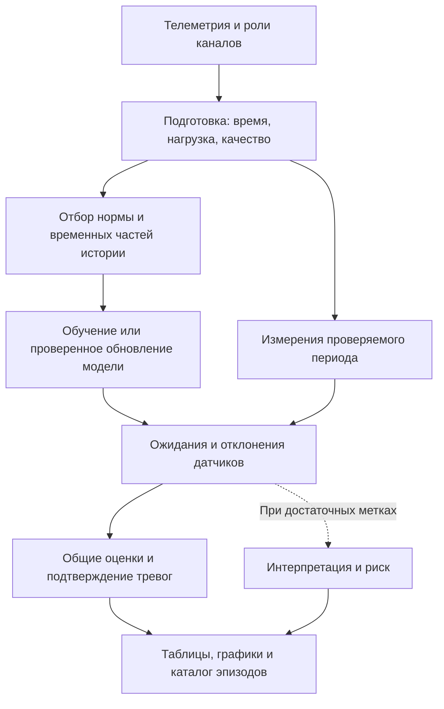

# Инструкция по подготовке данных, обучению и разбору отклонений

Основной файл: [02_Обучение.ipynb](02_Обучение.ipynb).

**Текущий маршрут и интерфейс:** [какие ноутбуки использовать](docs/МАРШРУТ_НОУТБУКОВ.md),
[новый 02: обучение и отчёты](docs/02_ОБУЧЕНИЕ_И_ОТЧЁТЫ.md).
01 теперь использует общую подготовку 02/05; 03 необязателен; 04 перенесён в архив.
В текущем 02 классификаторы не обучаются, а результаты читаются без RESULT/LIVE.
Упоминания LIVE, DETAIL, INTERPRETATION и ручной разметки ниже описывают прежний интерфейс;
справочник общих параметров SETTINGS остаётся полезен.

Живые карточки каждой модели/котла, график прежнего вида с историческим риском,
все параметры `LIVE` и действия при неготовом классификаторе описаны в
[ГРАФИКИ_И_ГОТОВНОСТЬ_РИСКА.md](docs/ГРАФИКИ_И_ГОТОВНОСТЬ_РИСКА.md).
Обновление качества (контракт 4): [изменения, перенос и новые параметры](docs/КАЧЕСТВО_И_ПЕРЕНОС.md). Этот документ обновлён под новую реализацию; 50 прежних верхнеуровневых параметров сохранены, добавлены пять, описанных в разделе 22.
Инструкция относится к текущему последовательному конвейеру `monitoring_v3`, а не к ноутбукам `*_legacy.ipynb`.

## Оглавление

- [1. Автоматические результаты и участие пользователя](#1-что-делается-автоматически-и-что-нужно-от-пользователя)
- [2. Первый запуск по шагам](#2-первый-запуск-пошагово)
- [3. Требования к телеметрии и таблице ролей](#3-какие-данные-ожидаются)
- [4. Источники и приоритет настроек](#4-откуда-берутся-настройки)
- [5. Все параметры SETTINGS](#5-полный-справочник-settings)
- [6. Правила датчиков SENSOR_RULES](#6-полный-справочник-sensor_rules)
- [7. Просмотр DETAIL и схемы тревог](#7-полный-справочник-detail-и-схем-тревог)
- [8. Необязательные метки EPISODE_LABEL_EDITS](#8-ручные-метки-episode_label_edits)
- [9. Интерпретация INTERPRETATION](#9-полный-справочник-interpretation)
- [10. Дополнительные исследования RESEARCH](#10-полный-справочник-research)
- [11. Чтение таблиц и графиков](#11-как-читать-результаты)
- [12. Статусы и ошибки](#12-статусы-и-типовые-проблемы)
- [13. Новый месяц и повторные запуски](#13-новый-месяц-повторный-запуск-и-изменения-настроек)
- [14. Файлы результатов](#14-где-лежат-результаты)
- [15. Проверка сохранённой модели](#15-применение-сохранённой-модели-без-обучения)
- [16. Необязательные команды](#16-необязательные-команды-и-все-их-аргументы)
- [17. Начальный набор настроек](#17-что-оставить-на-первом-запуске)
- [18. CatBoost простыми словами](#18-как-работает-catboost-простыми-словами)
- [19. Как CatBoost используется в нашем проекте](#19-как-catboost-используется-у-нас)
- [20. Весь алгоритм от телеметрии до результата](#20-как-работает-весь-наш-алгоритм)
- [21. Длительный расчёт, восстановление и модели для дашборда](#21-длительный-расчёт-восстановление-и-модели-для-дашборда)

## 1. Что делается автоматически и что нужно от пользователя

После настройки путей ноутбук автоматически загружает данные, определяет режимы по нагрузке, формирует реестр событий, обучает модели, выполняет месячные обновления, рассчитывает тревоги, строит таблицы и графики. Отдельно запускать скрипты или переносить их результаты в ноутбук не требуется.

От пользователя нужны доступные на его компьютере файлы телеметрии и таблица назначений датчиков. При первом запуске нужно проверить, правильно ли распознаны датчик нагрузки, рабочие режимы и каналы. Передавать конфиденциальную телеметрию куда-либо для работы конвейера не требуется.

**Ручная разметка причин необязательна.** Если неизвестно, что произошло, оставьте `EPISODE_LABEL_EDITS = []`. Расчёт отклонений и тревог продолжит работать. Неизвестную причину не нужно заменять догадкой или меткой «норма».

| Результат | Формируется автоматически | Что означает |
|---|---|---|
| Режим по нагрузке | Да | Работа, пуск, останов или неизвестный режим по заданным правилам |
| Реестр событий | Да, из подтверждённых нагрузкой остановов и `Состояние` | Физические остановы, присоединённые документы, неизвестные причины и конфликты; причина не подтверждается независимо |
| Отклонения, тревоги, метрики, графики | Да | Расчёт модели и схем тревог |
| Каталог эпизодов | Да | Эпизоды для основного `alarm_budget` с идентификаторами и доступными признаками |
| `suggestions` | Да | Ограниченные гипотезы `possible_mode_change` и `check_measurements`; не подтверждённые причины |
| Классификатор причин | Только при достаточной проверенной разметке | Обучается по внесённым человеком меткам |
| Риск аварии за заданный горизонт | При достаточной истории аварийных отметок | Использует исходные отметки аварий, а не обязательную ручную разметку причин каждого отклонения |

Полного автоматического текстового объяснения причин каждой тревоги сейчас нет. Если оснований недостаточно, причина остаётся неизвестной. Флаг `verified=False` в реестре сам по себе не запрещает использование события текущими расчётами: достоверность метрик и риска зависит от качества исходных отметок.

## 2. Первый запуск: пошагово

### 2.1. Открыть ноутбук и выбрать Python

Откройте `training/02_Обучение.ipynb` внутри проекта. Сохраните рядом папку `lib` и остальные файлы проекта.

На текущем компьютере окружение проекта находится здесь:

```text
C:\Users\zapru\Desktop\ЦД\.venv\Scripts\python.exe
```

Выберите его как ядро Python. В Jupyter/VS Code отдельная ячейка запускается через **Shift+Enter**, все ячейки — через **Run All / Выполнить всё**. Вывод сохраняйте вместе с ноутбуком через **Ctrl+S**.

Зависимости описаны в [requirements.txt](requirements.txt). Если окружение уже подготовлено, переустанавливать их перед каждым запуском не нужно. Если оно новое, установка один раз из корня проекта:

```powershell
./.venv/Scripts/python.exe -m pip install -r training/requirements.txt
```

Для открытия ноутбука также нужна среда с поддержкой Jupyter и Python-ядра. В проверенном окружении используются CatBoost `1.2.10` и threadpoolctl `3.6.0`; последняя версия закреплена из-за проблемы перечисления DLL с кириллицей в другой проверявшейся версии.

### 2.2. Заполнить SETTINGS

В разделе **«1. Все настройки»** замените словарь `SETTINGS`. Пример первого расчёта для одного котла:

```python
SETTINGS = {
    "groups": {"БКЗ-500": ["К-5"]},
    "data_paths": {
        "К-5": "D:/МоиДанные/К-5/hourly.parquet",
    },
    "sensor_file": "sensor_roles.xlsx",
    "first_test": "2025-03-01",
    "output": "runs/my_first_run",
    "models": ["CatBoost"],
    "scenarios": ["local"],
    "feature_sets": ["conditions"],
}
```

Путь и дата — примеры: замените их своими. До `first_test` должна быть история для обучения, проверки и калибровки. Не ставьте эту дату равной началу файла. Выборочная история, отсутствующие данные, пуски и ремонты уменьшают доступный объём обучения.

В ячейках Python используются `True`, `False`, `None`. В JSON — `true`, `false`, `null`. Перед параметром не должно быть `#`, иначе строка остаётся комментарием и не применяется.

### 2.3. Сначала выполнить подготовку

Выполните начальную ячейку импорта, ячейку настроек и ячейку раздела **«2. Данные, режимы и события до обучения»**. Пока не запускайте обучение.

| Отчёт | Что проверить |
|---|---|
| Проблемы источников | Пустая таблица означает, что перечисленных проблем загрузки не найдено |
| Источники и настройки определения работы | Нужный датчик нагрузки, единицы, порог, период истории |
| Часы по режимам и график нагрузки | Реальные простои действительно выделяются; пуски и пропуски не принимаются за обычную работу |
| Реестр остановов, ремонтов и резерва | Интервалы и типы соответствуют имеющимся отметкам; предполагаемый останов может требовать проверки |
| Сопоставление датчиков | Найдены нужные столбцы, правильно назначены роли |
| Доступность и качество измерений | Нет неожиданного массового отсутствия данных или маскирования |

Раскрывайте большие таблицы нажатием на заголовок. Если порог работы неверный, добавьте в `SETTINGS` параметр `run_thresholds` с физически обоснованным значением. Если нужно сохранить редкий канал, настройте `SENSOR_RULES` по разделу 6.

После изменения повторно выполните **ячейку настроек и ячейку подготовки**. Само редактирование текста не меняет уже загруженные переменные.

Перед каждой подготовкой базовый JSON перечитывается, затем заново применяются текущие переменные `SETTINGS` и `SENSOR_RULES`. На графике нагрузки подписаны **фактически использованное число порога**, единица измерения и источник: ручной или автоматический. График строится по текущим данным, а не читается из прежнего PNG. Таблица сопоставляет заданный и использованный порог; несовпадение подготовленных данных с текущим порогом останавливает показ с понятным сообщением.

Если вместо заданного 140 видно автоматическое значение, проверьте точное имя котла в `groups` и `run_thresholds`: например, `К-5` и `К5` — разные ключи. Неиспользуемые ключи порогов показываются отдельной таблицей. После обновления кода перезапустите ядро Python и выполните первые три кодовые ячейки: импорты, настройки, подготовку. Для проверки порога запускать обучение не нужно.

### 2.4. Выполнить обучение и отчёты

После проверки подготовки выполните ячейки разделов 3–8 сверху вниз. Модели и расчётные файлы сохранятся в `output`, таблицы и графики появятся под ячейками.

При последующих запусках с проверенными настройками можно использовать **Run All**. Это запуск расчёта по команде пользователя; автоматического расписания обновлений в ноутбуке нет.

## 3. Какие данные ожидаются

### 3.1. Телеметрия

Обычный вход — один файл `hourly.parquet` на котёл. В `data_paths` можно указать другой поддерживаемый файл: Parquet, CSV или XLSX. Основной загрузчик ожидает **столбец `TimeValue`**, а не только безымянный временной индекс. Папка с файлами вместо одного файла в `data_paths` текущим аудитом не принимается.

Нужны исходные столбцы датчиков, соответствующие таблице ролей. Для подтверждённых часов нормы и событий нужен служебный столбец `Состояние`:

| Значение `Состояние` | Использование |
|---|---|
| `Работа` | Отбор часов нормы совместно с режимом по нагрузке и другими ограничениями |
| `Аварийный ремонт` | Событие типа `Авария` |
| `Плановый ремонт` | Событие типа `План` |
| `Резерв` | Событие типа `Резерв` |

Если столбца `Состояние` нет, добавляется «Нет данных». Это не восстанавливает отсутствующую разметку: часов подтверждённой нормы может не оказаться. Одна высокая нагрузка не заменяет все требования отбора нормы.

Если есть служебный столбец `_Тип`, значения `ИСП` и `ЗРР` исключаются из допуска к диагностике.

Общий загрузчик обучения, проверки и дашборда требует временные метки на сетке `step`. Дубли числовых измерений усредняются, состояния (включая числовые 0/1) берутся из последней строки, без заполнения последнего пропуска. Неверные даты учитываются в аудите. Межсеточные метки отклоняются, чтобы не переносить будущее назад. Используйте согласованное время без смешивания часовых поясов.

### 3.2. Таблица sensor_roles.xlsx

Для каждого котла должен быть один лист, в названии которого номер соответствует номеру котла. Например, для `К-5` нужен однозначно определяемый лист с номером `5`.

| Столбец | Обязателен | Содержание |
|---|---|---|
| `col` | Да | Исходное имя канала в телеметрии |
| `роль` | Да как заголовок | Назначение канала; пустая ячейка трактуется как `проверять` |
| `общий параметр` | Нет | Общий смысловой ключ канала для сопоставления котлов; при отсутствии берётся `col` |
| `единица` | Нет | Единица измерения; заполненные значения проверяются на совместимость при объединении/переносе |

| Значение роли | Эквивалент в коде | Назначение |
|---|---|---|
| `проверять` | `target` | Датчик, отклонение которого оценивается |
| `условие` | `condition` | Числовое условие работы для модели |
| `состояние` | `state` | Категориальное состояние оборудования для модели |
| `нагрузка` | `load` | Ровно один канал для определения работы котла |
| `исключить` | `exclude` | Канал не используется |

Допустимы русские названия ролей и указанные английские эквиваленты. Роль `state` относится к состоянию оборудования; не назначайте ей заведомо будущую информацию о ремонте или исходе события.

Имена нормализуются при сопоставлении. В `SENSOR_RULES`, `related_inputs` и `RESEARCH["sensor"]` используйте **фактические общие ключи из аудита**, а не предполагаемое исходное написание. Ненайденные цели показываются в сопоставлении; проверьте его, даже если таблица проблем загрузки пуста.

## 4. Откуда берутся настройки

Порядок применения:

1. Базовые значения из `lib/monitoring_v3/config.py`.
2. Значения из `incremental_settings.json`.
3. Переопределения из `SETTINGS` в ноутбуке.
4. Объединение правил датчиков с `SENSOR_RULES`.

Словари вроде `groups` заменяются целиком. Вложенные `history_policy`, `regime_policy`, `risk_policy` объединяются с базовыми значениями по полям; их можно задавать частично. Правила `SENSOR_RULES` объединяются по каналам и полям с исходным файлом.

Если задана переменная окружения `BOILER_CONFIG_JSON`, ноутбук читает указанный ею JSON вместо `incremental_settings.json`. Обычно её задавать не нужно.

Относительные пути в основном ноутбуке считаются от `training`. Для Windows удобно использовать `D:/Папка/файл.parquet` либо Python-строки вида `r"D:\Папка\файл.parquet"`.

**Текущий JSON расширяет три базовых параметра:**

| Параметр | База библиотеки | Что получает ноутбук из текущего JSON при пустом SETTINGS |
|---|---|---|
| `models` | `["analogs", "AAKR", "MSET", "CatBoost"]` | `["analogs", "AAKR", "MSET", "HistGradientBoosting", "CatBoost"]` |
| `feature_sets` | `["conditions"]` | `["conditions", "forecast"]` |
| `scenarios` | `["local"]` | `["local", "pooled", "transfer"]` |

Остальные значения JSON совпадают с базовыми. Новый ноутбук явно переопределяет три списка в `SETTINGS`: только CatBoost, conditions и local. Таблица выше относится к пустому SETTINGS. Итоговый набор всегда показан в «Действующих настройках». Ниже перечислены прежние 50 параметров; ещё пять — в разделе 22.

## 5. Полный справочник SETTINGS

Любой параметр этого раздела можно добавить в `SETTINGS`. Неизвестные ключи вызывают ошибку. Параметров `fast`, `refit`, `TRAIN_UPDATE` и `RECOMPUTE` в новом конвейере нет.

### 5.1. Источники, котлы и сохранение

| Параметр | Базовое значение | Допустимое значение и смысл |
|---|---|---|
| `groups` | `{"БКЗ-500": ["К-5", "К-6", "К-7"]}` | Непустой словарь групп с непустыми списками различных котлов. Названия без `..` и символов `< > : " / \` и вертикальной черты, `? *`, поскольку используются в путях |
| `data_root` | `"opc_wide"` | Общая папка; для котла ищется `<data_root>/<котёл>/hourly.parquet` |
| `data_paths` | `{}` | Словарь точных путей по котлам. Непустой путь котла имеет приоритет над `data_root` |
| `sensor_file` | `"sensor_roles.xlsx"` | Путь к Excel с ролями каналов |
| `sensor_rules` | `"sensor_rules.json"` | Путь к исходному JSON правил качества; файл должен существовать |
| `output` | `"runs/incremental"` | Папка моделей, истории и отчётов. Одинаковая папка нужна для продолжения совместимого расчёта |
| `schema_version` | `1` | Служебный маркер конфигурации. Не выбирает другой алгоритм; обычно не меняется |

### 5.2. Время, нагрузка и отбор нормы

| Параметр | Базовое значение | Допустимое значение и смысл |
|---|---|---|
| `first_test` | `"2025-03-01"` | Дата начала основного отчёта. При history_policy.bootstrap=True ранние месячные модели строятся до неё после опорного периода подготовки |
| `step` | `"1h"` | Положительный шаг не более часа, на который час делится без остатка: например `"1h"`, `"30min"`, `"15min"`. Уменьшение шага не создаёт измерений, которых нет в источнике |
| `run_thresholds` | `{}` | Числовой порог по каждому котлу, например `{"К-5": 120.0}`. Значение в единицах канала нагрузки. Если не задано, рассчитывается по прошлому |
| `threshold_fraction` | `0.25` | Число строго между 0 и 1. Автопорог = эта доля медианы положительной нагрузки на отметках `Работа` в раннем прошлом; граница задана history_policy |
| `startup_hours` | `24` | Неотрицательное число часов пускового режима после включения. Эти часы не допускаются к обычной диагностике; `0` отключает пусковое исключение |
| `load_hold_hours` | `3` | Неотрицательное число часов удержания последней известной нагрузки при пропуске. Дальше режим неизвестен; `0` не переносит значение на следующие отсчёты |
| `admission_delay_days` | `14` | Задержка принятия новых часов в норму, в днях. Также длина исключаемого участка перед известной аварией. Должна быть не меньше `pre_window_days` |
| `post_repair_hours` | `48` | Неотрицательное число часов исключения из нормы после завершённой отметки события реестра; текущая реализация применяет это и к резерву |

Работа определяется строгим превышением нагрузки над порогом: значение, равное порогу, относится к останову. Пропуски не заполняются без ограничения. Статусы `стоит`, `пуск`, `неизвестно`, а также `_Тип` со значениями `ИСП`/`ЗРР` не допускаются к обычной диагностике.

Автопорог не пересчитывается по будущему месяцу. Если порог нельзя определить из подтверждённой прошлой работы, нужно задать `run_thresholds`. Для переноса между котлами дополнительно нужна физическая сопоставимость нагрузки и сохранённого порога донора.

### 5.3. История обучения, память и проверка обновлений

Здесь **строки не равны часам при другом `step`**. В объединённом обучении строки разных котлов считаются отдельно.

| Параметр | Базовое значение | Допустимое значение и смысл |
|---|---|---|
| `min_train_rows` | `500` | Положительное целое: минимум пригодных строк для обучающей части |
| `calibration_rows` | `168` | Минимум отложенных строк и доступных оценок для порога; фактическая накопленная калибровка может быть длиннее |
| `min_sensor_rows` | `48` | Положительное целое: минимум измерений для цели; также используется как нижний предел объёма проверочной и калибровочной частей |
| `validate_rows` | `168` | Желаемое число независимых строк проверки обновления; не требуется для первого fit и при выключенной проверке |
| `validate_candidate` | `True` | Только `True`/`False`: сравнивать обновлённую модель с предыдущей перед принятием. При `False` дообучение принимается без проверочных прогнозов и сравнения ошибок. Калибровка порогов, отбор нормы, replay и разделение истории сохраняются |
| `memory_rows` | `1500` | Положительное целое: ограничение репрезентативной памяти моделей. Не ограничивает весь первоначальный обучающий набор |
| `replay_rows` | `500` | Для обычной работы задавайте положительное целое. Максимум примеров старых режимов, добавляемых к новым при продолжении CatBoost; также используется в проверках и интерпретации. Фактическое число ограничено имеющейся памятью |
| `update_rows` | `2000` | Для обычной работы задавайте положительное целое. Максимум новых принятых строк одного обновления, отбираемых с покрытием режимов. Это не размер окна полного переобучения |
| `calibration_limit` | `4000` | Максимум используемых калибровочных строк в эксперименте, в pooled — суммарно по участникам. Полный резерв сохраняется и не обучает будущие версии |
| `validation_tolerance` | `0.25` | Для обычной работы неотрицательная доля. Кандидат допускается, если проверочная ошибка в физических единицах, нормированная фиксированным масштабом целей, не хуже прежней более чем в `1 + значение` раз. `0.25` допускает ухудшение до 25%; дополнительно проверяются старые режимы |

Для первого обучения нужны min_train_rows пригодных обучающих строк и отдельная калибровка, но отдельная проверка кандидата не требуется. Используется вся прошлая зрелая норма, а не обязательная последняя неделя. Для обновлений проверочный резерв нужен только при validate_candidate=True. Поэтому 500 исходных строк и 500 пригодных обучающих плюс независимая калибровка — разные условия.

Не все типы и диапазоны проверяются загрузчиком заранее. Значения выше описывают рабочий смысл параметров; отрицательные размеры, пустые горизонты и неподходящие типы не являются способом отключить механизм.

### 5.4. Выбор моделей, сценариев и признаков

| Параметр | Базовое значение | Допустимое значение и смысл |
|---|---|---|
| `models` | `["analogs", "AAKR", "MSET", "CatBoost"]` | Непустой список из вариантов таблицы ниже. Текущий JSON дополнительно включает `HistGradientBoosting` |
| `scenarios` | `["local"]` | Непустой список из `local`, `pooled`, `transfer`. В текущем JSON включены все три |
| `feature_sets` | `["conditions"]` | Непустой список из `conditions`, `forecast`, `related`. В текущем JSON включены `conditions` и `forecast` |
| `horizons` | `[1, 6]` | Непустой список положительных горизонтов в часах, кратных `step`. Применяется к `forecast` |
| `related_inputs` | `{}` | Словарь `цель: [связанные цели]` с проверенными общими ключами. Для `related` требуется непустой список для каждой цели; саму цель включать нельзя |
| `neighbors` | `30` | Для обычной работы положительное целое: число ближайших примеров в `analogs`. У AAKR/MSET есть собственные внутренние параметры; этот ключ не задаёт им все виды соседства |

| Модель | Назначение | Что происходит при новом месяце |
|---|---|---|
| `analogs` | Линейная зависимость от условий и локальная поправка по памяти аналогов | Обновляются статистики и память |
| `AAKR` | Ядерная реконструкция взаимосвязей датчиков | Обновляются статистики и репрезентативная память |
| `MSET` | Реконструкция по опорным состояниям | Обновляются статистики и память |
| `CatBoost` | Отдельная модель квантилей для каждой цели | Добавляются деревья через `init_model`, используются новые строки и ограниченный replay |
| `HistGradientBoosting` | Сравнительная модель квантилей | После первого обучения заморожена; месячное дообучение не заявляется |
| `CatBoostCorrection` | CatBoost учит поправку к фиксированному прогнозу `analogs` по отдельной истории | Продолжается модель поправки; опорная модель аналогов фиксирована, чтобы смысл ошибки не менялся |
| `CatBoostMulti` | Общие деревья для нескольких целей с пропусками | Продолжается общий ансамбль |

| Сценарий | Обучение и проверка |
|---|---|
| `local` | Отдельная модель каждого котла |
| `pooled` | Обучение по котлам группы, проверка каждого участника |
| `transfer` | Каждый котёл группы по очереди становится донором для остальных. Модель и пороги не обучаются на получателе |

Для общей модели/переноса используется совместимый общий набор каналов. Проверяются роли и заполненные единицы измерения. У группы из одного котла нет получателей для `transfer`.

| Набор признаков | Смысл |
|---|---|
| `conditions` | Ожидаемые значения по текущим условиям, нагрузке и состояниям |
| `forecast` | Прогноз цели на `horizons` часов вперёд с использованием доступных на исходный момент условий и прошлых значений целей |
| `related` | Реконструкция каждой цели по условиям и явно перечисленным связанным каналам |

**`forecast` и `related` создаются только для строки модели `CatBoost`.** Для остальных моделей цикл использует `conditions`. Добавление набора признаков в список не создаёт его для всех методов.

В `related_inputs` нужны каналы из проверяемого набора. Нельзя подавать саму цель или её прямую производную, позволяющую тривиально восстановить ответ. Это требует проверки смысла каналов, а не только проверки имён.

### 5.5. Параметры CatBoost и вычислений

| Параметр | Базовое значение | Допустимое значение и смысл |
|---|---|---|
| `cb_initial_trees` | `150` | Положительное целое: деревья первоначального CatBoost; также число итераций сравнительного HistGradientBoosting, классификаторов и исследования Cox |
| `cb_update_trees` | `20` | Положительное целое: добавляемые деревья одного продолжения CatBoost |
| `cb_max_trees` | `1500` | Положительное целое: ограничение дальнейшего роста ансамбля. Задавайте не меньше начального размера. При достижении лимита используется прежняя модель, полного переобучения автоматически не происходит |
| `cb_depth` | `4` | Положительная целая глубина, поддерживаемая соответствующей библиотекой/моделью. Больше — сложнее модель и выше затраты |
| `learning_rate` | `0.05` | Шаг обучения CatBoost-регрессии и классификаторов интерпретации, 0 < значение ≤ 1. У экспериментального Cox и HistGradientBoosting собственные библиотечные настройки |
| `threads` | `2` | Положительное целое: вычислительные потоки в местах, где код передаёт это ограничение; это не число одновременно обучаемых котлов |
| `seed` | `42` | Целое начальное значение генератора для воспроизводимости в использующих его алгоритмах |

Регрессионный `CatBoost` использует CPU, квантили `0.25/0.5/0.75` и временной порядок. `CatBoostMulti` использует `MultiRMSEWithMissingValues`. GPU и произвольная функция потерь не задаются ключами `SETTINGS`.

### 5.6. Оценки отклонений, тревоги и их проверка

| Параметр | Базовое значение | Допустимое значение и смысл |
|---|---|---|
| `minimum_coverage` | `0.7` | Число больше 0 и не больше 1. Минимум доли доступных оценок целей; применяется также при отборе обучающих строк. При недостатке покрытия тревога не рассчитывается, а не считается отсутствующей |
| `smooth_hours` | `6` | Для обычной работы положительное окно сглаживания агрегированной оценки, в часах. Действует и на виды `instant` |
| `slow_hours` | `48` | Для обычной работы положительное окно среднего знакового отклонения каждого датчика, в часах. Название вида остаётся `slow48`, даже если значение изменено |
| `persist_hours` | `3` | Положительная длительность последовательных превышений в часах до подтверждения тревоги. При `step="1h"` это три отсчёта превышения |
| `merge_hours` | `12` | Неотрицательный интервал подавления повторного уведомления после конца прежнего эпизода, в часах. Не закрашивает промежуток ниже порога как активную тревогу |
| `alarm_budgets` | `[0.5, 1.0, 2.0]` | Список положительных бюджетов уведомлений на 720 часов калибровочного фона. Рассчитываются все перечисленные варианты |
| `alarm_budget` | `1.0` | Основной бюджет; должен присутствовать в `alarm_budgets`. Используется в экспорте, каталоге эпизодов и при `DETAIL["budget"] = None` |
| `max_background_fraction` | `0.05` | Число больше 0 и не больше 1. Ограничение доли калибровочного времени в подтверждённой тревоге; `0.05` означает 5% |
| `pre_window_days` | `7` | Для обычной работы положительное окно перед аварией в днях для оценки обнаружения |
| `neutral_days` | `7` | Для обычной работы неотрицательное дополнительное окно перед предаварийным участком, исключаемое из фоновой оценки |
| `min_lead_hours` | `3` | Для обычной работы неотрицательный минимальный запас до останова, в часах. Уведомления ближе к останову не засчитываются как раннее обнаружение |

Порог подбирается по прошлой калибровке, одновременно учитывая бюджет уведомлений и долю времени в тревоге. Частота на следующем месяце может отличаться. `alarm_budget=1.0` не означает «ровно одна тревога каждый месяц».

В оценке обнаружения учитывается **новое уведомление** в интервале от `stop - pre_window_days` до `stop - min_lead_hours`, правая граница исключена. Старая продолжающаяся тревога сохраняется отдельно и не становится новым предупреждением.

### 5.7. Горизонты интерпретации риска

| Параметр | Базовое значение | Допустимое значение и смысл |
|---|---|---|
| `risk_horizons` | `[24, 168]` | Горизонты риска в часах, больше min_lead_hours. Для каждого своя голова; её временной защитный промежуток равен H+48 часов |

Отрицательной метке риска нужен полностью наблюдавшийся горизонт. Плановое событие в горизонте препятствует присвоению обычной отрицательной метки. Число соседних часов перед одной аварией не считается числом независимых аварий.

## 6. Полный справочник SENSOR_RULES

Начальное состояние файла [sensor_rules.json](sensor_rules.json):

```python
SENSOR_RULES = {
    "defaults": {},
    "sensors": {},
}
```

Пустые переопределения в ноутбуке используют исходный файл. В нём сейчас общие правила: `kind="unreviewed"`, `mask_frozen=False`, `mask_spikes=False`. Непустые переопределения сохраняются в `<output>/notebook_settings/sensor_rules.json`; исходный JSON не перезаписывается.

| Поле | Значение, если не задано | Значение и действие |
|---|---|---|
| `defaults` | `{}` | Общие поля правил качества для проверяемых датчиков |
| `sensors` | `{}` | Словарь `общий ключ канала: {правила}`. Индивидуальные поля перекрывают общие |
| `kind` | `"unreviewed"` | Одно из `unreviewed`, `continuous`, `discrete`, `rare` |
| `mask_frozen` | `False` | Булево: маскировать подозрительное постоянство. Проверка залипания действует только при `kind="continuous"` |
| `mask_spikes` | `False` | Булево: маскировать подозрительные скачки; применяется только к `continuous` |
| `frozen_hours` | `24` | Для обычной работы положительное число часов без изменения до флага залипания непрерывного канала |
| `window_hours` | `168` | Для обычной работы положительное окно прошлых приращений для оценки скачка, в часах. Используется не меньше двух отсчётов |
| `spike_factor` | `8.0` | Положительный множитель масштаба прошлых приращений для флага скачка |
| `min` | Не задано | Нижняя физическая граница. Значения ниже неё маскируются независимо от `kind` и флагов маскирования |
| `max` | Не задано | Верхняя физическая граница. Значения выше неё маскируются независимо от `kind` и флагов маскирования |
| `group` | `""` | Технологическая группа канала для групповой схемы тревоги. Для её формирования `group` задаётся именно в `sensors`, общая запись в `defaults` сейчас не создаёт групповые виды |
| `note` | Необязательное поле исходного JSON | Текстовая памятка; на расчёт не влияет. Не является отдельной настройкой `SETTINGS` или переопределением качества в ноутбуке |

| `kind` | Когда применять |
|---|---|
| `unreviewed` | Смысл канала ещё не разобран; подозрительные значения не удаляются автоматически по постоянству |
| `continuous` | Непрерывный канал; доступны флаги подозрительных скачков и залипания |
| `discrete` | Дискретное числовое значение, которое может долго не меняться |
| `rare` | Редко меняющийся канал, переход которого нельзя терять |

Правила качества применяются к числовым целям, условиям и нагрузке. Границы режимов задаются отдельно. Пропуски и бесконечности не становятся допустимыми измерениями при выключенном маскировании залипания. Не маскируйте долгое постоянство токов или редких каналов без физического основания.

Пример структуры; названия каналов нужно заменить ключами из собственного аудита:

```python
SENSOR_RULES = {
    "defaults": {
        "kind": "unreviewed",
        "mask_frozen": False,
        "mask_spikes": False,
    },
    "sensors": {
        "редко меняющийся параметр": {
            "kind": "rare",
            "group": "топливоподача",
        },
        "непрерывный параметр": {
            "kind": "continuous",
            "frozen_hours": 48,
            "mask_frozen": False,
            "mask_spikes": False,
            "group": "водопаровой тракт",
        },
    },
}
```

Флаг подозрения не равен признанию датчика неисправным. Не включайте маскирование и физические границы только для того, чтобы получить меньше тревог. Длительно постоянная цель сохраняет опорное значение и ненулевой масштаб, чтобы её первое изменение могло дать отклонение.

## 7. Полный справочник DETAIL и схем тревог

`DETAIL` меняет просмотр сохранённых результатов, а не обучение.

| Параметр | Значение в ноутбуке | Что задаёт |
|---|---|---|
| `experiment` | `None` | Точное имя эксперимента из таблицы раздела 4. `None` — первый рассчитанный, подходящий остальным условиям; не автоматически лучший |
| `unit` | `None` | Имя котла. `None` — первый доступный для выбранного эксперимента |
| `view` | `"mean::instant"` | Схема оценки из таблицы ниже |
| `budget` | `None` | Положительный бюджет из рассчитанных `alarm_budgets`; `None` берёт `alarm_budget` |
| `start` | `None` | Начало показываемого периода, например `"2025-03-01"`; `None` — с начала |
| `end` | `None` | Конец показываемого периода; `None` — до конца. Для точной границы можно указать время |
| `importance_sensor` | `None` | Общий ключ цели для таблицы и диаграммы важности входов; None — первая реально обученная цель |
| `importance_month` | `None` | Версия модели для importance, например 2025-05; None — последняя сохранённая. Выбирается отдельно от периода графика тревог |

Каждая пространственная схема существует с суффиксами `::instant` и `::slow48`:

| Основа имени | Что агрегируется |
|---|---|
| `max` | Максимум абсолютных нормированных отклонений доступных целей |
| `mean` | Среднее абсолютных нормированных отклонений всех доступных целей |
| `top5` | Среднее пяти самых сильных отклонений; при наличии менее пяти берутся имеющиеся |
| `fraction` | Доля доступных целей с абсолютным нормированным отклонением больше 1 |
| `group:<название>` | Среднее абсолютных нормированных отклонений назначенной группы |

`instant` использует текущие ошибки, затем применяется `smooth_hours`. Поэтому «instant» не означает отсутствие сглаживания. `slow48` сначала усредняет **знаковую** ошибку каждого датчика за `slow_hours`, затем берёт модуль и агрегирует. Колебания с меняющимся знаком могут компенсироваться. Окна не переносят доказательство отклонения через разрыв расчёта.

Примеры видов: `mean::instant`, `top5::instant`, `max::slow48`, `group:топливоподача::instant`.

Ошибка датчика сначала масштабируется моделью, затем масштабом калибровочных ошибок. Единица на графике `ratio` — **порог конкретной схемы**, а не один градус, одно стандартное отклонение или вероятность аварии. `ratio > 1` — превышение порога; подтверждение дополнительно требует `persist_hours`.

Пример выбора:

```python
DETAIL = {
    "experiment": None,  # либо скопированное точное имя
    "unit": "К-5",
    "view": "mean::slow48",
    "budget": 1.0,
    "start": "2025-03-01",
    "end": "2025-05-31 23:00:00",
}
```

После изменения выполните **ячейку настроек и ячейку раздела 5**. `LF.run(CFG)` повторять не нужно. График использует готовый поток тревог: обрезка периода не создаёт новые уведомления.

## 8. Ручные метки EPISODE_LABEL_EDITS

Начальное значение — `[]`. Если нет достоверного объяснения, оставьте его пустым.

| Поле записи | Обязательность | Допустимое значение |
|---|---|---|
| `experiment` | Обязательно | Точное имя рассчитанного эксперимента из каталога |
| `unit` | Обязательно | Имя котла, например `"К-5"` |
| `episode_id` | Обязательно | Идентификатор существующего эпизода из каталога |
| `label` | Обязательно | Непустая подтверждённая категория. Набор не зафиксирован кодом: используйте одинаковые названия для одинакового смысла |
| `label_available_at` | Обязательно | Дата/время, когда подтверждение стало доступно, а не обязательно начало эпизода |
| `reviewer` | Обязательно | Непустое имя или идентификатор проверившего специалиста |
| `reason` | Необязательно, по умолчанию `""` | Пояснение и основание подтверждения |

```python
EPISODE_LABEL_EDITS = [
    {
        "experiment": "точное имя из каталога",
        "unit": "К-5",
        "episode_id": "идентификатор из каталога",
        "label": "mode_change",
        "label_available_at": "2025-04-10",
        "reviewer": "Иванов",
        "reason": "Переключение подтверждено записью в журнале",
    },
]
```

Выполните ячейку сохранения меток, затем интерпретацию в разделе 7. Каталог обновится автоматически. Сначала проверяется вся переданная пачка меток; если один эпизод не найден, запись пачки не начинается.

Каталог создаётся для основного `alarm_budget`, а не для `DETAIL["budget"]`. Один и тот же физический случай может дать эпизоды разных видов и моделей. Это не превращает его в несколько независимых аварий. Прежние проверенные метки сохраняются при повторном расчёте каталога.

Очистка списка до `[]` **не удаляет уже сохранённые метки**. Отдельной операции удаления меток в этой ячейке сейчас нет. Автоматически заполненное `suggestions` не копируется в `label`.

## 9. Полный справочник INTERPRETATION

| Параметр | Значение в ноутбуке | Что делает |
|---|---|---|
| `run` | `True` | В разделе 3 запускает помесячное обучение/продолжение риска. В разделе 7 — разбор подтверждённых причин; риск заново не fit. False отключает новые fit |
| `as_of` | `None` | None — обновление на каждом месячном срезе. Явная дата ограничивает знания для fit риска; после неё новые ответы не обучают голову. В разделе 7 это граница разбора проверенных причин |
| `attach` | `True` | В разделе 3 готовый риск присоединяется к текущему и соответствующему месячному экспорту. Дата головы запрещает применение в более раннем прошлом. Причины обрабатываются в разделе 7 |

Для риска измените блок в настройках и выполните раздел 3: классификаторы продолжаются вместе с регрессорами. Раздел 7 читает готовый риск и обучает только проверенные причины. Ноутбук не выдаёт автоматически полный текстовый диагноз каждого эпизода. В новом ноутбуке attach=True; значение False отключает изменение экспорта.

Предусмотрены:

- `cause` — класс смысла по проверенным эпизодам;
- `risk_24h`, `risk_168h` — при начальном `risk_horizons`; имена меняются вместе с горизонтами.

Для причин без разметки будет `requires_reviewed_episode_labels`. Для риска можно использовать отметки аварий без знания подробной причины, но при малом количестве независимых событий обучение не проводится.

Рабочее обучение использует доступные примеры, кроме постоянного независимого группового резерва калибровки. Нужны минимум две независимые группы каждого класса (настраивается risk_policy). Для вероятностей нужны дополнительно отложенные группы; без них сохраняется обученная голова с баллом и статусом trained_uncalibrated. Помесячная проверка риска использует версию, обученную по меткам, известным на начало месяца, и её последующие прогнозы. Разрыв H+48 часов защищает калибровочный резерв. Поздняя итоговая модель на раннее прошлое не применяется. Нет жёсткого деления 60/20/20 и запрета рабочего обучения из-за пустого положительного теста. Подробно — в инструкции обновления.

Порог класса причины настраивается через risk_policy.confidence (по умолчанию 0.7). При отсутствии калибровки или малой уверенности причина unknown. Риск по умолчанию собирается по группе на решениях во время тревожных эпизодов; это условная вероятность при отклонении, а не безусловный риск каждого рабочего часа. Ограничения малого числа независимых аварий видны отдельно.

При повторе без новых строк веса головы сохраняются; статусы калибровки и проверки рассчитываются по доступным данным. Исправление уже обученных меток/признаков или изменение классов создаёт новую голову с явным migration и архивированием предыдущей. Новые неизменённые примеры продолжают прежнюю голову.

Присоединённые классификаторы имеют дату доступности. Это не добавляет их задним числом к прежним месячным экспортам. Для исторической проверки нельзя считать позднее обученный классификатор доступным раньше этой даты.

## 10. Полный справочник RESEARCH

Дополнительные исследования по умолчанию выключены. Основное обучение и отчёты от них не зависят.

| Параметр | Значение в ноутбуке | Что делает |
|---|---|---|
| `ensemble` | `False` | Собирает совместные числовые признаки рассчитанных детекторов по каждому котлу; сохраняет таблицу и показывает последние 168 строк. Сам по себе не обучает итоговый ансамблевый классификатор |
| `survival` | `False` | Запускает исследование Cox по совместным признакам. При этом совместная таблица собирается даже при `ensemble=False` |
| `sensitivity` | `False` | Проверяет искусственные нарушения одного канала для модели из `DETAIL` |
| `as_of` | `None` | Дата доступности для survival. `None` — конец истории соответствующего котла |
| `sensor` | `None` | При `sensitivity=True` обязательный ключ проверяемой цели выбранной модели. Канал нагрузки или условия вместо цели не подходит |
| `start` | `None` | При `sensitivity=True` обязательная дата начала искусственного нарушения. Не раньше `cutoff` выбранного итогового экспорта и внутри доступной истории |

После изменения выполните ячейку настроек. Если поменялся `DETAIL`, повторите также раздел 5, затем последнюю ячейку раздела 8.

Survival использует недельные наблюдения, независимые циклы работы и правое цензурирование. Текущие нижние пределы: 20 наблюдений, пять аварийных циклов всего, не меньше трёх в обучении и одного в проверке при соблюдении временного разделения. Выход — экспериментальная оценка относительного риска, **не готовый прогноз точного числа часов до поломки**. Это отдельное исследование; его повторный запуск не реализует месячное продолжение основной модели Cox.

Проверка чувствительности меняет копию истории, а не исходную телеметрию. Фиксированные в коде нарушения:

| Вид | Воздействие |
|---|---|
| `step` | Скачок значения |
| `drift` | Постепенный сдвиг |
| `frozen` | Удержание последнего значения перед началом воздействия |
| `delay` | Задержка на 1/3/6 отсчётов; при часовом шаге — на 1/3/6 часов |
| `balance` | Сдвиг одного канала; это не полноценная физическая модель нарушения баланса |

Используются три уровня воздействия `1/3/6` масштабов цели и окно 48 часов; задержка измеряется отсчётами. Сейчас они не являются ключами `RESEARCH`. В таблице `delay_hours` показывает первое уведомление после начала воздействия, а `baseline_peak` помогает сравнить с исходной историей; это не гарантия, что уведомление вызвано только внесённым нарушением. Синтетические проверки не доказывают качество обнаружения реальных аварий.

## 11. Как читать результаты

### 11.1. Основные метрики

| Поле | Смысл |
|---|---|
| `events` | Число аварийных отметок с определённым остановом в рассматриваемом периоде |
| `detected` | Сколько событий получили новое уведомление в заданном предаварийном окне |
| `recall` | `detected / events`; пусто, если событий нет |
| `ongoing_events` | События со старой активной тревогой без нового уведомления в окне |
| `lead_hours` | Медиана упреждения первого засчитанного уведомления по обнаруженным событиям |
| `background_hours` | Часы рассчитанного фона, использованные в метриках |
| `background_notifications` | Новые уведомления в этом фоне |
| `alarms_per_720h` | Частота фоновых уведомлений, приведённая к 720 часам |
| `background_fraction` | Доля фонового времени в подтверждённой тревоге; `0.05` = 5% |
| `average_precision` | Average Precision для временных предаварийных меток и непрерывной оценки. Это не Precision при одном пороге |
| `random_precision` | Доля положительных часов среди использованных для AP; опорный случайный уровень |
| `calculated_hours` | Часы с доступной оценкой и конечным порогом |
| `unscored_hours` | Остальные часы рассматриваемого периода: сюда могут входить простои, недостаток покрытия и отсутствие калибровки; это не только сбой модели |
| `recall_low`, `recall_high` | Границы интервала обнаружения при повторной выборке целых событий в сравнении на общих часах |
| `weekly_notification_rate_low`, `weekly_notification_rate_high` | Интервал частоты уведомлений при повторной выборке недельных блоков; это отдельная оценка по доступному потоку уведомлений, не просто дубликат `alarms_per_720h` |

`comparison.csv` показывает исходное покрытие каждого варианта. `comparison_common_hours.csv` ограничивает оценки общими рассчитанными часами внутри одной группы, сценария, набора доноров и получателя. Если хотя бы один вариант имеет мало доступных часов, общая часть тоже может оказаться небольшой.

Не выбирайте модель только по `recall`: одновременно смотрите фоновые уведомления, время в тревоге, упреждение и покрытие. Пустая метрика означает отсутствие оснований для расчёта, а не ноль ошибок или идеальное качество.

### 11.2. Временной ряд и эпизоды

| Поле | Смысл |
|---|---|
| `score` | Агрегированная оценка до последнего сглаживания |
| `smoothed` | Оценка после `smooth_hours` |
| `coverage` | Доля доступных оценок целей; на графике показана в процентах |
| `ratio` | Сглаженная оценка, делённая на порог выбранного бюджета |
| `active` | Подтверждённая активная тревога |
| `notification` | Новый момент уведомления; после короткого перерыва уведомление может быть подавлено `merge_hours` |
| `model_cutoff` | Дата фактически использованной версии модели |
| `start` в эпизоде | Первое превышение, предшествующее подтверждению |
| `confirmed` | Момент фактического подтверждения; используется для признаков эпизода |
| `end` | Правая граница эпизода; интервал заканчивается перед этой границей |
| `peak` | Максимальное отношение к порогу внутри эпизода; известно только по завершении соответствующей части наблюдения |
| `detected` в таблице аварий | Было ли засчитано новое уведомление перед этим остановом |
| `observed_hours`, `possible_hours` | Доступные для оценки и возможные часы предаварийного окна в рассматриваемом периоде |

В диагностике прогноза `raw_crossing_fraction` — доля пересечений исходных квантилей, `central50_coverage` — покрытие интервалом между квартилями, `median_interval_width` — медианная ширина этого интервала, `median_absolute_error` — медианная абсолютная ошибка центрального прогноза в единицах датчика. Эти показатели доступны не для всех методов.

### 11.3. Реестр событий

Автоматический реестр сначала собирает подтверждённые низкой нагрузкой физические остановы, затем присоединяет документы Состояние в окрестности ±72 часа. Останов без документа остаётся неизвестным. Пропуск нагрузки не является остановом. Документ без найденного останова и неоднозначность сохраняются для проверки. Уточнения задаются event_overrides с датой доступности.

`start` — начало исходной отметки, `stop` — найденный кандидат останова, `end` — конец отметки. Они могут различаться. `label_available_at` изначально равен началу отметки. `reason` пустая, `verified=False`; `open_ended=True` означает незавершённое наблюдение. `missing_load_stop` — кандидат останова не найден, `reason_unverified` — причина не подтверждена. В реестр попадают отметки событий; он не является списком всех низконагрузочных участков.

## 12. Статусы и типовые проблемы

| Статус / сообщение | Что означает и что делать |
|---|---|
| `missing_source` | Файл не найден. Проверить `data_paths`, `data_root`, имена котлов |
| `Missing TimeValue` | Нет нужного столбца времени; проверить формат источника |
| `exactly one load channel required`, `Load channel missing or ambiguous` | В ролях/сопоставлении нет ровно одной нагрузки |
| `Cannot infer load threshold...` | Нет подходящей прошлой нагрузки для автопорога; проверить историю и `Состояние` либо задать проверенный `run_thresholds` |
| `Incompatible physical schema` | Несовместимые роли/единицы каналов при общей модели или переносе |
| `initial` | Первое обучение выполнено |
| `updated` | Кандидат месячного обновления принят |
| `restored=True` | Совместимое сохранённое состояние восстановлено; рядом может стоять исходный статус `initial`/`updated`, это не означает повторный первоначальный fit |
| `candidate_rejected` | Новая модель не прошла проверку; используется прежняя |
| `no_new_admitted_rows` | Нет новых строк, допущенных к обучению после задержек и исключений |
| `insufficient_training_data` / `insufficient_unseen_calibration` | Не хватает пригодного train или независимой калибровки; есть точные количества и причины отбора |
| `insufficient_valid_calibration_scores` | Калибровочные строки есть, но нет пригодных оценок основного порога; новый детектор не публикуется |
| `insufficient_unseen_validation` | При включённой проверке недостаточно её независимых строк; предыдущие веса сохраняются |
| `insufficient_history` | В эксперименте не удалось получить ни одной модели |
| `frozen_comparison_baseline` | HistGradientBoosting оставлен замороженным для сравнения |
| `tree_capacity_reached` | Достигнут лимит деревьев; автоматического полного переобучения нет |
| `requires_reviewed_related_inputs` | Для `related` не заполнены проверенные связи всех целей |
| `insufficient_calibration` | Недостаточно оценок для порога; такой участок не считается подтверждённой нормой без тревог |
| `complete` | Расчёт эксперимента и экспорт выполнены; не означает подтверждение качества на реальном оборудовании |
| `requires_reviewed_episode_labels` | Нет доступной проверенной разметки причин; можно оставить как есть |
| `training_requires_two_classes` / `insufficient_training_events` | Не хватает классов или независимых групп рабочего обучения; составы сохранены отдельно |
| `trained` / `trained_uncalibrated` | Голова обучена; во втором случае доступен только балл, подтверждённого процента нет |
| `single_class_test` | В историческом тесте один класс; нельзя проверить обнаружение аварий, но рабочее обучение возможно |
| `no_variable_inputs` | На пригодной обучающей части нет изменяющихся входов; строить деревья по ним невозможно |
| `not_run` | Интерпретация выключена, сохранённого статуса нет |
| `ready` | Совместная таблица признаков собрана |
| `insufficient_independent_events` | Недостаточно независимых аварийных циклов для survival |
| `trained_experimental` | Исследование Cox обучено; статус не делает результат промышленно подтверждённым |
| `synthetic_only` | Проверка только на искусственных воздействиях |
| `Initial-target cache is incompatible` / `Changed past data, configuration or code` | Сообщения старой версии. Обновите код, перезапустите ядро и сохраните прежнюю `output`: новая версия проверяет совместимость и пересчитывает неподходящие части автоматически |
| `checkpoint_migrated` | Совместимый checkpoint предыдущей версии проверен и восстановлен без повторного обучения |
| `checkpoint_recompute` | Данные/параметры изменились либо прежняя версия не распознана; этот срез пересчитывается, прежний checkpoint сохраняется перед заменой |
| `Нет вида ... с бюджетом ...` | Вид/бюджет не был рассчитан; выбрать существующий вариант или выполнить новый расчёт с нужными настройками |
| `migration=class_schema_changed` | Новые классы: голова пересоздана, прежняя версия сохранена; это отдельная миграция, а не обычное добавление деревьев |

При проблеме сначала смотрите таблицу источников и журнал обновлений, а не уменьшайте пороги и минимальные объёмы наугад.

## 13. Новый месяц, повторный запуск и изменения настроек

### 13.1. Продолжить с новыми данными

1. Дополнить файл телеметрии, сохранив прежнюю историю.
2. Оставить те же настройки, правила и `output`.
3. Выполнить **Run All** и проверить журналы обновлений.

Первое обучение не запускается заново при восстановлении совместимых checkpoints. Новая месячная модель использует предыдущую. CatBoost добавляет деревья с новыми принятыми строками и replay старых режимов. Данные последнего месяца не сразу становятся нормой из-за `admission_delay_days` и разделения обучающей/проверочной/калибровочной частей.

Предобработка повторяется при запуске. Готовые совместимые оценки месяцев восстанавливаются из отдельного кэша; изменившийся незавершённый месяц рассчитывается заново. Сохранение моделей и оценок не означает, что повторный проход вообще не выполняет вычислений: остаются проверка совместимости и сборка итоговых отчётов.

### 13.2. Обновления кода и повторное использование output

При обновлении кода сохраняйте прежнюю `output`. Совместимость обученного состояния проверяется отдельно от технической подписи файлов: данные до месячного среза, правила и роли датчиков, параметры обучения/калибровки, версии библиотек и версия контракта алгоритма. Изменения вывода и журналирования сами по себе не требуют повторного обучения. Выбор дополнительных моделей/сценариев и расположение output не меняют совместимость уже рассчитанного конкретного эксперимента.

Для известных предыдущих архивов progress/validation/copy_fix старые подписи проверяются автоматически по исходным байтам кода, сохранённой конфигурации и текущим данным прошлого. Если проверить совместимость нельзя либо данные/параметры изменились, соответствующий срез пересчитывается. Перед заменой старый checkpoint копируется в `checkpoints/previous_versions/`. Файлы `fingerprint.json` вручную удалять не нужно.

Изменение только `DETAIL`, `INTERPRETATION`, `RESEARCH` или новых записей `EPISODE_LABEL_EDITS` не требует новой папки обучения, если `CFG` и правила остаются прежними. При этом `attach=True` меняет итоговый экспорт, а новые классы причин имеют отдельное ограничение совместимости.

Новая папка нужна, если вы сами хотите отдельный независимый расчёт или сравнение настроек. Прежняя история моделей не подхватится в ней сама. Для обычного обновления менять папку не требуется.

### 13.3. Какие ячейки повторять

| Изменение | Что выполнить |
|---|---|
| Только `DETAIL` | Настройки → раздел 5 с графиком |
| Только `INTERPRETATION` | Для риска: настройки → раздел 3 (регрессионные checkpoints восстановятся). Для причин: раздел 7 |
| Новые подтверждённые метки | Ячейка `EPISODE_LABEL_EDITS` → раздел 7; каталог можно обновить разделом 6 |
| Только `RESEARCH` | Настройки → при необходимости раздел 5 → последняя ячейка раздела 8 |
| Добавлен месяц при прежней конфигурации | Run All с прежней `output` |
| Порог, правила, модели, роли или прошлые данные изменены | Настройки → подготовка → обучение и отчёты; неподходящие части пересчитываются автоматически в прежней output |
| Ядро Python перезапущено | Сначала выполнить начальные ячейки. Для графиков без обучения можно загрузить итоговые CSV, как показано ниже |

Просмотр готовых отчётов после перезапуска ядра без повторного `LF.run(CFG)`: выполните импорты и настройки, затем отдельную ячейку:

```python
RESULT = {
    "status": pd.read_csv(Path(CFG["output"]) / "status.csv"),
    "summary": pd.read_csv(Path(CFG["output"]) / "comparison.csv"),
}
EXPERIMENTS = show_results(CFG, RESULT)
DETAIL_DIR = show_detail(CFG, DETAIL)
```

Этот пример требует уже завершённого расчёта и существующих CSV. Для нового обучения или интерпретации после перезапуска нужна также загрузка `CONTEXTS` в разделе подготовки.

## 14. Где лежат результаты

Все пути ниже относительны к `output`.

| Путь | Содержимое |
|---|---|
| `audit/source_issues.csv` | Проблемы загрузки |
| `audit/<котёл>/audit.json` | Аудит времени, нагрузки и режимов |
| `audit/<котёл>/sensor_audit.csv` | Сопоставление имён и ролей |
| `audit/<котёл>/sensor_statistics.csv` | Статистика доступности и диапазонов |
| `audit/<котёл>/load_and_modes.png` | График нагрузки и режимов |
| `audit/<котёл>/regimes.parquet` | Режим, допуск к диагностике и отбор нормы для первого среза |
| `audit/<котёл>/events_to_review.csv` | Автоматический реестр событий |
| `audit/<котёл>/quality.parquet` | Флаги качества измерений |
| `notebook_settings/sensor_rules.json` | Объединённые правила, если в ноутбуке заданы переопределения |
| `comparison.csv` | Сравнение схем/моделей с исходным покрытием |
| `comparison_common_hours.csv` | Сравнение на общих часах |
| `status.csv` | Итоговые статусы экспериментов |
| `models.csv` | Готовые экспорты для дашборда; обновляется по мере обучения, не требует окончания всех экспериментов |
| `progress.jsonl` | Этапы, длительности, сообщения о продолжающемся расчёте и ошибки |
| `experiments/<эксперимент>/experiment.json` | Состав и вариант эксперимента |
| `experiments/<эксперимент>/updates.json` | Месячные статусы и принятие обновлений |
| `experiments/<эксперимент>/checkpoints/` | Состояния для продолжения совместимой цепочки |
| `experiments/<эксперимент>/scored/<дата>/<котёл>.joblib` | Готовые оценки и признаки месяца для восстановления после прерывания |
| `experiments/<эксперимент>/<котёл>/prequential_errors.parquet` | Исторические ошибки моделей, доступных на соответствующий момент |
| `experiments/<эксперимент>/<котёл>/prediction_diagnostics.csv` | Диагностика прогнозов, если метод её поддерживает |
| `experiments/<эксперимент>/<котёл>/interpretation_features.parquet` | Признаки для интерпретации |
| `experiments/<эксперимент>/<котёл>/episode_labels.csv` | Каталог и сохранённые человеческие метки |
| `experiments/<эксперимент>/<котёл>/<вид>__<бюджет>.parquet` | Временной ряд схемы; двоеточия вида заменены подчёркиваниями |
| `experiments/<эксперимент>/<котёл>/*_alarms.csv` | Эпизоды тревог |
| `experiments/<эксперимент>/<котёл>/*_events.csv` | Обнаружение аварийных отметок |
| `experiments/<эксперимент>/<котёл>/model/` | Итоговый экспорт |
| `experiments/<эксперимент>/<котёл>/model_history/<месяц>/` | Месячные экспорты для исторического применения |
| `experiments/<эксперимент>/<котёл>/interpretation_status.json` | Статусы классификаторов |
| `experiments/<эксперимент>/<котёл>/interpretation/` | Обученные классификаторы и их отчёты |
| `investigations/<котёл>/ensemble/` | Совместные признаки детекторов |
| `investigations/<котёл>/survival/` | Эксперимент Cox и его отчёты |
| `investigations/<котёл>/sensitivity/` | Проверка искусственных воздействий |

Пример файла ряда: `mean__instant__1.0.parquet`.
Ноутбук сохраняется обычным сохранением редактора. Файлы `output` записываются самим расчётом. Сохранение одного не заменяет сохранение другого.

## 15. Применение сохранённой модели без обучения

Необязательный отдельный файл: [03_Проверка_сохранённой_модели.ipynb](03_Проверка_сохранённой_модели.ipynb). Он нужен для проверки уже экспортированной модели на выбранной истории, а не для регулярного обновления основной цепочки. Открывайте его с рабочей папкой `training`.

| Параметр ноутбука 03 | Начальное значение | Что указать |
|---|---|---|
| `MODELS_ROOT` | `"runs/incremental"` | Ваша `output`, чтобы вывести таблицу найденных экспортов |
| `MODEL_DIR` | `""` | Конкретная папка экспорта с `config.json`, `model.py`, манифестом и состоянием |
| `DATA_PATH` | `""` | Файл телеметрии получателя; обычно Parquet или CSV |
| `TARGET_UNIT` | `"К-5"` | Проверяемый котёл |
| `SENSOR_FILE` | `"sensor_roles.xlsx"` | Таблица назначений датчиков |
| `PERIOD_START` | `None` | Начало проверяемого периода; `None` использует доступную допустимую границу |
| `PERIOD_END` | `None` | Конец проверяемого периода; в отчёте сохраняется исключаемая правая граница |
| `WARMUP_HOURS` | `None` | Вся доступная предыстория подготовки. Число ограничивает её часами и может изменить восстановление длительно постоянных состояний и другие признаки |
| `REQUIRE_UNSEEN_UNIT` | `False` | При `True` получатель не должен входить в список обучающих котлов экспорта |

После выбора параметров выполните ячейки. Здесь пороги не калибруются заново и модель не обучается. Результаты сохраняются по умолчанию в `training/saved_model_checks`.

Для исторической проверки берите соответствующий месячный экспорт, а не итоговую модель, обученную позже. Проверка применения строже аудита обучения: время без timezone, пропусков временных меток и дублей. Загружайте только собственные доверенные joblib-экспорты.

## 16. Необязательные команды и все их аргументы

Для обычной работы достаточно ноутбука. Этот раздел нужен только для запуска без редактора. Команды выполняются из `training` через `../.venv/Scripts/python.exe -X utf8 <скрипт> ...`. У всех CLI также есть стандартный `-h / --help`.

| Скрипт | Аргументы и начальные значения |
|---|---|
| `run_incremental.py` | `--config` — по умолчанию соседний `incremental_settings.json`; `--audit-only` — только аудит, по умолчанию выключен |
| `data_tools/audit_training_data.py` | `--config` обязателен; выполняет только аудит |
| `run_overnight.py` | `--notebook` — основной `02_Обучение.ipynb`; `--config` — необязательный JSON; `--output` — отдельный выполненный ноутбук, по умолчанию `runs/02_executed.ipynb`; `--check-only` — остановиться перед обучением, по умолчанию выключен, стандартный результат при нём `runs/02_preflight.ipynb` |
| `train_interpretation.py` | Обязательные `--config`, `--directory` (папка рассчитанного получателя с признаками), `--unit`, `--as-of`; необязательный `--attach` выключен; `--features` — другой файл признаков, по умолчанию стандартный `interpretation_features.parquet` получателя |
| `run_experiments.py` | Обязательный позиционный вид `ensemble`, `survival` или `sensitivity`; обязательные `--config`, `--unit`; для `survival` нужен `--as-of`; для `sensitivity` нужны `--model` (папка экспорта), `--sensor`, `--start`; остальные условные аргументы без значений по умолчанию |
| `run_validation.py` | `--output` — по умолчанию `runs/synthetic_validation`; папка должна быть новой. Создаёт только искусственную демонстрационную историю |

Пример сохранения выполненной копии ноутбука:

```powershell
../.venv/Scripts/python.exe -X utf8 run_overnight.py --config incremental_settings.json --output runs/my_executed.ipynb
```

Исходный и выходной ноутбуки должны различаться. Копия сохраняется после ячеек, в том числе при ошибке. Аудит возвращает ненулевой код при проблемах источников.

`--features` с совместными признаками позволяет отдельно исследовать классификатор, но его нельзя присоединять через `--attach` к одиночному детектору без соответствующего ансамблевого применения.

## 17. Что оставить на первом запуске

Для первого локального прохода достаточно одного котла, `models=["CatBoost"]`, `scenarios=["local"]`, `feature_sets=["conditions"]`, `DETAIL["view"]="mean::instant"`. Правила маскирования оставьте выключенными, неизвестные причины — пустыми. `INTERPRETATION` можно оставить включённой: недостаток разметки будет показан статусом. `RESEARCH` оставьте выключенным до получения основного расчёта.

После проверки подготовки можно выполнить отдельный расширенный расчёт с новой `output`: добавить другие котлы, модели, прогноз и сценарии переноса. Начальные численные значения — настройки реализации, а не подтверждённые технологические нормы конкретного котла.

Без реальной телеметрии проверена работа кода и искусственных сценариев. Лучшая модель, физически верные пороги и полезность тревог на ваших котлах определяются при локальной проверке ваших данных.

## 18. Как работает CatBoost простыми словами

### 18.1. Обучение по примерам

CatBoost — способ построить модель по таблице примеров. В строке указаны условия, а рядом — известный ответ. Например: нагрузка, расходы, положения механизмов и фактически измеренная температура. Во время обучения модель ищет зависимости, позволяющие по условиям оценивать ответ для следующих наблюдений.

CatBoost относится к градиентному бустингу на деревьях решений. Это конкретная реализация этого семейства методов. Для объяснения достаточно представить последовательность небольших схем с вопросами и ответами. [Официальное описание обучения CatBoost](https://catboost.ai/docs/en/concepts/algorithm-main-stages).

### 18.2. Что такое дерево

Условная схема может последовательно спрашивать: «нагрузка выше границы?», «механизм включён?», «расход выше другой границы?». Для получившегося сочетания ответов дерево выдаёт число. Границы и число подбираются при обучении, а не выписываются специалистом вручную.

Одно небольшое дерево описывает только часть зависимости. Поэтому строится много деревьев. Каждое следующее пытается уменьшить ошибки уже построенной совокупности. Результат получается сложением их вкладов. Это упрощённое объяснение механизма бустинга; поправки подбираются по выбранному критерию ошибки.

Схематически для числовой задачи:

```text
Предсказание = исходная оценка + поправка 1 + поправка 2 + ...
```

Малые поправки позволяют постепенно описывать сложную зависимость. Но уменьшение ошибки на обучающих примерах ещё не гарантирует качество на следующем месяце. Поэтому в проекте отдельно проверяется модель на других временных участках.

### 18.3. Что в CatBoost полезно для наших данных

В таблице могут быть и числа, и категории: например, название котла или состояние оборудования «включён/выключен». CatBoost умеет обрабатывать категориальные признаки своими механизмами; заранее задавать им условные числовые величины с физическим порядком не требуется. [Поддержка категориальных признаков](https://catboost.ai/docs/en/features/categorical-features).

Практический смысл для проекта: ожидаемая температура может зависеть одновременно от нагрузки и сочетания состояний оборудования. Модель оценивает зависимость по этим условиям, а не только сравнивает температуру с её средним за всю историю.

При этом CatBoost сам по себе не знает устройства котла. Смысл датчиков, допустимость обучения на конкретных часах и правило выдачи тревоги задаёт наш конвейер. Качество зависит от полноты и правильности примеров. Если в принятую за норму историю попало неблагополучное поведение, оно может частично попасть в представление модели о норме.

Временную историю также нужно предоставить явно. Например, прошлая температура и изменение нагрузки становятся отдельными входами. Параметр `has_time=True`, используемый у нас, сохраняет входной порядок на соответствующих этапах обучения CatBoost; он сам не создаёт лаги и не заменяет проверку на будущих месяцах. [Описание has_time](https://catboost.ai/docs/en/references/training-parameters/common#has_time).

## 19. Как CatBoost используется у нас

### 19.1. Основная задача — ожидаемые значения при выбранной норме

Главный вариант называется `CatBoost` с признаками `conditions`. Он обучается на истории, которую правила отбора допустили как нормальную работу. Для каждой проверяемой цели строится отдельная модель.

На вход идут доступные условия: нагрузка, каналы роли `condition`, состояния оборудования роли `state`, изменения нагрузки/условий, время после пуска и календарные признаки. Проверяемая температура служит ответом при обучении своей модели. Её текущее фактическое значение не подаётся на вход этой же модели в варианте `conditions`.

Для каждой цели модель оценивает три значения: нижний квартиль, медиану и верхний квартиль — квантили `0.25`, `0.5`, `0.75`. Медиана используется как центральное ожидание. Расстояние между квартилями помогает оценить характерный разброс и привести ошибку к сопоставимому масштабу.

**Условный пример, не результат расчёта реального котла:** при данных нагрузке и состоянии оборудования центральное ожидание температуры равно 240 °C, а факт — 248 °C. Модель дала ошибку в 8 °C. Чтобы понять, насколько это необычно, конвейер учитывает разброс прогноза и ошибки на отдельной калибровочной истории. Затем рассматривается поведение других датчиков и длительность отклонения.

Интервал между квартилями описывает центральную часть распределения, а не физически допустимые границы температуры. Выход за него сам по себе не объявляется аварией. Порог тревоги рассчитывается следующим этапом отдельно.

Если температура изменилась вместе с нагрузкой так, как обычно происходило в выбранной нормальной истории, отклонение может оказаться небольшим. Если нагрузка осталась прежней, а температура устойчиво ушла от ожидаемой зависимости, отклонение может вырасти. Это смысл контроля зависимости от режима, а не только абсолютного значения датчика.

### 19.2. Прогноз и дополнительные способы использования

| Вариант | Какой вопрос решает | Доступность сейчас |
|---|---|---|
| `CatBoost` + `conditions` | Какое значение ожидается при текущих условиях? | Основной вариант |
| `CatBoost` + `forecast` | Какое значение ожидалось на этот час из информации 1 или 6 часов назад? | Включён в текущем исходном JSON; горизонты задаются `horizons` |
| `CatBoost` + `related` | Какое значение согласуется с выбранными связанными датчиками? | Нужен проверенный список `related_inputs`, сам по себе не настроен |
| `CatBoostCorrection` | Какую систематическую ошибку прогноза аналогов можно исправить? | Можно явно включить в `models` |
| `CatBoostMulti` | Можно ли оценивать несколько целей общими деревьями? | Можно явно включить в `models` |
| Классификатор причин | На какой известный по разметке тип эпизода похоже отклонение? | Только при достаточном числе проверенных меток |
| Классификаторы риска | Насколько признаки связаны с аварией в следующие 24/168 часов? | При достаточных и достоверных аварийных отметках |
| Cox в `RESEARCH` | Как признаки связаны с относительным риском последующего отказа? | Дополнительное исследование, не готовый точный срок до отказа |

В `forecast` используются сдвинутые условия, прошлые значения целей, их изменения и длительность постоянства. Ошибка прогноза становится известна, когда наступает прогнозируемый час и появляется фактическое измерение. Такая ошибка и отдельная вероятность аварии — разные результаты.

Для классификатора причин нужны ответы вида «это было переключение оборудования». Для основной модели ожидаемых показаний такие подробные ответы не обязательны: ответами при обучении служат сами измерения на отобранных часах нормы. Поэтому отсутствие разметки причин не блокирует обнаружение отклонений.

### 19.3. Что происходит при новом месяце

Сохраняется прежний ансамбль CatBoost. Кандидат продолжения получает новые принятые строки и ограниченное число примеров прежних режимов. Вызов с `init_model` продолжает обучение от сохранённой модели. [Параметр init_model](https://catboost.ai/docs/en/concepts/python-reference_catboostregressor_fit#init_model).

При базовых настройках первоначально строится 150 деревьев, при продолжении добавляется 20. До 500 примеров старой памяти используются как replay: это напоминание о прежних условиях. Реальное число ограничено объёмом сохранённой памяти и доступных данных. При достижении лимита 1500 деревьев дальнейшее добавление прекращается.

Старые деревья сохраняются; новый суммарный прогноз может измениться за счёт новых поправок. Поэтому «дообучение» не означает неизменность ответов на старых примерах.

Прежде чем принять кандидата, код сравнивает его с предыдущей моделью на отдельном проверочном участке и примерах исходных режимов. По умолчанию допуск `validation_tolerance=0.25` разрешает ухудшение проверочной ошибки до 25%; это не требование обязательного улучшения. Если проверка не пройдена, остаётся предыдущая модель. При нехватке новых пригодных данных тоже не запускается скрытое полное переобучение.

Проверка кандидата — добавленная в новом конвейере защита от ухудшения, а не обязательная операция CatBoost. В исходной legacy-версии такого сравнения месячного кандидата не было. Для пробного запуска без неё добавьте в `SETTINGS`:

```python
"validate_candidate": False,
```

При `False` пропускаются подготовка проверочного набора, прогнозы старой/новой модели и их сравнение. Обновление принимается после успешного дообучения, в аудите появляется `validation_status="disabled"`, в журнале — «Обновление принято без проверки кандидата». Перед изменением копируется состояние конвейера. Обученные нативные объекты CatBoost не проходят через `deepcopy`: они используются как неизменяемые начальные модели, а продолжение создаёт новые объекты через `init_model`. При False проверочные строки не резервируются и их нехватка не блокирует обучение. Постоянный независимый резерв калибровки сохраняется. Калибровка порогов и дальнейший расчёт отклонений выполняются. Вернуть проверку: `"validate_candidate": True`.

Replay — это не исправление старых измерений и не поиск ближайших часов к новому месяцу. Хранится до `memory_rows=1500` прежних примеров; из них выбирается до `replay_rows=500`. Выбор покрывает сочетания категориальных состояний и диапазоны явно указанной физической нагрузки, с распределением примеров по времени внутри групп. Например, 720 новых строк + 500 старых дают 1220 строк дообучения. После обновления память снова ограничивается 1500 представителями. Это напоминает модели прежние режимы; значения исходной телеметрии не перезаписываются.

Дополнительно сохраняется исходная, не обновляемая модель. Сравнение её ошибок с ошибками адаптируемой модели даёт дополнительные признаки для интерпретации. Это полезное наблюдение, но не гарантия, что адаптация никогда не усвоит неблагополучный режим.

Основная реализация: [models.py](lib/monitoring_v3/models.py); месячный цикл и принятие обновлений: [pipeline.py](lib/monitoring_v3/pipeline.py).

## 20. Как работает весь наш алгоритм

### 20.1. Общая последовательность



### 20.2. От источника до готового отчёта

1. **Загружаются измерения и назначения каналов.** Код определяет, какой канал является нагрузкой, какой условием, какой состоянием оборудования, а какой нужно проверять. Данные приводятся к общей временной сетке; сопоставление и проблемы выводятся в аудит.

2. **Выделяются режимы работы по нагрузке.** При низкой нагрузке котёл считается стоящим. После включения выделяется пусковой участок. При длительной нехватке нагрузки режим неизвестен. Эти интервалы не считаются обычной диагностируемой работой. По начальным настройкам после включения исключаются 24 часа; физическую пригодность такого значения нужно проверить на своей истории.

3. **Проверяется качество измерений.** Записываются пропуски, подозрительные скачки, постоянство непрерывных каналов и фактическое маскирование. Редкое постоянство само по себе не исключает канал. Маскирование по подозрению включается отдельными правилами, а не автоматически для всех датчиков.

4. **Формируется реестр событий.** Подтверждённые по нагрузке остановы связываются с имеющимися документами Состояние; неизвестные причины и документы без найденного останова остаются видимыми. Несколько документов не превращают один физический останов в несколько независимых аварий.

5. **Отбирается прошлая история для конкретного месячного среза.** Нужны допущенная работа и отметка `Работа`. Последние 14 дней по базовым правилам ещё не принимаются в обучение. Исключаются участки перед уже известными авариями и после завершённых событий. Будущая дата окончания ещё не завершённого ремонта для этого не используется. Такой отбор снижает риск обучения на предаварийной истории, но не доказывает исправность всех оставшихся часов.

6. **Прошлое делится на обучение, проверку и калибровку.** Постоянные календарные блоки резервируются среди всей прошлой пригодной истории; их принадлежность сохраняется между версиями. При первом обучении отдельная проверка не нужна. Обучающая часть нужна для построения зависимости, проверочная — для принятия обновления, калибровочная — для масштабов отклонений и порогов. Проверяемый будущий месяц не используется для настройки его собственной месячной модели.

7. **Обучается или восстанавливается модель.** При первом подходящем срезе выполняется начальное обучение. Для последующих месяцев используется прежнее состояние и новые принятые примеры. Совместимые checkpoints восстанавливаются с диска; нехватка данных и отклонённые обновления отражаются статусами. В зависимости от сценария модель обучается по одному котлу, группе или донору для другого котла.

8. **Для проверяемых часов рассчитываются отклонения датчиков.** В варианте CatBoost фактическое значение сравнивается с ожиданием при соответствующих условиях и масштабируется с учётом разброса. Разница в градусах и разница в расходе приводятся к сопоставимым оценкам. Нехватка измерений или необученная цель дают отсутствие оценки, а не нулевую ошибку.

   На этом этапе берётся только текущий месяц и необходимый запас предыдущих часов для лагов и скользящих окон. Многолетняя история не прогоняется через модель заново для каждого месяца. Результат месяца сохраняется отдельно; при совместимом повторном запуске он восстанавливается.

9. **Отдельные ошибки объединяются несколькими способами.** Одновременно рассчитываются максимум, среднее всех доступных целей, среднее пяти самых сильных ошибок, доля превышений и заданные технологические группы. Для устойчивого сдвига отдельно используются средние знаковые ошибки за 48 часов. Схемы дополняют друг друга: одна лучше замечает одиночный сильный канал, другая — совместное отклонение многих каналов.

10. **Проверяется покрытие и применяется сглаживание.** При базовом `minimum_coverage=0.7` нужно не меньше 70% доступных оценок целей. Общая оценка сглаживается за 6 часов. Даже вид `instant` проходит это сглаживание; его отличие от `slow48` — в отсутствии предварительного 48-часового усреднения знаковой ошибки каждого датчика.

11. **Оценка сравнивается с порогом и подтверждается тревога.** Порог уже подобран на прошлой калибровке под бюджеты 0.5/1/2 уведомления на 720 часов и ограничение времени в тревоге. По базовым настройкам превышение должно удержаться три часовых отсчёта. Время подтверждения сохраняется отдельно от первого превышения. Интервал подавления повторных уведомлений 12 часов не превращает промежуток ниже порога в непрерывную тревогу.

12. **Создаются эпизоды и необязательная интерпретация.** Для эпизодов сохраняются идентификатор, начало, подтверждение, конец и доступные гипотезы. При наличии достаточной разметки обучаются причины и риск. Без неё отклонение и тревога остаются в отчёте, а причина — неизвестной. Сами предположения не становятся подтверждёнными обучающими метками.

13. **Проверяются результаты по историческим отметкам и всё сохраняется.** Считаются обнаруженные события, упреждение, фоновые уведомления, время в тревоге и покрытие. Сравниваются исходные и общие рассчитанные часы. В ноутбуке появляются таблицы и графики; отдельно сохраняются месячные состояния, итоговый экспорт и файлы отчётов.

При переходе к следующему месяцу повторяется месячный цикл. Восстановление прежней модели не отменяет подготовку и расчёт оценок. Исторический результат каждого месяца строится с той версией модели, которая была доступна к его срезу, а не с окончательной моделью, обученной после всей истории.

### 20.3. Что означает результат для пользователя

Самый надёжный смысл обычной тревоги в этой схеме: **наблюдаемая работа устойчиво отличается от зависимостей, выученных на выбранной нормальной истории, при достаточном покрытии измерений**.

Из этого ещё не следует конкретная неисправность. Причиной могут оказаться неисправность оборудования, изменение режима, проблема измерения или недостаток подходящих примеров в обучении. Разделять эти случаи должны дополнительные признаки, достоверные события и, где возможно, проверенные метки.

Поэтому смотреть нужно не только на число тревог, но и на фактические режимы, участвующие каналы, длительность, покрытие и обнаружение известных событий. Работа системы без ручных причин возможна; подтверждённый диагноз без соответствующих данных автоматически не появляется.

## 21. Длительный расчёт, восстановление и модели для дашборда

### 21.1. Что теперь видно во время обучения

Журнал последовательно показывает:

1. Проверку зависимостей и загрузку данных.
2. Эксперимент `N/всего` и месяц `N/всего`.
3. Первоначальное обучение либо обновление, число обучающих строк и целей.
4. Расчёт ошибок калибровки и подбор порогов.
5. Сохранение checkpoint и экспорт модели.
6. Оценки месяца, сборку тревог и итоговых отчётов.

В основном ноутбуке при `LIVE.enabled=True` каждому сочетанию модели и котла выделяются **свой обновляемый блок и график прежнего вида**. Завершённые карточки сохраняются. Отдельно показаны доля обработанных месячных срезов и датчики текущей операции. В этом же разделе 3 графики дополняются помесячными оценками риска до перехода к следующему месяцу. При отключённом LIVE или прямом `LF.run(CFG)` остаётся один общий индикатор. Быстрые сообщения заменяют содержимое, вместо добавления тысяч строк; последние пять этапов раскрываются под индикатором. Дополнительные виджеты устанавливать не нужно.

Процент относится к датчикам **текущего прохода**, а не ко всем месяцам и экспериментам. Во время копирования, обновления памяти и подготовки входов процент неизвестен — показывается индикатор без процента. Быстрые события обновляют экран не чаще примерно 2–3 раз в секунду; изменения этапа и ошибки показываются сразу. На долгом этапе время обновляется примерно каждые полсекунды, если поток Python доступен. При ошибке блок выделяется красным, исключение остаётся в выводе.

Полная копия журнала находится в `<output>/progress.jsonl`: начала/окончания этапов, все обучения и прогнозы датчиков, длительности и периодические статусы раз в 15 секунд. При обычном запуске Python вне ноутбука остаются текстовые сообщения «Начало», «Готово» и «Выполняется». При недоступном интерфейсе обновления также используется текстовый вывод.

Для обычного CatBoost дополнительно выводятся число числовых и категориальных входов, число уникальных значений у крупнейших категориальных входов, потоки и число логических CPU. Затем показываются номер и имя цели, пригодные строки и длительность её обучения. В периодическом сообщении видна последняя завершённая итерация, например `цель 85/226 «температура» · деревья 70/150`. Отсутствие новой итерации может означать подготовку данных внутри CatBoost. После трёх завершённых обучений появляется приблизительное время оставшихся целей по последним десяти: это ориентир только для данного fit, без калибровки, других месяцев и экспериментов.

Месячное обновление теперь разбито на отдельные подэтапы: копирование предыдущей модели, дообучение кандидата, обновление памяти примеров, подготовка общих проверочных входов, прогнозы старой модели, прогнозы новой модели, сравнение ошибок и решение. У каждого есть начало, окончание и собственное время. После цели `226/226` виден следующий реальный подэтап. Пока работает вложенный подэтап, родитель не повторяет свой периодический статус.

В «ошибках калибровки» отдельно обозначены проходы обновляемой и исходной эталонной модели. Это не проверка кандидата: оба прохода остаются и при `validate_candidate=False`.

При проверочных прогнозах индикатор показывает текущий датчик и счётчик завершённых. В `progress.jsonl` записываются начало и окончание каждого прогноза, имя и номер датчика, строки, подэтап и `prediction_seconds`. Такое разделение позволяет отличить медленную подготовку входов от конкретного вызова старой или новой модели. Работа индикатора сама по себе не доказывает продвижение вычисления внутри CatBoost.

Загрузка CPU 10% и память 3 ГБ сами по себе не доказывают зависание. Например, `threads=2` ограничивает параллельную работу; важны также размер входов и сложность категорий. Новые строки журнала позволяют отличить медленную отдельную цель от медленной обработки всех целей. Увеличение `threads` не гарантирует пропорционального ускорения.

Если данных для обучения недостаточно, выводятся причина и размеры частей истории. Такой статус не означает, что модель обучилась. При `insufficient_history` готового экспорта этого эксперимента не будет.

### 21.2. Как получить модель для дашборда

Как только месячная модель подготовлена, **до расчёта её исторических оценок** сохраняются:

```text
<output>/experiments/<эксперимент>/<котёл>/model/
<output>/experiments/<эксперимент>/<котёл>/model_history/<месяц>/
```

В журнале появляется «Готовая модель для дашборда» с абсолютным путём. В `<output>/models.csv` записываются `experiment`, `unit`, `method`, `scenario`, `variant`, `evaluation_month`, `model_cutoff`, `model_dir`, `history_dir`, `status`. `model_cutoff` — реальная версия модели; при пропуске обновления она может быть старше проверяемого месяца. `status=ready` означает готовность экспорта, а не окончание всех отчётов и не подтверждение качества.

Для дашборда задайте:

```text
MODEL_DIR=<абсолютный путь из столбца model_dir>
MODEL_VIEW=mean::instant
```

Передайте эти значения окружению процесса backend и перезапустите его. Остальная настройка источников дашборда остаётся необходимой. Выберите вид, который существует в `config.json` экспорта. В таблице раздела 4 ноутбука также показаны готовые пути.

Папка экспорта содержит `model.py`, `state.joblib`, `config.json`, собственный `monitoring_v3`, `kernel_models.py`, `manifest.json` и остальные служебные файлы. Передавайте всю папку. Сохранённого checkpoint из папки `checkpoints` недостаточно для подключения дашборда.

Если оценка месяца позже завершилась ошибкой или запуск был прерван, уже готовый экспорт остаётся. При обновлении папки `model/` сначала подготавливается полная новая копия; при неудачной замене возвращается прежняя. Для исторического просмотра выбирайте соответствующий месячный экспорт.

### 21.3. Что ускорено и что сохраняется после прерывания

Повторные вставки сотен столбцов в pandas заменены сборкой таблиц целиком: предупреждение `DataFrame is highly fragmented` устраняется в источнике. Топ-5, границы тревог и перебор порогов рассчитываются над массивами. Правила подтверждения и подавления уведомлений сохранены.

Обычный CatBoost готовит один `Pool` на проверочную таблицу для всех датчиков старой и новой версии, вместо упаковки таблицы при каждом из до 452 вызовов `predict`. Остальные прогнозы и диагностика интервалов этого регрессора также готовят вход один раз на таблицу. `Pool` временный и не попадает в состояние модели или экспорт. Проверка качества кандидата и её критерии сохраняются.

Для месячных оценок используется ограниченная предыстория, достаточная для окон и горизонта прогноза; подготовленные возраста состояний при этом не обнуляются. Готовые оценки, признаки и диагностика сохраняются в `scored/` с проверкой совместимости. При добавлении измерений внутрь незавершённого месяца его кэш становится непригодным и пересчитывается; уже завершённые совместимые месяцы могут быть восстановлены.

После прерывания повторите запуск с прежними настройками и папкой результатов. Восстанавливаются совместимые checkpoints и законченные месячные оценки; известные совместимые предыдущие версии кода проверяются автоматически.

В первом обучении обычного CatBoost каждая завершённая цель теперь отдельно сохраняется в `<output>/experiments/<эксперимент>/partial/<дата>/<хеш входов>/<хеш цели>.joblib`. Завершённые цели восстанавливаются, текущая незавершённая цель обучается заново. Это не сохранение каждой итерации дерева. Для дообучения по месяцам по-прежнему точкой восстановления служит готовый месячный checkpoint. Для CatBoostMulti и CatBoostCorrection сохранение отдельных целей этим механизмом не предусмотрено.

Частичные файлы пока нельзя подключать к дашборду: необходимы остальные цели, калибровка и полный экспорт `model/`. Кэш проверяет фактические входы, цели, параметры, библиотеки и контракт модели. Изменение технической подписи кода само по себе не отбрасывает такие цели. Если запись цели была прервана до атомарной замены файла, она выполняется снова.

### 21.4. Обновление со старой версии

После замены кода перезапустите ядро Python и оставьте прежнюю output, например `"output": "runs/incremental_validation"`. Совместимые месячные checkpoints и отдельные первоначальные цели восстанавливаются. Изменения данных/параметров вызывают пересчёт нужной части, а не ошибку с требованием новой папки. Неизвестные старые версии не принимаются без проверки. Порядок установки: [PREDICTION_UPDATE.md](docs/PREDICTION_UPDATE.md).

Если старое первоначальное обучение CatBoost всё ещё работает и ядро ещё не перезапускалось, можно попытаться сохранить уже завершённые цели **до перезапуска**:

1. Нажмите **Interrupt / Прервать** и дождитесь `KeyboardInterrupt`. **Restart пока не нажимайте.**
2. Обновите файлы кода из архива, включая новый `lib/monitoring_v3/target_training.py`, сохранив ноутбук и свои настройки.
3. В этом же ядре сразу выполните новую ячейку (рабочая папка — `training`, как у основного ноутбука):

```python
from monitoring_v3.target_training import rescue_initial
RESCUED = rescue_initial("runs/incremental_prediction")
```

4. Проверьте сообщение `Сохранено завершённых целей: N из 226`. Затем перезапустите ядро, укажите в `SETTINGS` ту же `"output": "runs/incremental_prediction"`, оставьте прежние данные и параметры обучения и выполните ноутбук сверху вниз. Этот перенос не применяется к прерванному месячному обновлению уже обученной модели.

Перенос поддерживает обычный CatBoost с `variant="conditions"` или `"forecast"` во время первого обучения. Он извлекает завершённые модели из traceback последнего прерывания, поэтому не работает после перезапуска ядра или если ещё не закончилась ни одна цель. Если traceback уже заменён другой ошибкой, восстановление также может быть недоступно. Сырой обучающий набор не записывается: сохранённые модели сопровождаются хешем входов, целей, параметров и версий библиотек. При несовпадении повторное использование блокируется. Это отдельный явный перенос завершённых целей; обычная проверка совместимости checkpoints остаётся строгой.

Ускорение зависит от числа датчиков, длительности истории и метода. Быстрая обработка оценок не отменяет затрат первоначального обучения сотен отдельных моделей CatBoost. Число выбранных экспериментов не сокращается автоматически.

Отдельная проверка на искусственных данных: 5 556 строк, 226 переменных целей, 20 входов (16 числовых, четыре категориальных с двумя значениями), 150 деревьев, глубина 4, два потока. Первое обучение с журналом и сохранением целей заняло 145.8 с на машине проверки. Это не оценка времени ваших данных: сотни лаговых входов и сложные категории могут значительно увеличить время. Точная причина прежнего многочасового расчёта без его журнала не установлена.


## 22. Политики качества и новые отчёты

К прежним 50 верхнеуровневым параметрам добавлены `history_policy`, `regime_policy`, `risk_policy`, `critical_sensors`, `event_overrides`. Полная таблица **всех их вложенных значений и значений по умолчанию**, примеры и обновлённый порядок работы — в [КАЧЕСТВО_И_ПЕРЕНОС.md](docs/КАЧЕСТВО_И_ПЕРЕНОС.md#4-настройки-новых-механизмов). Всего верхнеуровневых ключей 55.

В SENSOR_RULES доступны также `scale_floor` и `resolution` (по умолчанию 0): неотрицательные минимумы масштаба ошибки в физических единицах цели. Они не меняют телеметрию. Редкие/дискретные цели исключены из непрерывного среднего и выводятся отдельными событиями изменения.

Новые автоматические отчёты: `admission_diagnostics.csv`, `calibration_diagnostics.csv`, `calibration_sensor_diagnostics.csv`, `target_update_diagnostics.csv`, `comparison_frozen.csv`, `comparison_periods.csv`. Они показаны в разделе 4 ноутбука. Проверенные метки, не совпавшие с новыми эпизодами, сохраняются в `reviewed_episode_history.csv`.

После изменения смысла подготовки/разбиения контракт 4 требует однократного причинного пересчёта с архивированием старых checkpoints. Дальнейшее добавление месяца — продолжение совместимой модели. Старый подробный обзор кода сохранён как снимок **до** этой доработки, а не описание новой схемы разбиения и классификаторов.

Автоматическая feature importance — в [разделе 7 инструкции обновления](docs/КАЧЕСТВО_И_ПЕРЕНОС.md#7-важность-признаков--feature-importance). Сохраняются отдельные входные важности целей и классификаторов, сводка по целям и изменения между версиями. Используется нативная PredictionValuesChange без повторного fit. Это глобальное влияние на модель, не диагноз и не локальное объяснение тревоги.


Последняя повторная проверка и полное объяснение исправлений: [ПОВТОРНАЯ_ПРОВЕРКА.md](docs/ПОВТОРНАЯ_ПРОВЕРКА.md). Включены доступность меток во времени, целые срезы pooled, фактическое продолжение CatBoost, пересмотр нормы и атомарное обновление экспортов.


Актуальный порядок раздела 3, отсутствие ручного LIVE_REPORT, исправление
pandas FutureWarning и определение Precision: [ОБУЧЕНИЕ_РИСКА_В_РАЗДЕЛЕ_3.md](docs/ОБУЧЕНИЕ_РИСКА_В_РАЗДЕЛЕ_3.md).
